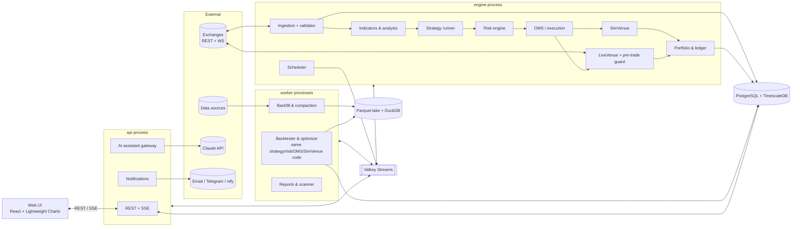
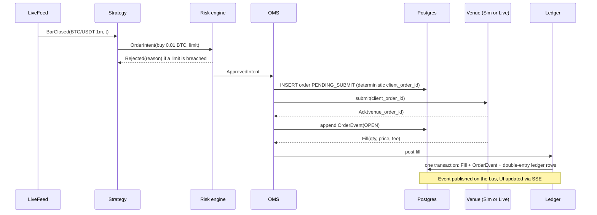
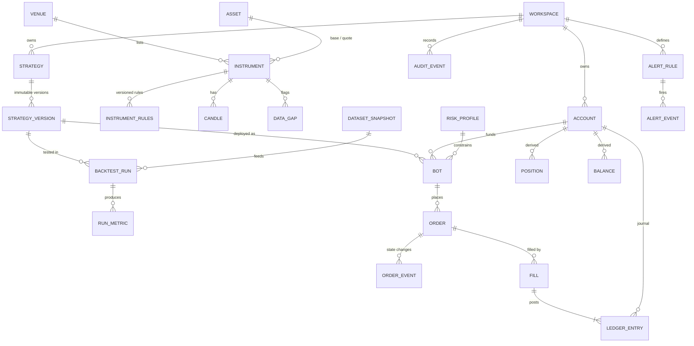

# 06 — Data & Architecture

*Ubik planning document · draft 2026-10-18 · ID prefixes: `DA` (data), `AR` (architecture & tech stack), `NFR` (non-functional requirements).*

## Summary

- **Pick exchanges by the owner's jurisdiction. In P1 this is mostly a choice of data source.** Outside the US: **Binance** (best free history, Demo Mode, 0.10% fees) plus **Coinbase Advanced or Kraken** as a regulated second venue. In the US: **Coinbase Advanced + Kraken**. Binance.com blocks US IPs: we got HTTP 451 from a US address during research. Paper trading uses Ubik's own simulator. Exchange demo accounts are only used to test adapters before going live.
- **Ubik should own a thin trading kernel built on ports and adapters.** The Clock, the data feed and the execution venue are swappable parts, so backtest, paper and live are combinations of the same code. One fill simulator serves both backtest and paper. Exchange access goes through a Ubik `ExchangeAdapter` interface, implemented in P1 with **ccxt** (MIT; WebSocket support now included free). NautilusTrader gets a time-boxed spike before we commit.
- **Use two storage roles.** **PostgreSQL (+TimescaleDB Community)** is the system of record (orders, fills, ledger, config, audit) and holds recent candles. A **Parquet + DuckDB data lake** of files holds history and immutable backtest datasets. Measured: 1-minute candles cost about 17 MB per pair-year. ClickHouse or QuestDB only comes in if we later record full order books at scale.
- **Run a modular monolith with three process roles from one Python codebase**: `engine` (always on), `api` and `worker`. In P3 a fourth role, the execution `gateway`, becomes the only holder of exchange keys (doc 08). Processes talk over Valkey Streams, and the browser gets live updates over SSE. Everything runs under Docker Compose on a 4 vCPU / 8 GB box for **~$0–60/month** in P1.
- **The proposed stack is confirmed, with adjustments.** Engine: Python 3.13, asyncio, FastAPI, **polars 2.x** (not pandas) and **TA-Lib 0.8** (now ships prebuilt wheels). Avoid **pandas-ta**: its repo is gone and its last release was a beta in Sep 2025. UI: TypeScript/React with **TradingView Lightweight Charts 5** (Apache-2.0, attribution required).
- **Correctness comes before speed**: Decimal ledger, orders persisted *before* sending, UTC microsecond timestamps, explicit data gaps, point-in-time data, and golden/parity/replay tests in CI.

---

## 1. Scope and position on working assumptions

Scope here: exchanges, connectivity, data, storage, architecture, stack, data model, operations, NFRs. Related topics live elsewhere:

- Backtester and fill-model semantics: [04](04-strategies-backtesting-paper-trading.md)
- Risk, OMS and ledger rules: [05](05-risk-portfolio-execution.md)
- Screens and assistant UX: [07](07-ux-and-beginner-experience.md)
- Key storage, auth and legal: [08](08-security-legal-compliance.md)

Refinements to the lead's assumptions:

1. **"Postgres + time-series extension *or* columnar store"**: I recommend **both**, in separate roles. Postgres handles state and hot data; Parquet/DuckDB handles history and reproducible backtests.
2. **Python: yes. pandas as the core dataframe: no.** Use polars and numpy, and drop pandas-ta (§8).
3. **"Live data in paper mode": agreed. Ubik should also *record* it from day one.** For Coinbase and Kraken there is no free bulk order-book or candle history, so recording is the cheap way to get venue-specific data for realistic fills.
4. **Single-user: agreed, but put a `workspace_id` on user-owned tables now.** It costs nothing today. Retrofitting for P4 multi-user would be expensive.
5. **Jurisdiction is an architecture input.** It decides which endpoints are reachable and where a server may legally run.

---

## 2. Exchange selection

Terms used below:

- **REST**: request/response HTTP calls.
- **WebSocket (WS)**: a persistent connection where the exchange pushes updates.
- **Rate limit**: how many calls the exchange allows per time window.
- **Testnet / demo**: an exchange-hosted fake-money environment.
- **Maker / taker fee**: the fee for an order that rests on the book vs. one that fills immediately.

"Verify" marks figures not confirmed from a primary source.

| Exchange | API | Testnet / demo | Historical data | Spot fee, entry tier (maker/taker) | Rate limits | Availability |
|---|---|---|---|---|---|---|
| **Binance** | Excellent: REST, WS, WS trading API, FIX | Spot Testnet (separate prices/liquidity, monthly reset). **[Demo Mode](https://developers.binance.com/docs/binance-spot-api-docs/demo-mode/general-info)** (`demo-api.binance.com`, same features as live) | **Best free source.** [data.binance.vision](https://data.binance.vision/) bulk klines down to 1s, trades and aggTrades since 2017, futures funding/bookDepth/metrics. REST: 1,000 klines per call | 0.10% / 0.10% (0.075% with BNB) ([schedule](https://www.binance.com/en/fee/schedule)) | Per IP: 6,000 weight/min; orders 100 per 10 s and 200,000/day (read from `exchangeInfo`, 2026-10-18) | **Not for US persons.** HTTP 451 from a US IP during research. Restricted in other places too (e.g. AMF delisting in France, Jul 2026, per press). Verify per country |
| **Binance.US** | Separate company with a smaller API | Verify | Limited | Verify | Verify | [Some US states only](https://support.binance.us/en/articles/9842798-list-of-supported-states-and-regions) (e.g. no NY or TX) |
| **Coinbase Advanced** | Good: REST and WS. Public REST is [cached for 1 s](https://docs.cdp.coinbase.com/coinbase-app/advanced-trade-apis/rest-api) | [Sandbox](https://docs.cdp.coinbase.com/coinbase-app/advanced-trade-apis/sandbox) is **static and mocked** (accounts/orders only) | REST only, [350 candles per call](https://docs.cdp.coinbase.com/api-reference/advanced-trade-api/rest-api/products/get-product-candles). No bulk dumps | ~0.40% / 0.60% under $10K/month. Lowered [Sep 2026](https://cryptodaily.co.uk/2026/09/coinbase-advanced-fees-usdc-vip-tiers), so verify | Verify | US (incl. NY) and many countries. Publicly listed and regulated |
| **Kraken Pro** | Good: REST, WS v2, FIX | **No spot sandbox** (futures demo only) | OHLC returns only the **last 720 candles**. Trades can be paged through full history. [No bulk dump](https://docs.kraken.com/exchange/guides/general/historical-data) | **0.40% / 0.80%**, falling to 0.22% / 0.38% from $10K ([fees](https://www.kraken.com/features/fee-schedule)) | Per IP, ~1 req/s for history | US (not NY/ME per third-party lists), EU, UK, CA, AU |
| **Bybit** | Good (v5) | Testnet and [Demo](https://bybit-exchange.github.io/docs/v5/demo) (`api-demo.bybit.com`) | REST klines | ~0.10% / 0.10% (verify) | [600 req per 5 s per IP](https://bybit-exchange.github.io/docs/v5/rate-limit) | **No US/Canada.** EEA via Bybit EU (MiCA). Third-party reports say UK spot returned Dec 2025 |
| **OKX** | Good (v5) | [Demo](https://www.okx.com/docs-v5/en/) via header `x-simulated-trading: 1` | REST candles | ~0.08% / 0.10% (verify) | Per endpoint, per 2 s | Regional hosts `us.okx.com` and `eea.okx.com`. [OKX US](https://www.theblock.co/post/355107/okx-rebuilding-super-app-in-the-us-ceo-roshan-robert) is spot-only and excludes NY and TX |
| **Bitstamp** | Mature. [Owned by Robinhood since Jun 2025](https://robinhood.com/us/en/newsroom/robinhood-completes-acquisition-of-bitstamp/) | Verify | Long REST history | Higher (verify) | Verify | EU, UK, US |
| **Newer** (Hyperliquid, Bitget, MEXC) | Varies | Varies | Varies | Low | Varies | Derivatives focus or weaker regulatory standing. **Not P1.** Hyperliquid is a P4 candidate |

**Takeaways**

- **In P1 the exchange is a data dependency.** Fills are simulated, so what matters is free history plus a reliable WS feed *for the venue we'd later trade on*. Backtesting on Binance prices and then trading on Coinbase adds a cross-venue price gap ("basis") the backtest never saw.
- **Exchange sandboxes are uneven.** Binance, Bybit and OKX demos are realistic. Coinbase's sandbox is mocked, and Kraken has no spot sandbox. **So paper mode must be Ubik's own simulator** (AR-012). Exchange demos are only used for adapter contract tests.
- **Entry-tier taker fees range 8×** (0.10% to 0.80%). The cost model must be per venue and per tier, or backtests will mislead.

**Recommendation**

| Owner's jurisdiction | Primary | Secondary | Note |
|---|---|---|---|
| EU/EEA, UK, most of APAC/LatAm where Binance is permitted | **Binance** | **Coinbase** or **Kraken** | Check country-level Binance status first |
| United States | **Coinbase Advanced** | **Kraken** | Backfill Coinbase via REST (1 year of 1m ≈ 1,500 calls). Binance bulk data (`data-api.binance.vision` was reachable from a US IP) only for research, and only if doc 08 confirms the ToS allow it |
| Canada / other restricted | Decide after doc 08 | Kraken / Coinbase | — |

| ID | Requirement | Priority | Phase | Rationale / notes |
|---|---|---|---|---|
| AR-001 | Ubik shall support at least two venues, selected by a "jurisdiction profile" setting (default non-US: Binance + Coinbase; US: Coinbase + Kraken), without code changes. | Must | P1 | Jurisdiction unknown. |
| AR-002 | Ubik shall keep a per-venue registry (order types, fee tiers, rate limits, demo/regional hosts, quirks). Adapters, the cost model and the UI shall all read from it. | Must | P1 | One source of truth for fee realism. |
| AR-003 | Ubik shall treat geo-block responses (HTTP 451/403 with region messages) as configuration errors: stop retrying, explain to the user, and never route around them. | Must | P1 | Legal safety (doc 08). |
| AR-004 | Before live trading on a venue, its adapter shall pass a contract-test suite against the venue's demo/testnet. Where none exists (Coinbase, Kraken spot), the suite runs with minimum-size live orders under the P3 staged rollout. | Must | P3 | Proves parity for each venue. |

---

## 3. Connectivity layer

| Option | Status (Oct 2026) | Pros | Cons |
|---|---|---|---|
| **ccxt** | v4.5.88 (14 Oct 2026), **MIT**. ~100 exchanges. **WebSocket "Pro" is bundled free** ([docs](https://docs.ccxt.com/docs/pro)). `setSandboxMode` for testnets, `enableDemoTrading` for Binance Demo | One unified REST+WS API in Python/JS. Handles signing, precision and market metadata | Lowest-common-denominator abstraction, so order types, errors and partial-fill semantics leak through. Several releases a week means regression risk |
| Native SDKs | Exchange-maintained | Full feature coverage | One integration per venue. Uneven quality |
| Framework adapters (NautilusTrader, Hummingbot) | §8 | Battle-tested order-state handling | Ties us to that framework's domain model |

**Design.** Ubik defines **ports** (interfaces the core depends on). **Adapters** implement them. Strategies never see ccxt.

```text
MarketDataFeed:  subscribe(instruments, channels) -> stream[Bar | Trade | BookTop | BookDelta]
                 history(instrument, timeframe, start, end) -> Frame
ExecutionVenue:  submit(OrderIntent{client_order_id}) -> Ack ; cancel(id) ; amend(...)
                 order_status(client_order_id) ; open_orders() ; fills(since) ; balances()
                 stream_account() -> stream[OrderEvent | Fill | BalanceEvent]
Clock:           now() -> UTC µs ; schedule(at, callback)
```

Implementations:

- **`CcxtFeed` / `CcxtVenue`**: live data and trading via ccxt.
- **`SimVenue`**: one fill simulator used in paper (live book and trades) and backtest (history).
- **`HistoricalFeed`**: replays lake snapshots.
- **`NativeVenue`**: only where ccxt falls short (P3+).

| ID | Requirement | Priority | Phase | Rationale / notes |
|---|---|---|---|---|
| AR-005 | Strategy, risk and OMS code shall reach exchanges only through the `MarketDataFeed`/`ExecutionVenue` ports, never by importing ccxt or SDKs (CI-enforced). Native-SDK adapters may be added behind the same ports. | Must | P1 | Parity; swappable library. |
| AR-006 | Adapters shall pin an exact ccxt version. Upgrades shall merge only after contract tests and recorded-session replay tests pass. | Must | P1 | Release churn. |
| AR-007 | Adapters shall normalize symbols (`BASE/QUOTE@VENUE`), numbers (Decimal parsed from strings), timestamps (UTC µs), errors (retryable / rate-limited / rejected / insufficient-funds / **unknown-state**) and order states (doc 05). | Must | P1 | "Unknown-state" triggers reconciliation. |
| AR-008 | Ubik shall rate-limit itself per venue and per IP, staying ≤ 80% of published limits, and shall back off on 429/418/Retry-After. | Must | P1 | Binance bans IPs that keep retrying. |
| AR-009 | WS connections shall be supervised: heartbeats, reconnect with backoff and jitter, resubscription, order-book sequence-gap detection (forcing a fresh snapshot), and REST backfill of missed candles. | Must | P1 | Feeds drop regularly. |

---

## 4. Data sources and costs

Terms used below:

- **OHLCV**: open-high-low-close-volume candles.
- **Trades**: individual executions.
- **L2 order book**: resting orders aggregated by price level.
- **Funding rate**: periodic payments between perpetual-futures longs and shorts.
- **Open interest (OI)**: the number of open futures contracts.

| Data class | Free (use first) | Paid upgrade (2026 list prices) | License notes |
|---|---|---|---|
| OHLCV | Exchange REST/WS. Binance bulk dumps. Kraken trades→bars. Coinbase REST | [CoinAPI](https://www.coinapi.io/market-data-api/pricing) Startup $79/mo (pay-as-you-go with $25 free credit). Kaiko/Amberdata (enterprise quotes) | Personal use. Check exchange ToS before republishing |
| Trades | Binance bulk `trades`/`aggTrades`. Self-recorded WS. Kraken trades | [Tardis.dev](https://tardis.dev/#pricing) Spot Solo $900/mo, Academic $450/mo. **First day of every month is free without a key** (we tested this on 2026-10-18) | Tardis: no redistribution |
| L2 order book | **Self-record** top-20 snapshots. Binance futures `bookDepth`. Tardis free samples | Tardis, Kaiko, CoinAPI | Same |
| Funding / OI / liquidations | Exchange REST. Binance futures dumps | [CoinGlass](https://www.coinglass.com/pricing) Hobbyist $29/mo (personal, 30 req/min), Standard $299 (commercial) | Personal plans: non-commercial |
| Market cap / metadata | [CoinGecko Demo](https://www.coingecko.com/en/api/pricing): free, 100 calls/min, 10K credits/month | Basic $35/mo, Analyst $129/mo | **Attribution required**. No redistribution. CoinDesk Data (ex-CryptoCompare) [ended its free tier on 21 May 2026](https://coinmarketcap.com/api/resources/coindesk-api-alternatives-7-crypto-data-feeds-compared-in-2026) |
| On-chain | DefiLlama API (verify terms) | Glassnode (API mostly on top tiers or quote; ~$49–$999/mo per trackers, verify). CryptoQuant (~$29–$109/mo, Premium ~$799 per [third-party](https://costbench.com/software/onchain-analytics/cryptoquant/), verify) | Metrics get **revised**, so store point-in-time (DA-017) |
| Sentiment | [alternative.me Fear & Greed](https://alternative.me/crypto/fear-and-greed-index/) (free, daily) | Santiment, LunarCrush (verify) | Attribution must sit next to the data |
| News | Publisher RSS (check terms). GDELT | [CryptoPanic API](https://cryptopanic.com/developers/api/) (pricing unverified) | Store headlines and links only |
| Macro | FRED (free key; ALFRED keeps revision history) | — | Use those revision snapshots for point-in-time |

**Budget:** P1 is **$0**. P2 extras are optional, ~$30–150/mo. Tardis is a P3/P4 decision.

| ID | Requirement | Priority | Phase | Rationale / notes |
|---|---|---|---|---|
| DA-001 | Ubik shall ingest live 1m candles and trades (or the best available ticker) over WS for configured instruments, with REST polling as fallback. | Must | P1 | Live data even in paper. |
| DA-002 | Ubik shall backfill ≥ 5 years of 1m candles where available: Binance bulk files with checksum verification, Coinbase REST paging, Kraken trades→bars. | Must | P1 | Backtest history. |
| DA-003 | From first start, Ubik shall record its own venue data: finalized candles, plus top-20 L2 snapshots every second for instruments with active bots. | Should | P1 | Builds venue-specific slippage data that isn't free. |
| DA-004 | Ubik shall snapshot instrument rules (tick, lot, minimum order value, status) daily and keep their history. | Must | P1 | Backtests use the rules in force at the time. |
| DA-005 | Ubik shall record stablecoin→USD rates and label "USD" figures that are actually USDT/USDC. | Should | P1 | Depeg honesty. |
| DA-006 | Ubik shall ingest funding/OI/long-short context from free exchange sources for the traded assets. | Should | P2 | Doc 03 analysis. |
| DA-007 | Each external source shall be a `DataSource` plugin with caching, quota tracking and an off switch. Paid sources are off by default and show estimated cost. If a source fails, dependent features show "unavailable since …" instead of stale values. | Should | P2 | Free tiers vanish. |
| DA-008 | Ubik shall keep a license registry per source (attribution, commercial use, redistribution, retention). The UI shall show required attributions, and exports shall exclude data that may not be redistributed. | Must | P1 | CoinGecko, alternative.me and TradingView require attribution. |

---

## 5. Data quality and time

Bad data is the most common reason a backtest flatters a strategy. This section is the data contract for every other module.

**Time and candles**

- All timestamps are **UTC with µs precision**. The UI converts to local time for display only.
- Candles are labelled by **open time** and cover [open, open + timeframe).
- Higher timeframes are built from 1m in UTC. Days close at 00:00 UTC; weeks start Monday 00:00 UTC.
- A candle is **final** only when the venue flags it closed (Binance WS kline `x: true`), or at close + 2 s grace when polling.
- **Unit traps are real.** Binance bulk files switched from **milliseconds to microseconds in January 2025** (we checked the Dec 2024 and Jan 2025 files). A naive loader would be wrong by 1000×.

**Validation at ingest**

| Check | Rule | On failure |
|---|---|---|
| Parse | All fields present. Prices > 0 | Reject and log |
| OHLC invariants | low ≤ min(open, close) ≤ max(open, close) ≤ high; volume ≥ 0 | Quarantine |
| Alignment | open_time is a multiple of the timeframe. Not more than 5 s in the future | Reject |
| Duplicates | Unique (instrument, timeframe, open_time) | Upsert and log the revision |
| Continuity | Missing candle → `DATA_GAP` record | Backfill. **Never forward-fill silently** |
| Outliers | Return beyond k × rolling MAD, or > X% from the cross-venue median | Flag as `suspect` and keep the row |
| Reconciliation | REST vs. WS vs. bulk vs. rebuilt-from-trades | Diff report. One canonical source per venue |
| Staleness | Age > 2 × timeframe + grace | Feed marked stale. New entries blocked |

**Survivorship and identity.** "Survivorship bias" means testing only on coins that still exist, which flatters results. Ubik keeps delisted instruments (LUNA/UST and FTT in 2022, BUSD pairs in 2023–24). It builds universes point-in-time: "top 10 by volume" is computed *as of each date*. Rename and migration aliases (e.g. MATIC→POL, 2024) keep history chains intact.

**Point-in-time ("bitemporal") storage.** Some data is revised after publication: on-chain metrics, sentiment, macro, rankings, corrected candles. For these Ubik stores `valid_time` (the moment the value describes) and `known_at` (when it became available). Backtests read only `known_at ≤ decision time`. Anything else is lookahead: using information that didn't exist yet.

| ID | Requirement | Priority | Phase | Rationale / notes |
|---|---|---|---|---|
| DA-009 | Ubik shall store timestamps as UTC µs, label candles by open time over [open, open+tf), and build higher timeframes from 1m in UTC. | Must | P1 | Consistent semantics. |
| DA-010 | Strategies shall receive only finalized candles unless they explicitly opt in to intrabar data, which shall be labelled in their reports. | Must | P1 | No lookahead (doc 04). |
| DA-011 | Ubik shall run the §5 checks at ingest and store the results as queryable quality flags. It shall never silently correct data. | Must | P1 | Honesty. |
| DA-012 | Gaps shall be explicit records. They shall be auto-backfilled after reconnects, and any that remain shall be listed in backtest reports and shaded on charts. | Must | P1 | Beginners must see data holes. |
| DA-013 | A freshness monitor shall mark stale feeds, block new entries on them, and alert the owner. | Must | P1 | Classic bot failure. |
| DA-014 | Ubik shall retain delisted instruments, support rename aliases, and build universes point-in-time. | Should | P1 | Must by P2 (scanner). |
| DA-015 | Bulk loaders shall verify checksums and detect timestamp-unit changes before writing. | Must | P1 | A verified trap. |
| DA-016 | Ubik shall record venue outages and maintenance windows, and the backtester shall treat them as non-tradable. | Should | P2 | Realism. |
| DA-017 | Revisable data shall be stored bitemporally (`valid_time`, `known_at`), and backtests shall query it as of the decision time. | Must | P2 | No lookahead from revisions. |

---

## 6. Storage

### 6.1 Volume estimates

Measured on Binance BTCUSDT data with DuckDB, Parquet + zstd compression, on a 4-vCPU box. Other figures are estimates.

| Data | Rate | Size | P1 footprint |
|---|---|---|---|
| 1m candles | 525,600 per pair-year | **~33 B/row in Parquet → ~17 MB per pair-year** (Sep 2026: 43,200 rows = 1.42 MB). Postgres: ~150 B/row incl. index | 6 pairs × 2 venues × 6 years ≈ **1.3 GB Parquet**. 90 days hot in Postgres ≈ 0.25 GB |
| 1s candles | 31.5M per pair-year | ~0.8 GB per pair-year (zipped) | Optional |
| Trades (BTCUSDT) | **~3.0M per day** (1 Oct 2026) | **~4.3 B/row → ~13 MB/day → ~4.7 GB per pair-year** | 2–3 pairs: ~10 GB/yr. One day re-aggregated into 1m bars in **0.16 s** |
| L2 top-20 snapshots @ 1 s | 86,400 per pair-day | Est. 10–20 MB/day/pair | 5 pairs: ~20–35 GB/yr |
| Full incremental L2 (every book change) | 10+ updates/s | Est. 0.2–1 GB/day/pair (verify with Tardis samples) | Not P1 |
| Orders, fills, ledger, audit | Small | < 100 MB/yr | Postgres |

**Conclusion:** P1–P2 fits in a **100–250 GB SSD**. Only full order-book capture at scale needs a dedicated tick database.

### 6.2 Options

| Option | License | Strengths | Weaknesses | Ubik role |
|---|---|---|---|---|
| **PostgreSQL 17/18** | PostgreSQL | ACID (safe transactions), exact `NUMERIC`, mature | Row storage is bulky for ticks | **System of record** |
| **+ TimescaleDB Community** | Apache-2.0 core. Compression, continuous aggregates and retention under the [Timescale License](https://www.tigerdata.com/docs/about/latest/timescaledb-editions) (free to self-host; you can't resell the *database* as a service) | "Hypertables" (auto-partitioned time tables), ~10×+ compression, auto-rolled 5m/1h/1d views, all still SQL | "-oss" images lack these features | **Hot market data**, optional |
| **Parquet + DuckDB / polars** | Apache-2.0 format, MIT engines | Zero-ops columnar files (each column stored together, so fast scans and small size). Immutable snapshots. Portable | No concurrent multi-writer transactions. Needs a compaction job | **History and backtest datasets** |
| ClickHouse | Apache-2.0 | Very fast columnar analytics, ASOF joins | Another server. Not for transactional state | Tick/L2 store, P3+ |
| QuestDB | Apache-2.0 (HA is Enterprise) | Very high ingest (vendor claims ~1M rows/s, [benchmark](https://questdb.io/time-series-benchmark-suite)), ASOF joins | Smaller ecosystem | ClickHouse alternative |

### 6.3 P1 design and growth path

- **Postgres (+Timescale)** holds accounts, orders, fills, ledger, bots, strategies, runs, alerts, audit, config and jobs. It also keeps **90 days of 1m candles** plus rollups, for charts and live indicator warm-up.
- **The Parquet lake** uses layout `lake/{venue}/{type}/{symbol}/{tf}/year=YYYY/month=MM/`. A nightly job moves finished days out of Postgres. Backtests read only **dataset snapshots**: manifests of files, content hashes and a quality summary.
- **Growth**: past ~50 GB/month of tick/L2 capture, add ClickHouse or QuestDB behind the same `MarketDataStore` interface.

| ID | Requirement | Priority | Phase | Rationale / notes |
|---|---|---|---|---|
| DA-018 | PostgreSQL shall be the system of record for transactional and config data. All money amounts shall be `NUMERIC`/Decimal, never binary floats. | Must | P1 | Exact accounting. |
| DA-019 | Hot market data (≥ 90 days of 1m plus 5m/1h/1d rollups) shall be served from Postgres/TimescaleDB, and the schema shall remain valid on plain Postgres. | Should | P1 | Fast charts; no lock-in. |
| DA-020 | Historical market data shall be stored as zstd Parquet partitioned by venue/type/symbol/timeframe/month and queried with DuckDB/polars. A dedicated tick store may be added later behind the `MarketDataStore` interface. | Must | P1 | Measured ~17 MB per pair-year. |
| DA-021 | Every backtest shall reference an immutable dataset snapshot. Re-running the same snapshot, strategy version and config shall give identical results. | Must | P1 | Reproducibility. |
| DA-022 | The owner shall be able to export orders, fills, ledger, balances and backtest results as CSV/Parquet at any time. | Must | P1 | Data ownership; tax prep in P3. |

---

## 7. System architecture

### 7.1 A modular monolith with three process roles

A **modular monolith** is one codebase with enforced module boundaries, deployed as a few processes instead of many microservices. That gives most of the isolation at a fraction of the operational cost.

- **`engine`** is always on (asyncio). It runs ingestion, strategies, risk, OMS, venues, ledger and scheduler.
- **`api`** (FastAPI) serves REST and SSE, the AI-assistant gateway and notifications.
- **`worker`** processes run backtests, optimizations, backfills and reports. These are CPU-heavy, so they run in separate processes to avoid Python's single-thread lock (the GIL) stalling the engine.
- **`gateway`** (P3; interface designed in P1) is the execution gateway: the **only** process that decrypts exchange keys and talks to private exchange endpoints, as doc 08 SEC-001 requires. It accepts only risk-approved intents from the engine over an authenticated local channel, and it enforces its own symbol allow-list and maximum order size.



### 7.2 How modes swap the clock, feed and venue

| Mode | Clock | Feed | Venue | Account |
|---|---|---|---|---|
| **Backtest** | `SimClock` (jumps event to event) | `HistoricalFeed` (snapshot) | `SimVenue` | Ephemeral |
| **Paper** | `WallClock` | `LiveFeed` | `SimVenue` (same code, fills against the live book) | Paper (Postgres) |
| **Shadow** (P3) | `WallClock` | `LiveFeed` | `SimVenue` for fills, plus `LiveVenue` **read-only** to compare simulated vs. achievable fills | Paper |
| **Live** (P3) | `WallClock` | `LiveFeed` | `LiveVenue` behind a pre-trade guard that can't be bypassed | Live, with reconciliation (doc 05) |

A single **composition root** wires the adapters together from `mode` in config. Strategy code is identical in all modes. It may use only the injected `Clock`, events and order-intent API. It may not call `datetime.now()`, open network connections, or import adapters.

### 7.3 Order flow with a write-ahead intent

**Idempotent** means doing something twice has the same effect as doing it once. The **write-ahead (outbox) pattern** means persisting an action *before* performing it. Together they mean a crash can never produce a duplicate order.



On restart, the engine loads every order in `PENDING_SUBMIT` or `OPEN`, queries the venue by `client_order_id`, and adopts, cancels or marks each one. Only then do strategies resume. Paper mode uses the identical path, so the logic is battle-tested before real money.

### 7.4 Messaging, UI updates, config, scheduling, notifications

- **Messaging.**
  - Inside the engine: a typed in-process async bus.
  - Between processes: **Valkey Streams** behind an `EventBus` interface. Valkey is the BSD-licensed Redis fork; Redis 8 is now [AGPL/SSPL/RSAL tri-licensed](https://www.theregister.com/2025/08/14/redis_redux/). NATS JetStream can replace it in P4.
  - Durable jobs sit in a Postgres table claimed with `FOR UPDATE SKIP LOCKED`, so they survive restarts.
  - Rejected for P1: LISTEN/NOTIFY alone (no replay, 8 KB payload limit) and Kafka (too heavy).
- **Real-time UI.** **Server-Sent Events (SSE)** carry prices, bot status, job progress and assistant streaming. SSE is a one-way HTTP push stream with automatic reconnect. Commands go over REST, with TypeScript types generated from FastAPI's OpenAPI schema. WebSockets only if a truly two-way need appears.
- **Configuration.** Layered and Pydantic-validated: code defaults → `ubik.yaml` → environment variables (secrets) → DB runtime settings (UI-editable, every change audited).
- **Scheduler and notifications.** Schedules are persisted, with a missed-run policy. Notifications go in-app plus email, Telegram or ntfy, with deduplication, rate limits and quiet hours (critical alerts bypass them).

| ID | Requirement | Priority | Phase | Rationale / notes |
|---|---|---|---|---|
| AR-010 | Ubik shall be one repository and Python package of modules with declared interfaces, deployed as `engine`, `api` and `worker` processes. Cross-module imports shall be CI-checked. | Must | P1 | Isolation without microservices. |
| AR-011 | Each mode shall be assembled from the `Clock`/`MarketDataFeed`/`ExecutionVenue` ports at one composition root. Strategy code shall have no mode branches and no access to wall-clock time, network or adapters. | Must | P1 | Sim-live parity. |
| AR-012 | Backtest and paper shall use the same `SimVenue` fill-simulation code. | Must | P1 | One fill model to validate (doc 04). |
| AR-013 | Events shall flow over a typed in-process bus inside the engine and over a schema-versioned `EventBus` (Valkey Streams) between processes. | Must | P1 | Swappable later. |
| AR-014 | Backtests, optimizations, backfills and reports shall run as durable jobs in workers, with progress, cancellation, timeouts and CPU/memory limits. | Must | P1 | The engine never stalls. |
| AR-015 | The OMS shall persist each order with a deterministic `client_order_id` before submitting it. After a restart it shall reconcile every non-final order with the venue before strategies resume. This applies in paper mode too. | Must | P1 | No duplicates (NFR-006). |
| AR-016 | Order events, fills and ledger entries shall be append-only. Positions and balances shall be derived, snapshotted and rebuildable. | Must | P1 | Auditability (doc 05). |
| AR-017 | The UI shall receive real-time updates via SSE and send commands via REST, using an API client generated from OpenAPI. | Must | P1 | Simple and robust. |
| AR-018 | Configuration shall be layered (defaults → file → env → DB), validated at startup, and every runtime change shall be audited. | Must | P1 | Safe changes. |
| AR-019 | The live venue shall start only if `mode: live` is set, credentials are verified as trade-only (no withdrawals), the user has explicitly unlocked live mode in the UI with re-authentication, and a risk profile is active. Otherwise the engine shall refuse and explain why. | Must | P3 | Designed in P1 so that going live is a config change, not a rewrite (docs 05, 08). |
| AR-020 | Ubik shall provide a shadow mode comparing simulated fills with the live book and with read-only venue state. | Should | P3 | Staged rollout. |
| AR-021 | A persisted scheduler (with missed-run policy) and a notification service (in-app plus ≥ 1 push channel, with dedup, rate limits and quiet hours that critical alerts bypass) shall be provided. | Must | P1 | Unattended always-on bot. |
| AR-022 | Every user-owned table shall carry `workspace_id`, with authorization enforced in the API layer. | Should | P1 | Cheap path to P4 multi-user. |
| AR-023 | Indicators, strategies, venues, data sources and notification channels shall be loadable plugins (entry points) behind versioned interfaces. | Should | P1 | Must in P2 for third-party plugins. |

---

## 8. Tech stack

### 8.1 Engine core: build or adopt?

Doc 02 owns the overall build-vs-reuse decision. This is the architecture view.

| Option | License / status | Assessment |
|---|---|---|
| **Custom thin kernel** (Python asyncio + polars/numpy) | Ours | **Recommended for P1.** We control event semantics, fill and ledger explanations, and beginner safety, which is where Ubik differs. One-minute bars on ≤ 20 pairs means tens of events per minute, trivial for Python. We own fill and accounting correctness, mitigated by the §10 tests. |
| **[NautilusTrader](https://github.com/nautechsystems/nautilus_trader)** | LGPL-3.0. Stable 1.231 (Aug 2026). **2.0 RC7 with a Rust-native runtime (Oct 2026)**. Python 3.12–3.14 | Strongest open-source sim-live engine, with stable Binance/Bybit/OKX/Coinbase/Kraken adapters. Against it: a steep learning curve, churn during the v2 transition, and a domain model that would leak into the beginner UX. **Spike for ≤ 2 weeks.** Adopt if our strategy API sits cleanly on top, our ledger and explanations can hook its events, and v2 is stable by P1 coding start. Revisit for P4 market making. |
| Freqtrade 2026.9 | GPL-3.0 | Mature dry-run, backtesting, hyperopt and UI. But it is built around a candle loop with one strategy per process, and GPL limits later distribution. Use it as a reference design. |
| Hummingbot (Apache-2.0), Jesse 3.4 (MIT), vectorbt 1.1 (Apache-2.0 + Commons Clause, verify) | — | Hummingbot is a P4 market-making reference. Copy vectorbt's vectorized-sweep idea for fast screening. |

### 8.2 Stack

| Layer | Choice (Oct 2026) | License | Why / alternatives |
|---|---|---|---|
| Engine language | **Python 3.13** (3.12 minimum), asyncio, `uv` lockfiles | PSF | Best quant ecosystem. Rust only as an escape hatch. Node has weak numerics; Go has no quant libraries |
| Dataframes | **polars 2.0** (6 Oct 2026), numpy, numba if profiling shows a need | MIT/BSD | Multithreaded, Arrow-native. pandas 3.0 only at library boundaries |
| Indicators | **TA-Lib 0.8.2** (Oct 2026; binary wheels for x86 and ARM on all three OSes, so no C compile) plus Ubik implementations with reference tests | BSD | **Avoid pandas-ta**: GitHub repo returns 404, domain gone, last release `0.4.71b0` (beta, Sep 2025). `ta` was last released 2023 |
| SQL on files | **DuckDB 1.5** | MIT | Parquet queries |
| API | **FastAPI 0.14x**, Pydantic v2, Uvicorn | MIT | Async, OpenAPI, SSE |
| DB access | SQLAlchemy 2 Core, psycopg 3 (LGPL, used unmodified), Alembic | MIT/LGPL | Migrations |
| DB / bus | PostgreSQL 17/18 + TimescaleDB; **Valkey 9** | PostgreSQL / Apache+TSL; BSD-3 | §6, §7.4 |
| Connectivity | **ccxt 4.5.x** | MIT | §3 |
| Frontend | **TypeScript, React 19, Vite, TanStack Query** | MIT | Mainstream, with lots of developer and AI help available |
| Price charts | **[Lightweight Charts 5.2](https://github.com/tradingview/lightweight-charts)** | Apache-2.0 **plus attribution** (NOTICE plus a visible link to tradingview.com; the `attributionLogo` option satisfies it) | Small and fast. Alternatives: KLineCharts 10, or ECharts 6 for non-price charts. TradingView's full "Charting Library" needs a separate license |
| Ops / testing | structlog, Prometheus, Grafana (AGPL, run unmodified), Uptime Kuma; pytest, Hypothesis, Playwright | — | §10 |

**Performance plan.**

- Precompute indicators in vectorized form before the event loop, so the loop only decides and simulates fills.
- Parallelize parameter sweeps across workers.
- Offer a vectorized "screening" backtest for wide sweeps, then confirm finalists with the event-driven engine (doc 04).
- **Indicator parity:** in live mode, recompute indicators with the *same vectorized function* over a warm-up window at each bar close. That costs microseconds for 1m bars and removes a classic parity bug: a separate incremental implementation drifting from the batch one.

### 8.3 AI assistant integration (UX in doc 07)

- **Placement.** A gateway in the `api` process. It uses the official Anthropic Python SDK and streams answers to the UI over SSE.
- **Models (configurable per route).**

  | Model | ID | Price (input / output per M tokens) | Use |
  |---|---|---|---|
  | **Claude Opus 5.5** (default) | `claude-opus-5-5` | $4 / $20 | Analysis and explanations |
  | **Claude Sonnet 5.5** | `claude-sonnet-5-5` | $2 / $10 | Lighter chat |
  | **Claude Haiku 5.5** | `claude-haiku-5-5` | $0.10 / $0.50 | Bulk news/sentiment tagging through the Batch API at 50% off |

  The stable system prompt and glossary use prompt caching.
- **Tools, not memory.**
  - It answers through read-only tools: market snapshot, backtest report, metric explanations, positions, glossary.
  - It can create **drafts** (strategy config, alert) that the user confirms.
  - It **cannot** place or cancel orders, change risk limits or switch modes.
  - Any number it states comes from a tool result with an as-of timestamp.
- **Cost.** A monthly cap with a usage meter, and the feature is opt-in. Estimate: 50 chats/month at ~30K input and 2K output tokens on Opus 5.5 ≈ **$8/mo**. Tagging 3,000 headlines/day on Haiku 5.5 ≈ **$3/mo**.

| ID | Requirement | Priority | Phase | Rationale / notes |
|---|---|---|---|---|
| AR-024 | The engine, analysis and backtester shall be written in Python 3.13 (minimum 3.12) with locked dependencies, polars/numpy as the dataframe stack, and strict static typing in core modules (OMS, ledger, risk, adapters). | Must | P1 | Correctness, performance. |
| AR-025 | Indicators shall come from TA-Lib or Ubik implementations validated against reference values. Unmaintained libraries (e.g. pandas-ta) shall not be used. | Must | P1 | Supply-chain risk. |
| AR-026 | Paper and live shall compute indicators with the same functions as backtests, over a warm-up window. A parity test shall assert identical outputs (±1e-9) on recorded data. | Must | P1 | Sim-live parity. |
| AR-027 | The UI shall be TypeScript/React. Price charts shall use Lightweight Charts with the attribution its license requires. | Must | P1 | License compliance. |
| AR-028 | Before P1 build, a ≤ 2-week NautilusTrader spike shall be run against the §8.1 criteria and the outcome recorded as an architecture decision record (ADR). | Should | P1 | Don't reinvent an engine if one fits. |
| AR-029 | The assistant shall use the Anthropic API with per-route models (default `claude-opus-5-5`; `claude-sonnet-5-5`, `claude-haiku-5-5`). It shall have read-only tools and draft-only actions, shall never place orders or change risk or mode settings, shall enforce a monthly spend cap, and shall state only numbers taken from tool results, with timestamps. | Must | P2 | Safety; no made-up ("hallucinated") figures. |

---

## 9. High-level data model



Key design points:

- **Instrument**: canonical `BASE/QUOTE@VENUE`, with listing status and dates. Delisted instruments are kept. `INSTRUMENT_RULES` (tick, lot, minimum order value) has `valid_from`/`valid_to`. Renames use alias rows.
- **Candle**: `(instrument, timeframe, open_time UTC µs)` plus OHLCV, trade count, source, `is_final` and quality flags. Hot rows in Postgres, history in Parquet. Trades, book snapshots, funding and OI live mostly in the lake, with `known_at` where revisable.
- **Account**: kind is `backtest`, `paper` or `live`. Paper and live share one schema, which is what makes going live a configuration change.
- **StrategyVersion** never changes after creation: code hash, parameter schema, parameters. A **Bot** is a deployment of a strategy version on an account, with instruments and a risk profile.
- **Order** has a deterministic `client_order_id`, a venue order ID, and an append-only `ORDER_EVENT` history. **Fill** is unique on (venue, venue trade ID) and records fee, fee asset and maker/taker.
- **LedgerEntry** is double-entry: every transaction sums to zero per asset, with signed `NUMERIC` amounts and typed entries (trade/fee/funding/deposit/adjustment). Positions and balances are derived from it (doc 05).
- **BacktestRun** records the snapshot, strategy version, config, cost model, seed and engine version, which together are enough to reproduce it.
- **AuditEvent**: actor, action, before/after values. Append-only and never deleted.
- Supporting tables: **Job**, **AssistantMessage** (tokens and cost), and **ApiCredential**, which stores only a reference to an encrypted secret (doc 08).

---

## 10. Deployment and operations

**Deployment.** One `docker compose up`, with images built for **amd64 and arm64** (PC, Apple-silicon Mac, Raspberry Pi 5, ARM VPS). Services:

- `postgres` (TimescaleDB image) and `valkey`
- `engine`, `api` (also serves the web app) and `worker` (scalable)
- `caddy` for TLS
- `backup`
- optional `observability` profile: Prometheus, Grafana, Uptime Kuma

Remote access goes through **WireGuard or Tailscale**, not open ports. The database and bus are never exposed (doc 08).

**Hosting cost (P1)**

| Option | Spec | ~Cost / month | Trade-offs |
|---|---|---|---|
| Home machine (mini-PC, desktop, Raspberry Pi 5 8 GB + NVMe) | 4+ cores, 8–16 GB, ≥ 250 GB SSD | $3–10 (electricity) | Free, and data stays home. But home internet and power outages stop the bot |
| Budget VPS (e.g. Hetzner) | 4 vCPU / 8 GB | ~€8–20 | Cheap, but prices rose [in April](https://www.igorslab.de/en/hetzner-to-significantly-increase-prices-for-cloud-and-dedicated-servers-from-april-2026/) and [June 2026](https://wz-it.com/en/blog/hetzner-price-increase-june-2026-cpx-ccx-alternatives/) and some plans were shown as unavailable |
| Mainstream VPS (DigitalOcean, Vultr, Akamai) | 4 vCPU / 8 GB | ~$40–60 | Predictable |
| Encrypted off-site backups (B2 / S3-compatible) | ~100 GB | ~$1 | — |
| LLM (P2, opt-in) | — | ~$5–15 | Capped (AR-029) |

⚠️ **The server's location has legal weight.** Running the bot in another country to reach an exchange that blocks the owner's own country may breach exchange terms or law. Doc 08 must decide. Ubik should record the owner's declared jurisdiction and warn if the server's region differs.

**Backups.** Postgres uses continuous WAL archiving (WAL is Postgres's change log) plus a nightly full backup via pgBackRest. The lake uses restic: self-recorded data can't be re-downloaded, so it must be backed up, while public bulk files can be. Everything goes encrypted to off-site storage, with quarterly restore drills.

**Observability.**

- JSON logs with correlation IDs (bot, order, job).
- Prometheus metrics: event-loop lag, WS reconnects, data freshness, rate-limit headroom, order latency, job duration, disk usage.
- `/healthz` (alive) and `/readyz` (DB, bus and data fresh).
- **Dead-man's switch**: the engine pings an external monitor every minute, and 3 minutes of silence alerts the owner, even if the machine is down.

**Time sync.** `chrony` (an NTP client) with an alert above 100 ms offset, plus comparison against exchange server time. Signed requests fail outside the exchange's receive window (Binance's default is 5 s), and drift corrupts candle boundaries.

**Testing.**

| Layer | What it proves |
|---|---|
| **Property-based** (Hypothesis) | For any random sequence of fills, partial fills, fees and cancels: every ledger transaction sums to zero, spot balances never go negative, and the rebuilt state equals the snapshot |
| **Replay** | Recorded WS sessions (with disconnects) produce the same orders every time |
| **Golden backtests** | A fixed snapshot and strategy give a known trades+metrics hash. Changes need explicit approval |
| **Parity** | Backtest and paper on the same recorded day make identical decisions and compute identical indicator values |
| **Adapter contract** | Nightly against exchange demos/testnets, and before every ccxt upgrade |
| **Chaos** | Kill the engine between "intent saved" and "submitted" and mid-fill. Drop the WS. Restore from backup. Result: **no duplicates, no lost fills** |
| Unit, UI end-to-end (Playwright) | Modules; critical UI paths (onboarding, start/stop bot, kill switch) |

**CI** (e.g. GitHub Actions) runs lint (ruff, eslint), type checks, all of the above suites, the import-boundary check, pip-audit/npm audit, a license check, secret scanning and multi-arch builds.

| ID | Requirement | Priority | Phase | Rationale / notes |
|---|---|---|---|---|
| AR-030 | Ubik shall deploy with one Docker Compose command on amd64 or arm64, without exposing the DB or bus publicly, and with VPN/tunnel remote access by default. | Must | P1 | Self-hosting security. |
| AR-031 | Ubik shall back up Postgres (WAL plus nightly full) and the lake to encrypted off-site storage, with a documented, tested restore procedure. | Must | P1 | NFR-012. |
| AR-032 | Ubik shall provide structured logs, metrics, liveness/readiness endpoints and an external dead-man's-switch heartbeat. | Must | P1 | Always-on engine. |
| AR-033 | CI shall block merges unless the property, replay, golden, parity and import-boundary tests and the dependency/license audits pass. | Must | P1 | Correctness gates. |
| AR-034 | Ubik shall record the owner's declared jurisdiction and warn when the server's region or the enabled venues conflict with it. | Should | P1 | Legal (doc 08). |

---

## 11. Non-functional requirements

Ubik is **not** high-frequency trading. Targets favor reliability and correctness at minute-scale decisions. "p95" means 95% of cases meet the target.

| ID | Requirement | Priority | Phase | Rationale / notes |
|---|---|---|---|---|
| NFR-001 | Ubik shall go from a finalized candle to the strategy's decision in ≤ 250 ms p95 for ≤ 20 instruments. | Must | P1 | Ample for 1m+ strategies. |
| NFR-002 | The OMS shall go from approved intent to the order leaving Ubik in ≤ 300 ms p95, excluding network time. | Must | P1 | Matters for live. |
| NFR-003 | Prices and bot state shall reach the UI ≤ 1 s p95 after receipt. The UI shall be interactive in ≤ 2 s, and 1 year of 1h candles with indicators shall render in ≤ 1 s. | Should | P1 | Responsiveness (doc 07). |
| NFR-004 | Engine availability shall be ≥ 99.5% per month in P1 (≈ 3.6 h of downtime) and ≥ 99.9% for live on VPS hosting, excluding venue outages. | Must | P1 | Always-on bot. |
| NFR-005 | After a WS drop, Ubik shall reconnect in ≤ 5 s p95 and backfill missed candles in ≤ 2 min, or flag a gap. | Must | P1 | Completeness. |
| NFR-006 | After a crash or restart at any point, Ubik shall resume with **zero duplicate orders and zero lost fills** (proven by chaos tests), resuming bots only after reconciliation. Shutdown shall be graceful: stop new intents, finish persistence, then exit. | Must | P1 | Safety. |
| NFR-007 | Money arithmetic shall use Decimal/`NUMERIC` with venue precision rules. Paper ledgers shall reconcile exactly, and live differences shall be explained down to the venue's rounding (doc 05). | Must | P1 | Accounting accuracy. |
| NFR-008 | An event-driven backtest of 1 instrument × 5 years of 1m (~2.6M candles) with a template strategy shall finish in ≤ 60 s on 4 vCPU / 8 GB. 10 instruments shall finish in ≤ 10 min. | Must | P1 | "Years of 1m in minutes." |
| NFR-009 | Vectorized screening shall evaluate ≥ 1,000 parameter sets × 1 instrument × 1 year of 1m in ≤ 10 min. | Should | P2 | Optimization (doc 04). |
| NFR-010 | The same snapshot, strategy version, config, seed and engine version shall produce byte-identical trade lists and metrics. | Must | P1 | Golden tests, honesty. |
| NFR-011 | Default retention: candles forever; recorded trades 2 years; L2 snapshots 1 year; logs 30 days; metrics 90 days; orders, fills, ledger and audit **never deleted** (≥ 7 years or the jurisdiction's requirement). Configurable, with a disk forecast. | Should | P1 | Tax and audit (doc 08). |
| NFR-012 | Transactional data shall meet RPO ≤ 5 min (maximum data lost) and RTO ≤ 1 h (time to recover), with a successful restore drill at least quarterly. | Must | P1 | Recoverability. |
| NFR-013 | Host clock offset shall stay ≤ 100 ms (alert above), and engine timestamps shall never go backwards. | Must | P1 | Signed requests, candle integrity. |
| NFR-014 | P1 shall run in 4 vCPU / 8 GB / 100 GB SSD for 20 instruments and 10 paper bots, with idle CPU < 15%. | Must | P1 | Cheap hosting. |
| NFR-015 | Ubik shall run unchanged on Linux, macOS and Windows (Docker), on amd64 and arm64, with no cloud-vendor dependency. | Must | P1 | Portability. |
| NFR-016 | A ccxt-supported venue shall be addable in ≤ 1 developer-day plus contract tests. A new indicator shall be one module plus reference tests, with no core changes. | Should | P2 | Extensibility (AR-023). |
| NFR-017 | The owner shall be alerted within 2 min of engine death, stale data while positions are open, a ledger mismatch, or disk > 85%. | Must | P1 | Observability. |
| NFR-018 | Ubik shall stay ≤ 80% of every venue's rate limits and incur zero IP bans in normal operation. | Must | P1 | Venue access. |
| NFR-019 | Core modules (OMS, ledger, risk, SimVenue, adapters) shall have ≥ 90% branch coverage. Golden and parity suites run on every merge. | Should | P1 | Quality bar. |
| NFR-020 | All dependencies shall be pinned and license-checked. GPL/AGPL components shall run only as separate, unmodified services unless an ADR approves otherwise. | Must | P1 | Keeps P4 distribution options open. |

---

## Open questions for the owner

1. **Which country (and US state, if applicable) do you live in?** This decides Binance vs. Coinbase, which data sources are allowed, and whether a VPS abroad is permissible.
2. **Do you already have accounts or API keys on any exchange?** We would prefer the venue you'd eventually trade on.
3. **Home machine or VPS?** Is a home outage pausing paper trading acceptable? What is the monthly ceiling for hosting, data and AI combined?
4. **Which home currency should reports use** (USD, EUR, …)? This affects stablecoin and FX conversion and later tax exports.
5. **How many pairs and how much history to backfill?** The default is 6 pairs × 6 years of 1m.
6. **Record order-book snapshots from day one?** That's ~20–35 GB/year, and it makes simulated fills much more realistic.
7. **Preferred alert channel**: email, Telegram, ntfy, or something else?
8. **Will you write Python strategies yourself**, or use templates and the builder only? This affects how early plugins and sandboxing matter.
9. **Might Ubik be open-sourced or offered to others later?** This affects tolerance for copyleft dependencies and attribution duties.
10. **For the P2 assistant**: is sending portfolio summaries to the Claude API acceptable, and what monthly cap?

## Risks

| Risk | Likelihood | Impact | Mitigation |
|---|---|---|---|
| Venue restrictions change (Binance's 2026 MiCA turbulence), or the owner's jurisdiction blocks the plan | Medium | High | Jurisdiction profiles, ≥ 2 venues, venue-agnostic model (AR-001) |
| A free data source disappears (CoinDesk, May 2026) | High | Medium | Plugins, caching, graceful degradation, self-recording (DA-003, DA-007) |
| ccxt regression from frequent releases | Medium | Medium | Exact pins, contract and replay tests (AR-006) |
| Sim-live parity drift makes paper results misleading | Medium | High | Shared SimVenue, recompute-on-window indicators, parity tests (AR-012, AR-026) |
| Data-quality issues (gaps, unit changes, outliers, survivorship) inflate backtests | High | High | §5 contract, explicit gaps, point-in-time universes, quality summary in every report |
| Duplicate or lost orders after crashes (P3) | Low | Critical | Write-ahead intents, deterministic IDs, reconciliation, chaos tests (AR-015, NFR-006) |
| Python too slow for large optimizations | Medium | Medium | Vectorized screening, multiprocessing, numba; Rust/Nautilus escape hatch behind the ports |
| Single node fails (home internet, power, disk) | Medium | Medium / High in P3 | Dead-man's switch, backups, VPS for live, restore drills |
| Clock drift | Low | Medium | chrony plus exchange-time checks (NFR-013) |
| License breaches (TradingView attribution, TSL scope, GPL/AGPL, vendor redistribution) | Medium | Medium | License registry and dependency checks (DA-008, NFR-020) |
| Hosting price or availability shifts (Hetzner 2026) | Medium | Low | Portable multi-arch Compose stack |
| LLM cost overrun or wrong numbers misleading beginners | Medium | Medium | Spend cap, tool-grounded numbers, no trading authority (AR-029) |
| Over-engineering "everything a pro firm does" before P1 ships | High | High | Strict phasing. Add ClickHouse, native adapters and NATS only behind existing interfaces |
