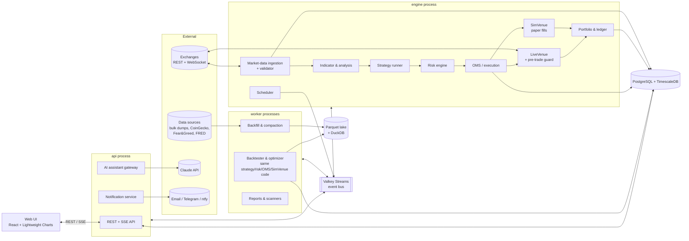
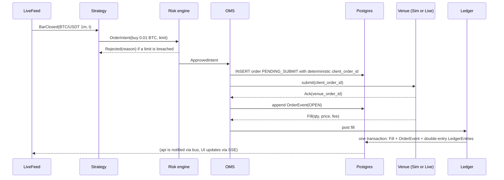
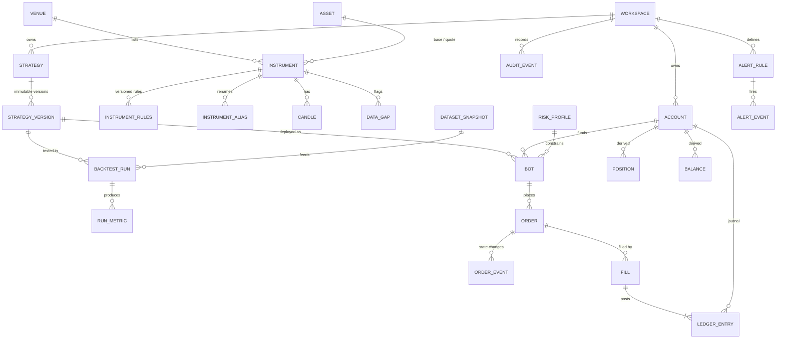

# 06 — Data & Architecture

*Planning document for Ubik. Owner: data/architecture planning. Status: draft for review, 2026-10-18. ID prefixes: `DA` (data), `AR` (architecture & tech stack), `NFR` (non-functional requirements).*

## Summary

- **Pick exchanges by the owner's jurisdiction. In P1 this is mostly a choice of data source.** Outside the US: **Binance** (best free history, Demo Mode, 0.10% fees) plus **Coinbase Advanced or Kraken** as a regulated second venue. In the US: **Coinbase Advanced + Kraken**. Binance.com blocks US IPs: we got HTTP 451 from a US address while writing this. Ubik's paper trading uses its own simulator, not exchange "demo" accounts. Those demo accounts are used later to test adapters before going live.
- **Ubik should own a thin trading kernel built on "ports and adapters".** The Clock, the market-data feed and the execution venue are swappable parts, so backtest, paper and live are just different combinations of the same code. Backtest and paper share one fill simulator. Exchange access goes through a Ubik `ExchangeAdapter` interface, implemented in P1 with **ccxt** (MIT; WebSocket support is now included free). NautilusTrader gets a time-boxed spike before we commit.
- **Use two storage roles.** **PostgreSQL (+TimescaleDB Community)** is the system of record: orders, fills, ledger, config, audit, and recent ("hot") candles. A **Parquet + DuckDB "data lake"** of files holds history and immutable backtest datasets. Measured: 1-minute candles cost about 17 MB per pair-year. ClickHouse or QuestDB only comes in if we later record full order books at scale.
- **Run a modular monolith with three process roles from one Python codebase.** `engine` is always on, `api` serves the web app, and `worker` runs backtests and backfills. They talk over Valkey Streams, and the browser gets live updates over SSE. Everything runs under Docker Compose on a 4 vCPU / 8 GB machine, for about **$0–60/month** in P1.
- **The proposed stack is confirmed, with adjustments.** Engine: Python 3.13, asyncio, FastAPI, Pydantic, **polars 2.x** (rather than pandas) and **TA-Lib 0.8** (now ships prebuilt wheels). Avoid **pandas-ta**: its GitHub repo is gone and its last release was a beta in Sep 2025. UI: TypeScript/React with **TradingView Lightweight Charts 5** (Apache-2.0, but attribution is required).
- **Correctness comes before speed.** That means a Decimal-based ledger, idempotent orders recorded *before* they are sent, UTC microsecond timestamps, explicit data gaps, point-in-time storage, and golden/parity/replay tests in CI.

---

## 1. Scope and position on working assumptions

This document covers exchanges, connectivity, data, storage, system architecture, tech stack, data model, operations and NFRs. Strategy and backtester semantics belong to [04](04-strategies-backtesting-paper-trading.md). Risk, OMS and ledger rules belong to [05](05-risk-portfolio-execution.md). Screens are in [07](07-ux-and-beginner-experience.md). Key storage, auth and legal topics are in [08](08-security-legal-compliance.md).

Where I refine or challenge the lead's assumptions:

1. **"PostgreSQL + time-series extension *or* columnar store"**: I recommend **both**, in different roles. Postgres/Timescale handles state and hot data; Parquet/DuckDB handles history and backtests. Each tool does what it is good at, and Parquet snapshots make backtests reproducible.
2. **Python: yes. pandas as the core dataframe: no.** Use polars and numpy, and don't depend on pandas-ta (see §8).
3. **"Live market data in paper mode": agreed, and Ubik should also *record* it from day one.** For Coinbase and Kraken there is no free bulk history of order books or of their own candles at scale. Recording is the only cheap way to get venue-specific data for realistic fills.
4. **Single-user: agreed, but put a `workspace_id` on every user-owned table from day one.** It costs nothing now. Retrofitting it for P4 multi-user would be expensive.
5. **Jurisdiction matters more for architecture than usual.** It decides which exchange endpoints are reachable at all, and where a VPS may legally run (see §10 and Open questions).

---

## 2. Exchange selection

Glossary for this section:

- **REST**: request/response HTTP calls.
- **WebSocket (WS)**: a persistent connection where the exchange pushes updates.
- **Rate limit**: how many calls the exchange allows per time window.
- **Testnet / demo**: an exchange-hosted fake-money environment.
- **Maker / taker fee**: the fee for an order that rests on the book vs. one that executes immediately.

### 2.1 Comparison (verified Oct 2026 where linked; "verify" = not confirmed from a primary source)

| Exchange | API quality | Testnet / demo | Historical data access | Spot fees, entry tier (maker/taker) | Rate limits | Regional availability |
|---|---|---|---|---|---|---|
| **Binance** (global) | Excellent: REST, WS streams, WS trading API, FIX | Spot **Testnet** (separate prices/liquidity, monthly reset) and **[Demo Mode](https://developers.binance.com/docs/binance-spot-api-docs/demo-mode/general-info)** (`demo-api.binance.com`, same features as live, balance resettable) | Best free source: [data.binance.vision](https://data.binance.vision/) bulk zips of spot klines (down to **1-second**), trades, aggTrades since 2017, and futures funding/bookDepth/metrics. REST: up to 1,000 klines per call | 0.10% / 0.10% (0.075% with BNB) ([schedule](https://www.binance.com/en/fee/schedule)) | Per IP: 6,000 request-weight/min; orders 100 per 10 s and 200,000/day; 300,000 raw requests per 5 min (read from `exchangeInfo` 2026-10-18) | **Not available to US persons.** `api.binance.com` returned HTTP 451 from a US IP during research. Restricted or limited in several other places (e.g. Binance France was delisted by the AMF in July 2026 per press reports). Verify per country |
| **Binance.US** | Separate company with a smaller API and fewer pairs | Not verified | Limited | Verify | Verify | US only, and [not in all states](https://support.binance.us/en/articles/9842798-list-of-supported-states-and-regions) (e.g. NY, TX excluded) |
| **Coinbase Advanced Trade** | Good: REST and WS. Public REST responses are [cached for 1 s](https://docs.cdp.coinbase.com/coinbase-app/advanced-trade-apis/rest-api) | [Sandbox](https://docs.cdp.coinbase.com/coinbase-app/advanced-trade-apis/sandbox) returns **static, mocked** responses (accounts/orders only), so it is useless for realistic paper trading | REST only, [max 350 candles per request](https://docs.cdp.coinbase.com/api-reference/advanced-trade-api/rest-api/products/get-product-candles). No bulk dumps | ~0.40% / 0.60% under $10K/month. Lowered [16 Sep 2026](https://cryptodaily.co.uk/2026/09/coinbase-advanced-fees-usdc-vip-tiers), so verify in account | Verify (no rate-limit headers per third-party docs) | US (incl. NY) and many countries. Publicly listed and regulated |
| **Kraken (Pro)** | Good: REST, WS v2, FIX | **No spot sandbox.** Futures demo only | OHLC endpoint returns only the **720 most recent candles**. Trades endpoint can be paged through full history (1,000 per call). [No bulk dump](https://docs.kraken.com/exchange/guides/general/historical-data) | **0.40% / 0.80%** at $0+, 0.22% / 0.38% from $10K ([fee page](https://www.kraken.com/features/fee-schedule)). Expensive for small accounts | Per IP. About 1 request/s suggested for history endpoints | US (not NY/ME per third-party lists), EU, UK, CA, AU |
| **Bybit** | Good (v5) | Testnet and [Demo Trading](https://bybit-exchange.github.io/docs/v5/demo) (`api-demo.bybit.com`, real public data, no WS trading in demo) | REST klines. Bulk files on public site (verify) | ~0.10% / 0.10% (verify) | [600 requests per 5 s per IP](https://bybit-exchange.github.io/docs/v5/rate-limit) | **Not US/Canada.** EEA via Bybit EU (MiCA). Third-party reports say UK spot returned Dec 2025 via Archax |
| **OKX** | Good (v5) | [Demo trading](https://www.okx.com/docs-v5/en/) via header `x-simulated-trading: 1` and demo keys | REST candles and history-candles | ~0.08% / 0.10% (verify) | Per endpoint, per 2 s | Regional hosts: `us.okx.com` (US/AU), `eea.okx.com` (EU). [OKX US](https://www.theblock.co/post/355107/okx-rebuilding-super-app-in-the-us-ceo-roshan-robert) is spot-only and excludes NY and TX |
| **Bitstamp** | Mature API. [Owned by Robinhood since Jun 2025](https://robinhood.com/us/en/newsroom/robinhood-completes-acquisition-of-bitstamp/) | Verify | Long history via REST | Higher (verify) | Verify | EU, UK, US |
| Newer venues: **Hyperliquid** (on-chain order book, perps-first, ccxt-"certified"), Bitget, MEXC | Varies | Varies | Varies | Low | Varies | Weaker regulatory standing or derivatives focus. **Not P1.** Hyperliquid is a P4 candidate |

### 2.2 Takeaways

- **In P1 the exchange is a data dependency, not a trading dependency.** Paper fills are simulated, so what matters is good free history plus a reliable WebSocket feed *for the venue we would later trade on*. Backtesting on Binance prices and then trading on Coinbase adds a price gap between venues ("basis") that the backtest never saw.
- **Exchange sandboxes are uneven.** Binance Demo Mode, Bybit Demo and OKX demo are realistic. Coinbase's sandbox is mocked. Kraken has no spot sandbox. **So Ubik's paper mode must be its own simulator (AR-013).** Exchange demos are only for adapter contract tests before P3.
- **Fees differ by up to 8× at the entry tier** (Binance 0.10% vs Kraken 0.80% taker). The cost model must be per venue and per fee tier, or backtests will mislead beginners.

### 2.3 Recommendation

| Owner's jurisdiction | Primary (data + future live) | Secondary | Notes |
|---|---|---|---|
| EU/EEA, UK, most of Asia-Pacific/LatAm where Binance is permitted | **Binance** | **Coinbase Advanced** or **Kraken** (regulated fallback, cross-venue check) | Check country-specific Binance status (MiCA turbulence in 2026) |
| United States | **Coinbase Advanced** | **Kraken** | Backfill Coinbase history via REST (1 year of 1m = ~1,500 calls). Use Binance bulk data only for research, and only if doc 08 confirms the ToS allow it. The market-data host `data-api.binance.vision` was reachable from a US IP |
| Canada / other restricted | Decide after doc 08 | Kraken or Coinbase | — |

| ID | Requirement | Priority | Phase | Rationale / notes |
|---|---|---|---|---|
| AR-001 | Ubik shall support at least two P1 venues, chosen through a "jurisdiction profile" setting (default non-US: Binance + Coinbase; US: Coinbase + Kraken), without code changes. | Must | P1 | Jurisdiction is unknown, so both paths must work. |
| AR-002 | Ubik shall keep a per-venue registry of capabilities and rules: order types, fee tiers, rate limits, demo/testnet hosts, regional hosts (e.g. `us.okx.com`), and quirks. Adapters, the cost model and the UI shall all read from it. | Must | P1 | One source of truth. Fee realism. |
| AR-003 | Ubik shall treat geo-block responses (HTTP 451/403 with region messages) as configuration errors that stop retries and explain the problem to the user. It shall never route around them. | Must | P1 | Legal safety; see doc 08. |
| AR-004 | Before a venue is enabled for live trading, its adapter shall pass a contract-test suite against that venue's demo/testnet. Where none exists (Coinbase, Kraken spot), the suite runs against minimum-size live orders under the P3 staged rollout. | Must | P3 | Proves sim-live parity per venue. |

---

## 3. Connectivity layer

### 3.1 Options

| Option | Status (Oct 2026) | Pros | Cons |
|---|---|---|---|
| **ccxt** | v4.5.88 (14 Oct 2026), **MIT**. Around 100 exchanges. **WebSocket "Pro" is bundled free in the same package** ([docs](https://docs.ccxt.com/docs/pro)). `setSandboxMode` covers testnets, `enableDemoTrading` covers Binance Demo | One unified API for REST and WS in Python and JS. Active development. Handles signing, precision and market metadata | Lowest-common-denominator abstraction, so it leaks: order types, error codes, partial-fill semantics. Releases ship several times a week, which brings regression risk |
| **Exchange-native SDKs** (Binance connector, Coinbase Advanced SDK, etc.) | Maintained by the exchanges | Full feature coverage (e.g. Binance WS trading API) | One integration per venue. Uneven quality |
| **Framework adapters** (NautilusTrader, Hummingbot) | See §8 | Battle-tested order-state handling | Ties us to that framework's domain model |

### 3.2 Recommended design

Ubik defines its own **ports**: interfaces that the core depends on. **Adapters** implement them. Strategies never see ccxt.

```text
MarketDataFeed:   subscribe(instruments, channels) -> async stream[Event]   # Bar, Trade, BookTop, BookDelta
                  history(instrument, timeframe, start, end) -> Frame
ExecutionVenue:   submit(OrderIntent with client_order_id) -> Ack
                  cancel(client_order_id); amend(...)
                  open_orders(); order_status(client_order_id); fills(since)
                  balances(); stream_account() -> async stream[OrderEvent|Fill|BalanceEvent]
Clock:            now() -> UTC µs; schedule(at, callback)
VenueRules:       precision, lot/tick/min-notional, fee tier, rate limits (from AR-002 registry)
```

Implementations:

- **`CcxtVenue` / `CcxtFeed`**: live data and live trading via ccxt. The version is pinned exactly, with per-venue overrides where needed.
- **`SimVenue`**: the shared fill simulator. In **paper** mode it fills against live trades and the live book. In **backtest** mode it fills against historical data. Fill-model details are in doc 04.
- **`HistoricalFeed`**: replays dataset snapshots from the Parquet lake.
- **`NativeVenue`**: only where ccxt is missing something we need (P3+).

| ID | Requirement | Priority | Phase | Rationale / notes |
|---|---|---|---|---|
| AR-005 | Ubik shall access exchanges only through its `MarketDataFeed` and `ExecutionVenue` ports. Strategy, risk and OMS code shall not import ccxt or SDKs. Import rules shall be enforced by an automated check in CI. | Must | P1 | Sim-live parity; lets us swap the library. |
| AR-006 | The P1 adapters shall use ccxt pinned to an exact version. Upgrades shall merge only after the adapter contract tests and recorded-session replay tests pass. | Must | P1 | ccxt ships several releases per week. |
| AR-007 | Adapters shall normalize: symbols to canonical `BASE/QUOTE@VENUE`; prices and quantities to Decimal parsed from strings; timestamps to UTC µs; errors to a fixed list (retryable, rate-limited, rejected, insufficient-funds, **unknown-state**); and order states to Ubik's state machine (doc 05). | Must | P1 | "Unknown-state" drives safe reconciliation. |
| AR-008 | Ubik shall rate-limit itself per venue and per IP (token bucket configured from AR-002), staying ≤ 80% of published limits, and shall back off on 429/418/Retry-After. | Must | P1 | Binance bans IPs that keep retrying (HTTP 418). |
| AR-009 | WebSocket connections shall be supervised: heartbeats, reconnect with exponential backoff and jitter, resubscription, order-book sequence-gap detection (which forces a fresh snapshot), and REST backfill of candles missed while disconnected. | Must | P1 | Exchange WS feeds drop regularly. |
| AR-010 | Ubik may add native-SDK adapters per venue behind the same ports when ccxt lacks a needed capability. | Could | P3 | E.g. Binance WS trading API for lower latency. |

---

## 4. Data sources and costs

Glossary for this section:

- **OHLCV**: open-high-low-close-volume candles.
- **Trades / ticks**: every individual execution.
- **L2 order book**: resting buy and sell orders aggregated by price level.
- **Funding rate**: the periodic payment between long and short holders of perpetual futures.
- **Open interest (OI)**: the number of open futures contracts.

| Data class | Free sources (recommended first) | Paid upgrades (2026 list prices) | License / redistribution notes |
|---|---|---|---|
| OHLCV candles | Exchange REST/WS. Binance bulk dumps (1s–1M klines). Kraken via trades→bars. Coinbase REST (350 per call) | CoinAPI (Startup $79/mo; pay-as-you-go with $25 free credit, [pricing](https://www.coinapi.io/market-data-api/pricing)), Kaiko/Amberdata (enterprise, quote only) | Exchange data for personal use. Check each exchange's ToS before republishing |
| Trades (ticks) | Binance bulk `trades`/`aggTrades`. Exchange WS (self-recorded). Kraken trades endpoint | [Tardis.dev](https://tardis.dev/#pricing): Spot "Solo" $900/mo, Academic $450/mo (quarterly/yearly billing). **The first day of every month is free without a key**, which we verified with a request on 2026-10-18 | Tardis: per-seat license, no redistribution |
| L2 order book | **Self-record** via WS (top-20 snapshots). Binance futures `bookDepth` dumps. Tardis free first-of-month samples | Tardis (incremental L2 for 50+ venues), Kaiko, CoinAPI | Same as above |
| Funding, OI, long/short, liquidations | Exchange REST. Binance futures `metrics`/funding dumps | [CoinGlass](https://www.coinglass.com/pricing): Hobbyist $29/mo (personal, 30 req/min), Standard $299 (commercial) | CoinGlass personal plans are not for commercial use |
| Market-wide (market cap, rankings, metadata) | [CoinGecko Demo](https://www.coingecko.com/en/api/pricing): free, 100 calls/min, 10K credits/month | CoinGecko Basic $35/mo, Analyst $129/mo | **Attribution required**. No resale or redistribution of API access. CoinDesk Data (ex-CryptoCompare) **retired its free tier on 21 May 2026** ([source](https://coinmarketcap.com/api/resources/coindesk-api-alternatives-7-crypto-data-feeds-compared-in-2026)), a reminder that free tiers vanish |
| On-chain | DefiLlama open API (TVL, stablecoins, verify terms). Public blockchain explorers (rate-limited) | Glassnode (API mostly on top tiers or quote; third-party trackers cite ~$49–$999/mo, verify), CryptoQuant (~$29–$109/mo Advanced/Pro, ~$799 Premium per [third-party](https://costbench.com/software/onchain-analytics/cryptoquant/), verify; moving to credits) | Vendor metrics are often **revised**, so they need point-in-time storage (DA-018) |
| Sentiment | [alternative.me Fear & Greed](https://alternative.me/crypto/fear-and-greed-index/): free, daily, `api.alternative.me/fng/`. Commercial use allowed **with attribution next to the data** | Santiment, LunarCrush (verify pricing) | Attribution must be shown in the UI |
| News | Publisher RSS feeds (check terms). GDELT | [CryptoPanic API](https://cryptopanic.com/developers/api/) (developer/growth plans, pricing unverified). NewsAPI (free dev plan is non-commercial, verify) | Store headlines and links, not full text |
| Macro | FRED API (free key; ALFRED keeps historical revisions, called "vintages") | — | Public domain or attribution. Use vintages for point-in-time |

**P1 data budget: $0.** P2 optional extras: around $30–150/mo (e.g. CoinGlass Hobbyist + CoinGecko Basic + a CryptoQuant tier). Tardis is a P3/P4 decision, for when serious slippage modeling or market-making research needs historical L2.

| ID | Requirement | Priority | Phase | Rationale / notes |
|---|---|---|---|---|
| DA-001 | Ubik shall ingest live 1m candles and trades (or the best available ticker) over WebSocket for every configured instrument, falling back to REST polling when WS is unavailable. | Must | P1 | Live data is used in paper mode too. |
| DA-002 | Ubik shall backfill at least 5 years of 1m candles where the venue offers them: Binance bulk dumps (with `.CHECKSUM` verification), Coinbase REST paging, and Kraken trades→bars. | Must | P1 | Backtests need history. |
| DA-003 | Ubik shall record, from first start, its own venue data for configured instruments: finalized candles, plus top-20 L2 snapshots every second for instruments with active bots. | Should | P1 | Builds venue-specific history and slippage calibration data that isn't available for free. |
| DA-004 | Ubik shall take a daily snapshot of instrument rules (tick size, lot size, minimum order value, status) and keep their history (`valid_from`/`valid_to`). | Must | P1 | Backtests must use the rules in force at the time. |
| DA-005 | Ubik shall record stablecoin→USD reference rates (USDT/USD, USDC/USD) and label any "USD" figure that is really USDT. | Should | P1 | Honesty: a stablecoin depeg is a real risk. |
| DA-006 | Ubik shall ingest funding, OI and long/short context from free exchange endpoints and dumps for the underlying assets of traded spot pairs. | Should | P2 | Market analysis (doc 03). |
| DA-007 | Each external source (CoinGecko, alternative.me, FRED, DefiLlama, paid vendors) shall be a `DataSource` plugin with caching, quota tracking and an off switch. Paid sources shall be off by default and show estimated monthly cost. | Should | P2 | Budget principle. |
| DA-008 | Ubik shall keep a data-license registry per source: attribution text, commercial-use flag, redistribution flag, retention limits. The UI shall show required attributions, and exports shall exclude data whose terms forbid redistribution. | Must | P1 | CoinGecko, alternative.me and TradingView all require attribution. |
| DA-009 | When a source fails or disappears, the features that depend on it shall degrade with a visible "data unavailable since …" notice rather than erroring or showing stale values as current. | Should | P2 | Free tiers vanish (CoinDesk, May 2026). |

---

## 5. Data quality and time

Bad data is the main reason backtests look better than reality. These rules are the data contract every other module relies on.

**Time and candle semantics**

- Every timestamp is **UTC with microsecond precision**. The UI converts to local time only for display.
- A candle is labelled by its **open time** and covers the half-open interval [open, open + timeframe). Binance's own close time is open + 59.999… s.
- Higher timeframes are built from 1m candles in UTC. Daily candles close at 00:00 UTC; weekly candles start Monday 00:00 UTC.
- A candle is **final** only when the venue flags it closed (e.g. Binance WS kline `x: true`), or at close + a grace period (2 s) when polling.
- Strategies see only final candles (doc 04 decides how intrabar logic is handled).
- **Unit traps are real.** Binance bulk files switched from **millisecond to microsecond timestamps in January 2025** (we checked the Dec 2024 and Jan 2025 files). A naive loader would be wrong by 1000× without noticing.

**Validation checks run at ingest**

| Check | Rule | Action on failure |
|---|---|---|
| Schema / parse | All fields present. Prices > 0. Decimal parse succeeds | Reject the row and log it |
| OHLC invariants | low ≤ min(open, close) ≤ max(open, close) ≤ high; volume ≥ 0 | Quarantine the row |
| Alignment | open_time is a multiple of the timeframe. Not more than 5 s in the future | Reject |
| Duplicates | Unique on (instrument, timeframe, open_time) | Upsert, keeping a revision log |
| Continuity | A missing expected candle creates a `DATA_GAP` record | Auto-backfill. If still missing, mark it a confirmed gap. **Never forward-fill silently** |
| Outliers | Return beyond k × rolling MAD, or > X% away from the cross-venue median | Flag as `suspect`. Keep the row. Strategies may exclude flagged rows |
| Cross-source reconciliation | REST candles vs. WS candles vs. bulk dump vs. candles rebuilt from trades | Produce a diff report and pick one canonical source per venue |
| Staleness | Last update older than 2 × timeframe + grace | Mark the feed stale and block new entries on it |

**Survivorship and identity.** "Survivorship bias" means testing only on coins that still exist today, which flatters results. Ubik keeps delisted instruments (e.g. LUNA/UST in 2022, FTT in 2022, BUSD pairs wound down in 2023–24) and builds universes point-in-time: "top 10 by volume" is computed as of each historical date. Renames and migrations (e.g. MATIC→POL in 2024) are handled with alias records, so a history chain doesn't break.

**Point-in-time ("bitemporal") storage.** Some data gets revised after publication: on-chain metrics, sentiment indices, macro series, market-cap rankings, even our own corrected candles. For these, Ubik stores both `valid_time` (the moment the value describes) and `known_at` (when Ubik or the vendor first had it). Backtests only read rows with `known_at ≤ decision_time`. Otherwise the backtest quietly uses information that didn't exist yet ("lookahead").

| ID | Requirement | Priority | Phase | Rationale / notes |
|---|---|---|---|---|
| DA-010 | Ubik shall store all timestamps as UTC with µs precision. It shall label candles by open time over [open, open+tf), and aggregate higher timeframes from 1m in UTC. | Must | P1 | Consistent semantics across venues. |
| DA-011 | Ubik shall deliver only finalized candles to strategies unless a strategy explicitly opts in to intrabar data, which shall be labelled in its reports. | Must | P1 | Prevents lookahead. Coordinate with doc 04. |
| DA-012 | Ubik shall run the validation checks in §5 at ingest and store the results as queryable quality flags. Data shall never be silently corrected. | Must | P1 | Honesty principle. |
| DA-013 | Gaps shall be explicit records. They shall be auto-backfilled after reconnects, and any that remain shall be listed in backtest reports and shaded on charts. | Must | P1 | Beginners must see data holes. |
| DA-014 | A freshness monitor shall mark feeds stale (age > 2 × timeframe + grace), block new entries for affected instruments, and alert the owner. | Must | P1 | Trading on stale data is a classic bot failure. |
| DA-015 | Ubik shall retain delisted instruments, support aliases for renames, and build strategy universes point-in-time. | Should | P1 | Must by P2 for multi-asset scanners. |
| DA-016 | Bulk loaders shall verify checksums and detect timestamp-unit changes (e.g. Binance ms→µs, Jan 2025) before writing. | Must | P1 | Verified trap. |
| DA-017 | Ubik shall record venue outage and maintenance windows. The backtester shall treat them as non-tradable periods. | Should | P2 | Realism. |
| DA-018 | Revisable data (on-chain, sentiment, macro, rankings, corrected candles) shall be stored bitemporally (`valid_time`, `known_at`), and backtests shall query it as of the decision time. | Must | P2 | Avoids lookahead from revised data. |

---

## 6. Storage

### 6.1 Volume estimates

Measured on Binance BTCUSDT data during research, using DuckDB with Parquet/zstd on a 4-vCPU box. Other numbers are estimates.

| Data | Rate | Size | P1 footprint |
|---|---|---|---|
| 1m candles | 525,600 per pair-year | **~33 B/row in Parquet → ~17 MB per pair-year** (measured: Sep 2026 had 43,200 rows in 1.42 MB). Postgres row store: ~150 B/row including index | 6 pairs × 2 venues × 6 years = 72 pair-years ≈ **1.3 GB Parquet**. Postgres hot table (90 days) ≈ 0.25 GB |
| 1s candles (Binance) | 31.5M per pair-year | ~2–2.5 MB/day zipped → ~0.8 GB per pair-year | Optional, for fill realism |
| Trades (BTCUSDT) | **~3.0M trades/day** (1 Oct 2026) | **~4.3 B/row in Parquet → ~13 MB/day → ~4.7 GB per pair-year**. Monthly zips are 0.5–1.4 GB | Record 2–3 pairs: ~10 GB/yr. Re-aggregating one day into 1m bars took **0.16 s** |
| L2 top-20 snapshots every 1 s (self-recorded) | 86,400 per pair-day | Est. 10–20 MB/day/pair compressed | 5 pairs: ~20–35 GB/yr |
| Full incremental L2 (every book change) | 10+ updates/s | Est. 0.2–1 GB/day/pair (order of magnitude, verify using Tardis samples) | **Not P1** |
| Orders, fills, ledger, audit | Small | < 100 MB/yr | Postgres |

**Conclusion:** P1–P2 fits comfortably on a **100–250 GB SSD**. Only full-depth order-book capture across many pairs would need a dedicated tick database.

### 6.2 Options

| Option | License | Strengths | Weaknesses | Ubik role |
|---|---|---|---|---|
| **PostgreSQL 17/18** | PostgreSQL | ACID (safe transactions), exact `NUMERIC`, mature tooling, one database for everything relational | Row storage is bulky and slow for long tick scans | **System of record** (P1) |
| **+ TimescaleDB Community** | Apache-2.0 core. Compression, continuous aggregates and retention are under the [Timescale License](https://www.tigerdata.com/docs/about/latest/timescaledb-editions) (free to self-host; you can't sell the *database* as a service) | "Hypertables" (auto-partitioned time tables), ~10×+ compression, auto-rolled 5m/1h/1d views, retention policies, all still SQL | "-oss" images lack the TSL features. Extension upgrades need care | **Hot market data** (P1). Optional: the schema must still work on plain Postgres |
| **Parquet + DuckDB / polars** | Apache-2.0 format, MIT engines | Zero-ops files, columnar (stores each column together, so scans and compression are fast), immutable snapshots, portable, very fast local scans | No concurrent multi-writer transactions. Needs a compaction job | **History and backtest datasets** (P1) |
| **ClickHouse** | Apache-2.0 | Very fast columnar analytics, ASOF joins, excellent compression | Another server to run. Not suitable for transactional state | Tick/L2 store if capture grows (P3+) |
| **QuestDB** | Apache-2.0 (HA/replication need the Enterprise edition) | Very high ingest rates (vendor claims ~1M rows/s, [benchmark](https://questdb.io/time-series-benchmark-suite)), ASOF joins | Smaller ecosystem | Alternative to ClickHouse |

### 6.3 Recommended P1 design and growth path

- **Postgres (+Timescale)** holds:
  - accounts, orders, fills, ledger, bots, strategies, runs and metrics, alerts, audit, config, jobs;
  - **hot candles** (last 90 days of 1m candles, plus continuous aggregates) for charts and for live indicator warm-up.
- **Parquet lake** holds everything historical:
  - layout `lake/{venue}/{datatype}/{symbol}/{timeframe}/year=YYYY/month=MM/*.parquet`;
  - a nightly job moves finished days out of Postgres and recompacts the files;
  - backtests read only from **dataset snapshots**: manifests listing files, content hashes and a quality summary. Any run can be reproduced exactly.
- **Growth**: if recorded tick/L2 data passes ~50 GB/month, add ClickHouse or QuestDB behind the same `MarketDataStore` interface. Nothing above that interface changes.

| ID | Requirement | Priority | Phase | Rationale / notes |
|---|---|---|---|---|
| DA-019 | PostgreSQL shall be the system of record for all transactional and configuration data. Money amounts (prices, quantities, fees, balances, P&L) shall use `NUMERIC`/Decimal, never binary floating point. | Must | P1 | Exact accounting (NFR-008). |
| DA-020 | Hot market data (≥ 90 days of 1m candles, plus 5m/1h/1d rollups) shall be served from Postgres/TimescaleDB, and the schema shall remain valid on plain PostgreSQL. | Should | P1 | Fast charts; avoids lock-in to TSL features. |
| DA-021 | Historical market data shall be stored as zstd-compressed Parquet, partitioned by venue/type/symbol/timeframe/month, and queried with DuckDB or polars. | Must | P1 | Measured ~17 MB per pair-year. |
| DA-022 | Every backtest run shall reference an immutable dataset snapshot (manifest + content hashes + quality summary). Re-running the same snapshot, strategy version and config shall give identical results. | Must | P1 | Reproducibility and honesty. |
| DA-023 | Ubik shall apply retention policies per data class (§11, NFR-012), each configurable with a disk-usage forecast. | Should | P1 | Small disks. |
| DA-024 | The owner shall be able to export orders, fills, ledger, balances and backtest results as CSV/Parquet at any time. | Must | P1 | Data ownership; tax prep in P3. |
| DA-025 | A dedicated tick/L2 store (ClickHouse or QuestDB) may be added behind the `MarketDataStore` interface once capture exceeds ~50 GB/month. | Could | P3 | Defer complexity. |

---

## 7. System architecture

### 7.1 Shape: a modular monolith with three process roles

A **modular monolith** is one codebase with strict internal module boundaries, deployed as a few processes rather than many microservices. For a single user this gives most of the isolation for a fraction of the operational cost. There are three roles:

- **`engine`**: always on, asyncio. Runs ingestion, strategies, risk, OMS, venues (paper or live), ledger and scheduler. It must not be blocked by heavy computation, and it restarts independently of the UI.
- **`api`**: FastAPI. Serves REST plus SSE to the browser, the AI-assistant gateway and the notification dispatcher.
- **`worker`**: one or more processes for backtests, optimizations, backfills, compaction and reports. These are CPU-heavy, so they run in separate processes to avoid Python's single-thread lock (the GIL) stalling the engine.



### 7.2 How modes swap the clock, data feed and venue

| Mode | Clock | Data feed | Execution venue | Account / ledger |
|---|---|---|---|---|
| **Backtest** | `SimClock` (jumps from event to event) | `HistoricalFeed` (dataset snapshot) | `SimVenue` | Ephemeral backtest account. Summary persisted |
| **Paper** | `WallClock` | `LiveFeed` (exchange WS) | `SimVenue` (same code, fills against the live book/trades) | Paper account in Postgres |
| **Shadow** (P3) | `WallClock` | `LiveFeed` | `SimVenue` for fills, plus `LiveVenue` **read-only** (balances, book) to compare simulated vs. achievable fills | Paper account |
| **Live** (P3) | `WallClock` | `LiveFeed` | `LiveVenue`, wrapped by a non-bypassable pre-trade guard | Live account plus reconciliation (doc 05) |

The **composition root** (the one place that wires adapters together) reads `mode` from config. Strategy code is identical in every mode. It may only use the `Clock`, the event API and order-intent API it is given. It may not call `datetime.now()`, open network connections, or import adapters.

### 7.3 Main flow: order lifecycle with a write-ahead intent

**Idempotent** means doing the same thing twice has the same effect as doing it once. The **outbox / write-ahead** pattern means persisting what you are about to do *before* doing it. Together they guarantee that a crash never produces a duplicate order.



On restart, the engine loads every order in `PENDING_SUBMIT` or `OPEN` and queries the venue by `client_order_id`. It then adopts, cancels or marks each one before any strategy resumes. Paper mode uses exactly the same path, so the logic gets months of testing before real money is involved.

### 7.4 Messaging, real-time UI, configuration, scheduling, notifications

- **Messaging**:
  - inside the engine, a typed in-process async event bus;
  - between processes, **Valkey Streams** (Valkey is the BSD-3-licensed fork of Redis; Redis 8 is now AGPL/SSPL/RSAL tri-licensed, [source](https://www.theregister.com/2025/08/14/redis_redux/)) behind an `EventBus` interface, so NATS JetStream can replace it in P4;
  - durable jobs (backtests, backfills) live in a Postgres job table claimed with `FOR UPDATE SKIP LOCKED`, so they survive restarts. Valkey only signals and streams progress.
  - Considered and rejected for P1: Postgres LISTEN/NOTIFY alone (no replay, 8 KB payload limit) and Kafka (too heavy).
- **Real-time UI**:
  - **Server-Sent Events (SSE)** for prices, bot status, job progress and assistant token streaming. SSE is a one-way HTTP push stream that reconnects automatically and passes through proxies easily;
  - REST for commands. TypeScript types are generated from FastAPI's OpenAPI schema;
  - WebSockets only if a genuinely two-way feature appears.
- **Configuration**: layered, and validated with Pydantic at startup. Order: code defaults → `ubik.yaml` → environment variables (secrets) → runtime settings stored in the DB (editable in the UI, every change audited).
- **Scheduler**: an in-engine scheduler with schedules persisted in Postgres and an explicit missed-run policy. Runs instrument refresh, compaction, backups, daily reports and scanner runs.
- **Notifications**: one service consuming bus events. Channels: in-app, email, Telegram or ntfy. It deduplicates, rate-limits and respects quiet hours, except for critical alerts.

| ID | Requirement | Priority | Phase | Rationale / notes |
|---|---|---|---|---|
| AR-011 | Ubik shall be one repository and one Python package of modules with declared public interfaces, deployed as `engine`, `api` and `worker` processes. Cross-module imports shall be checked in CI. | Must | P1 | Isolation without microservice overhead. |
| AR-012 | Ubik shall assemble each mode from the `Clock`, `MarketDataFeed` and `ExecutionVenue` ports at one composition root. Strategy code shall contain no mode branches and shall not access wall-clock time, the network or adapters. | Must | P1 | Sim-live parity. |
| AR-013 | Backtest and paper modes shall use the same `SimVenue` fill-simulation code. | Must | P1 | One fill model to validate. Details in doc 04. |
| AR-014 | Within the engine, events shall flow over a typed in-process bus. Between processes, a schema-versioned `EventBus` backed by Valkey Streams shall carry them. | Must | P1 | Swappable later (NATS). |
| AR-015 | Backtests, optimizations, backfills and reports shall run as durable jobs in worker processes, with progress events, cancellation, timeouts and CPU/memory limits. | Must | P1 | The engine must never stall. |
| AR-016 | Before submitting an order, the OMS shall persist it with a deterministic `client_order_id`. After a restart it shall reconcile every non-final order with the venue before strategies resume. This applies in paper mode too. | Must | P1 | No duplicate orders (NFR-007). |
| AR-017 | Order events, fills and ledger entries shall be append-only. Positions and balances shall be derived (with snapshots) and fully rebuildable from those records. | Must | P1 | Auditability. Details in doc 05. |
| AR-018 | The UI shall receive real-time updates over SSE and send commands over REST. The TypeScript API client shall be generated from the OpenAPI schema. | Must | P1 | Simple and robust. |
| AR-019 | Configuration shall be layered (defaults → file → env → DB runtime settings), validated at startup, and every runtime change shall create an audit event. | Must | P1 | Safe changes; supports P3. |
| AR-020 | The live venue shall only start if all of these hold: `mode: live`, venue credentials verified as trade-only (no withdrawals), an explicit unlock in the UI with re-authentication, and an active risk profile. Otherwise the engine shall refuse to start and explain which condition failed. | Must | P3 | Built in P1 as a configuration change, not a rewrite. See docs 05 and 08. |
| AR-021 | Ubik shall offer a shadow mode that compares simulated fills with the live order book and with read-only venue state. | Should | P3 | Staged rollout. |
| AR-022 | A persisted scheduler with a missed-run policy shall run periodic jobs. | Must | P1 | Unattended operation. |
| AR-023 | A notification service shall deliver in-app plus at least one push channel, with deduplication, rate limiting and quiet hours. Critical alerts (engine down, kill switch, stale data with open positions) shall bypass quiet hours. | Must | P1 | Always-on bot. |
| AR-024 | Every user-owned table shall carry `workspace_id`, and authorization shall be enforced in the API layer. | Should | P1 | Cheap path to P4 multi-user. |
| AR-025 | Indicators, strategies, venues, data sources and notification channels shall be loadable plugins (Python entry points) behind versioned interfaces. | Should | P1 | Must in P2 for third-party plugins. |

---

## 8. Tech stack

### 8.1 Engine core: build or adopt?

Doc 02 owns the overall build-vs-reuse decision. This is the architecture view.

| Option | License / status | Fit for Ubik |
|---|---|---|
| **Custom thin kernel** (Python asyncio + polars/numpy) | Ours | **Recommended for P1.** We control event semantics, fill and ledger explanations, and beginner safety, which is where Ubik differs from other tools. One-minute bars on ≤ 20 pairs means tens of events per minute, which is trivial for Python. The risk is that we own fill and accounting correctness. Tests mitigate that (§10). |
| **[NautilusTrader](https://github.com/nautechsystems/nautilus_trader)** | LGPL-3.0. Stable 1.231 (Aug 2026). **2.0 RC7 with a Rust-native runtime (Oct 2026)**. Python 3.12–3.14 | Strongest open-source sim-live engine, with stable Binance/Bybit/OKX/Coinbase/Kraken adapters. Against it: a steep learning curve, API churn during the v2 transition, and a domain model that would leak into the beginner UX. **Do a time-boxed spike (≤ 2 weeks) and decide against these criteria:** can our strategy API sit cleanly on top, can our ledger and explanations hook its events, and is v2 stable by P1 coding start. Revisit for P4 market making. |
| Freqtrade 2026.9 | GPL-3.0 | Mature dry-run, backtesting and hyperopt plus FreqUI. But it is built around a candle loop with one strategy per process, and GPL limits closed or SaaS distribution later. Use it as a reference design. |
| Hummingbot (Apache-2.0), Jesse 3.4 (MIT), vectorbt 1.1 (Apache-2.0 + Commons Clause, verify) | — | Hummingbot is a reference for P4 market making. vectorbt-style vectorized sweeps are a pattern to copy for fast optimization screening. |

### 8.2 Stack

| Layer | Choice (version, Oct 2026) | License | Why / alternatives considered |
|---|---|---|---|
| Engine/analysis language | **Python 3.13** (3.12 minimum), asyncio, `uv` lockfiles | PSF | Best quant ecosystem. Rust is fast but slows iteration, so it's an escape hatch only. TS/Node has ccxt but weak numerics. Go has no quant libraries |
| Dataframes / numerics | **polars 2.0** (released 6 Oct 2026), numpy, numba where profiling shows a need | MIT/BSD | polars is multithreaded and Arrow-native. pandas 3.0 only at library boundaries |
| Indicators | **TA-Lib 0.8.2** (Oct 2026; binary wheels for Linux/macOS/Windows on x86 and ARM, so no C compile) plus Ubik-maintained implementations with reference tests. `talipp` for incremental indicators (verify maintenance) | BSD | **Avoid pandas-ta**: the GitHub repo returns 404, its domain no longer resolves, and the last release is `0.4.71b0` (beta, Sep 2025). `ta` was last released in 2023 |
| SQL analytics | **DuckDB 1.5** | MIT | Fast queries over Parquet |
| API | **FastAPI 0.14x**, Pydantic v2, Uvicorn | MIT | Async, OpenAPI, SSE |
| DB access | SQLAlchemy 2 Core, psycopg 3 (LGPL-3.0, used unmodified), Alembic | MIT/LGPL | Migrations, typed SQL |
| Database | **PostgreSQL 17/18 + TimescaleDB Community** | PostgreSQL / Apache-2.0 + TSL | §6 |
| Bus / cache | **Valkey 9** | BSD-3 | Avoids Redis license questions |
| Exchange connectivity | **ccxt 4.5.x** | MIT | §3 |
| Frontend | **TypeScript, React 19, Vite, TanStack Query** | MIT | Mainstream. Lots of developers and AI assistance available |
| Price charts | **[TradingView Lightweight Charts 5.2](https://github.com/tradingview/lightweight-charts)** | Apache-2.0 **plus attribution**: include the NOTICE and a visible link to tradingview.com (the `attributionLogo` option satisfies this) | Small and fast. Alternatives: KLineCharts 10 (Apache-2.0), ECharts 6 for non-price charts. The full TradingView "Charting Library" needs a separate license |
| Observability | structlog, Prometheus client, Grafana (AGPL, run unmodified), Uptime Kuma | — | §10 |
| Testing | pytest, Hypothesis, Playwright | — | §10 |

**Performance plan.**

- **Precompute indicators in vectorized form** before the event loop, so the loop only does decisions and fill simulation.
- **Parallelize parameter sweeps** across worker processes.
- Offer a **vectorized "screening" backtest** for wide sweeps, then confirm finalists with the event-driven engine (doc 04).
- **Indicator parity in live mode:** recompute indicators with the *same vectorized function* over a rolling warm-up window at each bar close. For 1m bars this costs microseconds, and it guarantees backtest and live see identical values. A separate incremental implementation that drifts from the batch one is a classic parity bug.

### 8.3 AI assistant integration (high level; UX in doc 07)

- **Placement**: an assistant gateway inside the `api` process. It uses the official Anthropic Python SDK and streams answers to the UI over SSE.
- **Models (configurable per route)**:

  | Model | ID | Price (input / output per M tokens) | Use |
  |---|---|---|---|
  | **Claude Opus 5.5** (default) | `claude-opus-5-5` | $4 / $20 | Analysis and explanations |
  | **Claude Sonnet 5.5** | `claude-sonnet-5-5` | $2 / $10 | Lighter chat |
  | **Claude Haiku 5.5** | `claude-haiku-5-5` | $0.10 / $0.50 | Bulk tagging (news/sentiment) through the Batch API at 50% off |

  Prompt caching is used for the stable system prompt and glossary.
- **Tools, not memory**:
  - the assistant answers through **read-only tools**: market snapshot, backtest report, metric explanations, positions, glossary;
  - it can create **drafts** (strategy config, alert) that the user must confirm in the UI;
  - it **cannot** place or cancel orders, change risk limits or switch modes;
  - numbers it quotes must come from tool results and carry an "as of" timestamp.
- **Cost and privacy**: a monthly spend cap with a usage meter. Prompts and responses are logged without secrets. Off by default until the owner opts in. Rough estimate: 50 chats/month at ~30K input and 2K output tokens on Opus 5.5 ≈ **$8/month**. Tagging ~3,000 headlines/day on Haiku 5.5 ≈ **$3/month**.

| ID | Requirement | Priority | Phase | Rationale / notes |
|---|---|---|---|---|
| AR-026 | The engine, analysis and backtester shall be implemented in Python 3.13 (minimum 3.12) with locked dependencies. Core modules (OMS, ledger, risk, adapters) shall pass strict static type checking. | Must | P1 | Correctness. |
| AR-027 | Ubik shall use polars and numpy as its dataframe/numeric stack. pandas only at third-party library boundaries. | Should | P1 | Performance, Arrow interop. |
| AR-028 | Indicators shall come from TA-Lib or Ubik-maintained implementations validated against reference values. Ubik shall not depend on unmaintained indicator libraries such as pandas-ta. | Must | P1 | Supply-chain and maintenance risk. |
| AR-029 | Paper and live modes shall compute indicators with the same functions as backtests, over a warm-up window. An automated parity test shall assert identical outputs (tolerance 1e-9) on recorded data. | Must | P1 | Sim-live parity. |
| AR-030 | The web UI shall be built in TypeScript/React. Price charts shall use Lightweight Charts with the attribution required by its license. | Must | P1 | License compliance. |
| AR-031 | Before P1 build starts, the team shall run a ≤ 2-week NautilusTrader spike against the criteria in §8.1 and record the decision as an architecture decision record (ADR). | Should | P1 | Avoids reinventing an engine if it fits. |
| AR-032 | The AI assistant shall use the Anthropic API with configurable models per route (default `claude-opus-5-5`; `claude-sonnet-5-5`, `claude-haiku-5-5`). It shall have read-only tools and draft-only actions, shall never place orders or change risk or mode settings, and shall enforce a monthly spend cap. | Must | P2 | Safety and honesty. |
| AR-033 | Every number the assistant states shall come from a tool result shown with its as-of timestamp and source. | Must | P2 | Prevents made-up figures ("hallucinated" numbers). |

---

## 9. High-level data model



| Entity | Key fields (abridged) | Notes |
|---|---|---|
| Venue / Asset / Instrument | `instrument_id`, venue, base, quote, venue symbol, status, listed/delisted dates | Canonical `BASE/QUOTE@VENUE`. Delisted instruments kept |
| InstrumentRules | tick size, lot size, minimum order value, `valid_from`/`valid_to` | Point-in-time rules |
| Candle | instrument, timeframe, `open_time` (UTC µs), OHLCV, trade count, source, `is_final`, quality flags | Hot rows in Postgres, history in Parquet |
| Trade / BookSnapshot / FundingRate / OI | instrument, timestamp, values, `known_at` where revisable | Mostly in the lake |
| DataGap / VenueStatusEvent | instrument or venue, start, end, cause, resolved | Shown in reports and charts |
| DatasetSnapshot | manifest (files, hashes), coverage, quality summary | Makes backtests reproducible |
| Account | kind (`backtest`, `paper`, `live`), venue, base currency, `workspace_id` | Paper and live share the schema |
| Strategy / StrategyVersion | code hash, parameter schema, parameters, author, created | Versions never change after creation |
| Bot (deployment) | strategy version, account, instruments, risk profile, mode, state | The unit the user starts and stops |
| Order / OrderEvent | `client_order_id` (deterministic), venue order id, side, type, quantity, price, state, `intent_reason` | Append-only events |
| Fill | venue trade id, price, quantity, fee, fee asset, maker/taker, timestamp | Unique on (venue, venue trade id) |
| LedgerEntry | transaction id, account, asset, amount (signed `NUMERIC`), type (trade/fee/deposit/funding/adjustment), reference | Double-entry: each transaction sums to zero per asset |
| Position / Balance | derived plus periodic snapshot | Rebuildable from the ledger |
| BacktestRun / RunMetric / EquityPoint | snapshot, strategy version, config, cost model, seed, engine version, metrics | Golden tests compare these |
| RiskProfile / RiskEvent | limits, breaches, kill-switch actions | Doc 05 |
| AlertRule / AlertEvent / Notification | condition, channel, deliveries | Docs 03 and 07 |
| Job | type, parameters, state, progress, worker, timestamps | Durable queue |
| AuditEvent | actor, action, before/after, timestamp, IP/session | Append-only, never deleted |
| AssistantConversation / Message | model, tokens, cost, tool calls | Spend tracking |
| ApiCredential | venue, permissions, reference to the encrypted secret (never plaintext) | Doc 08 |

---

## 10. Deployment and operations

**Deployment.** One `docker compose up`. Images are built for both **amd64 and arm64**, so the same setup runs on an Intel/AMD PC, an Apple-silicon Mac, a Raspberry Pi 5 or an ARM VPS. Services:

- `postgres` (TimescaleDB image) and `valkey`;
- `engine`, `api` (also serves the built web app) and `worker` (can be scaled to several);
- `caddy` for TLS;
- `backup`;
- an optional `observability` profile: Prometheus, Grafana, Uptime Kuma.

Remote access goes through a **VPN or zero-trust tunnel** (WireGuard or Tailscale) by default rather than open ports. The database and bus are never exposed (doc 08).

**Hosting cost (P1)**

| Option | Spec | ~Cost / month | Trade-offs |
|---|---|---|---|
| Home machine (mini-PC, existing desktop, Raspberry Pi 5 8 GB + NVMe) | 4+ cores, 8–16 GB RAM, ≥ 250 GB SSD | $3–10 (electricity) | Free, and data stays home. But home internet and power outages stop the bot, and it needs secure remote access |
| Budget VPS (e.g. Hetzner) | 4 vCPU / 8 GB / 80–160 GB | ~€8–20 | Cheap, but Hetzner raised prices [in April](https://www.igorslab.de/en/hetzner-to-significantly-increase-prices-for-cloud-and-dedicated-servers-from-april-2026/) and [June 2026](https://wz-it.com/en/blog/hetzner-price-increase-june-2026-cpx-ccx-alternatives/), and some plans were shown as unavailable. Verify before buying |
| Mainstream VPS (DigitalOcean, Vultr, Akamai, Lightsail) | 4 vCPU / 8 GB | ~$40–60 | Predictable, many regions |
| Off-site backups (Backblaze B2 / S3-compatible) | ~100 GB | ~$1 | Encrypted with restic |
| LLM (P2, opt-in) | — | ~$5–15 | Capped by AR-032 |

⚠️ **The server's location has legal weight.** Running the bot on a VPS in another country to reach an exchange that blocks the owner's own country could breach exchange terms or local law. Doc 08 must decide. Ubik should record the owner's declared jurisdiction and warn if the server's region differs.

**Backups.**

- Postgres: continuous WAL archiving (WAL is Postgres's change log) plus a nightly full backup (pgBackRest).
- Parquet lake: restic snapshots. Self-recorded data can't be re-downloaded, so it must be backed up. Public bulk data can be.
- All backups go encrypted to off-site storage.
- RPO (maximum data lost) ≤ 5 min for ledger and orders. RTO (time to recover) ≤ 1 hour.
- Restore drills every quarter.

**Observability.**

- Logs: structured JSON with correlation IDs (bot, order, job).
- Prometheus metrics: event-loop lag, WS reconnects, data freshness per instrument, rate-limit headroom, order round-trip latency, job durations, disk usage.
- Health endpoints: `/healthz` (process alive) and `/readyz` (DB, bus and data fresh).
- **Dead-man's switch**: the engine pings an external monitor every minute, and silence for 3 minutes alerts the owner. This works even if the whole machine is down.

**Time sync.** Run `chrony` (an NTP client) and alert if the clock offset exceeds 100 ms. Also compare the local clock with exchange server time (e.g. Binance `GET /api/v3/time`). Signed exchange requests fail outside a "receive window" (Binance's default is 5 s), and a drifting clock corrupts candle boundaries.

**Testing strategy**

| Layer | What it proves |
|---|---|
| Unit tests | Modules in isolation |
| **Property-based tests** (Hypothesis) | Ledger invariants for any random sequence of fills, partial fills, fees and cancels: every transaction balances to zero, spot balances never go negative, and positions rebuilt from the ledger equal the stored snapshot |
| **Replay tests** | Recorded WS sessions (including disconnects) fed through the engine produce exactly the same orders every time |
| **Golden backtests** | A fixed dataset snapshot plus a strategy version gives a known hash of trades and metrics. Any change needs explicit approval |
| **Parity tests** | Backtest vs. paper on the same recorded day give identical decisions and indicator values |
| **Adapter contract tests** | Nightly against exchange demo/testnet. Before every ccxt upgrade |
| **Chaos tests** | Kill the engine between "intent saved" and "submitted", and mid-fill. Drop the WS. Restore from backup. **No duplicates, no lost fills** |
| UI end-to-end tests | Playwright on the critical paths (onboarding, start/stop bot, kill switch) |

**CI** (e.g. GitHub Actions): linting (ruff, eslint), type checks, unit/property/golden/parity tests, an import-boundary check, dependency audit and license check (pip-audit, npm audit), secret scanning, and multi-arch image builds. Merges require a green build.

| ID | Requirement | Priority | Phase | Rationale / notes |
|---|---|---|---|---|
| AR-034 | Ubik shall deploy with a single Docker Compose command on amd64 or arm64, with no public exposure of the database or bus, and remote access via VPN/tunnel by default. | Must | P1 | Self-hosting, security. |
| AR-035 | Ubik shall back up Postgres (WAL plus nightly full) and the Parquet lake to encrypted off-site storage, and shall provide a documented, tested restore procedure. | Must | P1 | See NFR-013. |
| AR-036 | Ubik shall provide structured logs, metrics, liveness/readiness endpoints and an external dead-man's-switch heartbeat. | Must | P1 | Always-on engine. |
| AR-037 | CI shall block merges unless the unit, property-based, replay, golden-backtest, parity and import-boundary tests, plus the dependency and license audits, all pass. | Must | P1 | Correctness gates. |
| AR-038 | Ubik shall record the owner's declared jurisdiction and warn when the server's region or the enabled venues conflict with it. | Should | P1 | Legal; see doc 08. |

---

## 11. Non-functional requirements

Ubik is **not** high-frequency trading. Targets aim at reliability and correctness at minute-scale decisions. "p95" means 95% of cases are at or below the value.

| ID | Requirement | Priority | Phase | Rationale / notes |
|---|---|---|---|---|
| NFR-001 | From receiving a finalized candle to the strategy's decision, Ubik shall take ≤ 250 ms p95 for ≤ 20 instruments. | Must | P1 | Ample for 1m+ strategies. |
| NFR-002 | From an approved intent to the order leaving Ubik, the OMS shall take ≤ 300 ms p95, excluding network time to the venue. | Must | P1 | Matters for live (P3). |
| NFR-003 | Prices and bot state shall reach the open UI ≤ 1 s p95 after Ubik receives them. | Should | P1 | Live feel. |
| NFR-004 | The UI shall become interactive in ≤ 2 s on a broadband desktop, and a chart of 1 year of 1h candles (with indicators) shall render in ≤ 1 s. | Should | P1 | Responsiveness. Doc 07 owns the UX. |
| NFR-005 | The engine shall be available ≥ 99.5% per month in P1 (≈ 3.6 h of downtime) and ≥ 99.9% for live trading on VPS hosting (P3), excluding venue outages. | Must | P1 | Always-on bot. |
| NFR-006 | After a WS disconnect, Ubik shall reconnect within 5 s p95 and backfill missed candles within 2 min, or flag a gap (DA-013). | Must | P1 | Data completeness. |
| NFR-007 | After a crash or restart at any point, Ubik shall resume with **zero duplicate orders and zero lost fills**, proven by the chaos tests. Bots shall resume only after reconciliation completes. | Must | P1 | Safety. |
| NFR-008 | All money arithmetic shall use Decimal/`NUMERIC` with venue precision rules. Paper ledgers shall reconcile exactly to the smallest unit, and live reconciliation differences shall be explained to the venue's rounding (doc 05). | Must | P1 | Accounting accuracy. |
| NFR-009 | An event-driven backtest of 1 instrument × 5 years of 1m data (~2.6M candles) with a template strategy shall finish in ≤ 60 s on a 4-vCPU/8 GB machine. 10 instruments × 5 years shall finish in ≤ 10 min. | Must | P1 | "Years of 1m in minutes." |
| NFR-010 | The vectorized screening mode shall evaluate ≥ 1,000 parameter sets × 1 instrument × 1 year of 1m data in ≤ 10 min on the same machine. | Should | P2 | Optimization at scale (doc 04). |
| NFR-011 | Backtests shall be deterministic: the same snapshot, strategy version, config, seed and engine version shall produce byte-identical trade lists and metrics. | Must | P1 | Golden tests and honesty. |
| NFR-012 | Default retention: 1m+ candles forever. Self-recorded trades 2 years. L2 snapshots 1 year. Logs 30 days. Metrics 90 days. Orders, fills, ledger and audit **never deleted** (≥ 7 years, or longer if the jurisdiction requires). All values configurable. | Should | P1 | Tax and audit (doc 08). |
| NFR-013 | Ubik shall meet RPO ≤ 5 min and RTO ≤ 1 h for transactional data, with a successful restore drill at least quarterly. | Must | P1 | Recoverability. |
| NFR-014 | Host clock offset shall be ≤ 100 ms (NTP-monitored), with an alert above that. Engine timestamps shall never move backwards. | Must | P1 | Signed requests and candle integrity. |
| NFR-015 | P1 shall run within 4 vCPU / 8 GB RAM / 100 GB SSD for 20 instruments and 10 paper bots, with idle CPU < 15%. | Must | P1 | Cheap hosting. |
| NFR-016 | Ubik shall run unchanged on Linux, macOS and Windows (via Docker) on amd64 and arm64, with no dependency on any specific cloud provider. | Must | P1 | Portability. |
| NFR-017 | Adding a ccxt-supported venue shall take ≤ 1 developer-day plus contract tests. A new indicator shall be one module plus reference tests, with no core changes. | Should | P2 | Extensibility (AR-025). |
| NFR-018 | The owner shall be alerted within 2 min of engine death, stale data while positions are open, a ledger reconciliation mismatch, or disk usage above 85%. | Must | P1 | Observability. |
| NFR-019 | Ubik shall stay ≤ 80% of every venue's published rate limits and shall incur zero IP bans (HTTP 418) in normal operation. | Must | P1 | Venue access. |
| NFR-020 | Core modules (OMS, ledger, risk, SimVenue, adapters) shall have ≥ 90% branch coverage. Golden and parity suites shall run on every merge. | Should | P1 | Quality bar. |
| NFR-021 | All dependencies shall be pinned and license-checked. Copyleft (GPL/AGPL) components shall run only as separate, unmodified services unless an ADR approves otherwise. | Must | P1 | Keeps P4 SaaS/distribution options open. |
| NFR-022 | Schema migrations shall be forward-only and tested on a production-sized copy. The engine shall shut down gracefully: stop new intents, finish in-flight persistence, then exit. | Should | P1 | Safe upgrades. |

---

## Open questions for the owner

1. **Where do you live, and for US residents, which state?** This decides the primary exchange (Binance vs Coinbase), which data sources are legal to use, and whether a VPS in another region is allowed.
2. **Do you already have accounts or API keys on any exchange?** We would prefer to use the exchange you would eventually trade on.
3. **Home machine or VPS?** Is a home outage pausing the bot acceptable in P1 (paper only)? What monthly ceiling should we plan for (hosting + optional data + AI)?
4. **Home currency for reporting** (USD, EUR, …)? This drives FX and stablecoin conversion and later tax exports.
5. **How much history and how many pairs** should P1 backfill? The default is 6 pairs × 6 years of 1m.
6. **Should Ubik record order-book snapshots** from day one? That's about 20–35 GB/year, and it gives much more realistic fills.
7. **Preferred alert channel**: email, Telegram, ntfy, or something else?
8. **Will you write strategy code yourself** (Python), or only use templates and the visual builder? This affects how much the plugin and sandboxing work matters early (AR-025).
9. **Might Ubik be open-sourced or offered to others later?** This affects tolerance for copyleft dependencies (NautilusTrader LGPL, Freqtrade GPL) and attribution duties.
10. **Opt-in for the AI assistant in P2**: is sending portfolio summaries to the Claude API acceptable, and what monthly cap?

## Risks

| Risk | Likelihood | Impact | Mitigation |
|---|---|---|---|
| Exchange regional restrictions change (e.g. Binance's 2026 MiCA turbulence in France/Greece), or the owner's jurisdiction blocks the planned venue | Medium | High | Jurisdiction profiles (AR-001), at least two venues, venue-agnostic data model |
| A free data source vanishes or tightens terms (CoinDesk retired its free tier in May 2026) | High | Medium | `DataSource` plugins, caching, graceful degradation (DA-009), self-recording (DA-003) |
| ccxt regression or breaking change from frequent releases | Medium | Medium | Exact pins, contract and replay tests before upgrading (AR-006) |
| Sim-live parity drift (indicators, fills, timing) makes paper results misleading | Medium | High | Shared SimVenue, recompute-on-window indicators, parity tests (AR-013, AR-029) |
| Data-quality issues (gaps, unit changes, outliers, survivorship) inflate backtests | High | High | Validation contract (§5), explicit gaps, point-in-time universes, quality summary in every report |
| Duplicate or lost orders after crashes (P3) | Low | Critical | Write-ahead intents, deterministic client IDs, reconciliation, chaos tests (AR-016, NFR-007) |
| Python performance ceiling for large optimizations | Medium | Medium | Vectorized screening, multiprocessing, numba/polars, and a Rust/Nautilus escape hatch behind interfaces |
| Single-node failure: home internet, power, disk | Medium | Medium (P1) / High (P3) | Dead-man's switch, backups, VPS for live, quarterly restore drills |
| Clock drift corrupts candles or signed requests | Low | Medium | chrony, offset monitoring, comparison with exchange time (NFR-014) |
| License violations (TradingView attribution, Timescale TSL scope, GPL/AGPL linkage, vendor redistribution) | Medium | Medium | License registry (DA-008), dependency license checks (NFR-021) |
| Hosting cost or availability changes (Hetzner's 2026 increases) | Medium | Low | Portable Compose stack, multi-arch images |
| LLM cost overrun, or wrong numbers that mislead beginners | Medium | Medium | Spend cap, tool-grounded numbers with timestamps, no trading authority (AR-032, AR-033) |
| Over-engineering: building "everything a pro firm does" before P1 ships | High | High | Strict phasing, and adding Valkey/ClickHouse/native adapters only behind existing interfaces |
