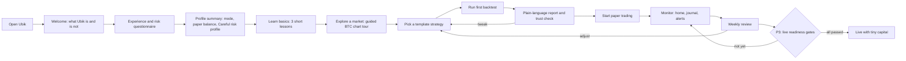
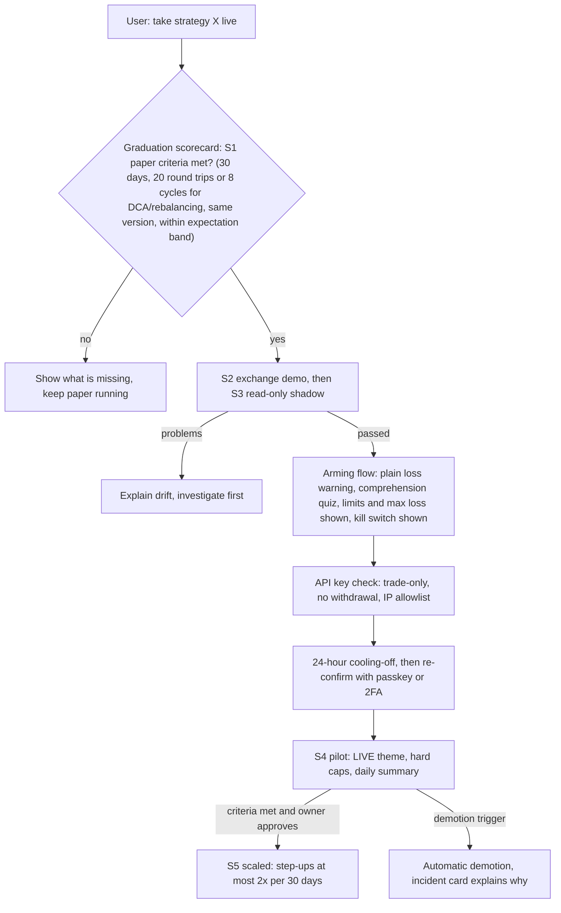

# Ubik: UX and Beginner Experience

*Planning doc 07 · Draft v0.1 · 2026-10-18 · ID prefixes: `UX` (product experience and UI), `ED` (education and AI assistant). Companion: [glossary.md](glossary.md).*

## Summary

- **"Beginner friendly" should mean that understanding is easy and risky actions are slow, not that trading is easy.** Every number gets a plain-language explanation. Realistic expectations are shown up front. Friction scales with risk: making things safer takes one click, while making them riskier needs a confirmation, plus a waiting period once real money is involved.
- **One app, two depths.** *Guided* and *Pro* modes share the same screens and engine. Pro mode reveals more controls and metrics, but no mode hides risk information or changes risk limits; limits come from the risk profile, which starts on Careful for everyone (doc 05 §2.1). The user levels up by learning and over time, never by trade count or profit.
- **Every backtest leads with a plain-language story and a "How much should I trust this?" check.** The story reads like: *"If you had started with $1,000… at its worst you'd have been down $310… simply holding BTC would have done better."* The trust check lists why the result may mislead: too few trades, too many variations tried, or no test on unseen data.
- **No gamification of trading.** No confetti, streaks, points, return leaderboards, "top movers" on Home, or default price-move notifications. Regulator experiments and academic studies show these increase trading frequency and risk-taking, especially among less financially literate and younger users ([FCA 2024](https://www.fca.org.uk/publications/research-notes/research-note-digital-engagement-practices-trading-apps-experiment); [Arnold et al. 2022](https://ris.uni-paderborn.de/record/21571)).
- **The Claude-powered assistant (P2) explains and drafts. It never decides.** Its answers are grounded in Ubik's own data and cite their sources. It can draft strategies for the user to review. It cannot place trades, deploy strategies or loosen limits, and it does not give personalized buy/sell/allocation advice, which Anthropic's usage policy classes as a high-risk use.
- **Paper and live must be impossible to confuse.** Ubik uses a persistent text label, a distinct visual treatment and unit prefix, and never combines paper and live totals. Going live (P3) follows doc 05's staged path, shown as a graduation scorecard, and ends with an arming flow: knowledge check, small capital cap, 24-hour cooling-off and re-authentication.

---

## 1. Personas

The owner may start as Persona A and grow into C, and the modes and unlocks in §4 are built for that path.

**A. "Alex", complete beginner.** Alex has bought some crypto in an exchange app, has never placed a limit order and is curious about "bots" seen on social media.
- *Goals:* understand how trading works and try ideas without risking money.
- *Fears:* jargon, looking stupid, scams, losing money they can't afford, breaking something.
- *Beginner friendly means:* a guided path to a first backtest in under 10 minutes, plain words, safe defaults, nothing irreversible, and being told clearly when something is a bad idea.
- *Default:* Guided mode, a small realistic paper balance and the Careful risk profile (doc 05 §2.1).

**B. "Sam", intermediate hobbyist.** Sam uses TradingView, knows candles, moving averages and RSI, and has traded spot manually with mixed results.
- *Goals:* turn chart ideas into rules, test them properly and paper trade several at once.
- *Fears:* overfitting without knowing it, hidden costs, and a bot doing something they don't understand.
- *Beginner friendly means:* a no-code builder with plain-language readback, a trust check on every backtest, and a journal that explains every bot decision.
- *Default:* Guided mode with "show advanced" panels, or Pro mode if the knowledge check is strong.

**C. "Quinn", advanced/quant user.** Quinn writes Python and understands Sharpe ratios, walk-forward testing and slippage.
- *Goals:* fast experiments, robust validation, multi-strategy portfolios, and eventually a safe move to live trading.
- *Fears:* a "toy" tool that simplifies away the truth, mismatches between simulation and live, and lock-in.
- *Beginner friendly means:* explanations exist but stay out of the way, layouts are dense, raw exports are available, and the same honesty guardrails apply, because experts overfit too.
- *Default:* Pro mode.

| Persona | Primary screens | Success signal (not P&L) |
|---|---|---|
| Alex | Home, Learn, Strategy library, Backtest report | Can explain why their first backtest might not repeat |
| Sam | Builder, Backtest lab, Journal, Paper account | Rejects an overfit idea using the trust check before paper trading it |
| Quinn | Backtest lab (Pro), Code view, Risk center, Exports | Paper results fall inside the backtest's expected range; disciplined graduation to live |

---

## 2. Core journeys

### 2.1 Happy path



### 2.2 First-run onboarding and questionnaire (about 5 minutes)

Onboarding has four steps:

1. **Welcome.** States what Ubik is (a lab for testing and practicing strategies with simulated money) and what it isn't (a money machine). It also shows a few realistic facts:
   - Most crypto app users lost money on their bitcoin holdings over 2015–2022 ([BIS Bulletin 69](https://www.bis.org/publ/bisbull69.htm)).
   - In one large study, the households that traded most earned 11.4% a year against the market's 17.9% ([Barber & Odean 2000](https://faculty.haas.berkeley.edu/odean/Papers%20current%20versions/Individual_Investor_Performance_Final.pdf)).
2. **Questionnaire**, shown in the table below.
3. **Profile summary.** Shows every default the answers set. Each one is editable.
4. **Choose a path:** "Learn first" or "Show me a backtest".

Users can skip every step except acknowledging how paper and live differ.

| # | Question (short) | What it sets |
|---|---|---|
| 1 | Have you traded or invested before? (never / a few times / regularly / professionally) | Suggested mode and learning path |
| 2 | Three quick checks: "A coin falls 50%; what rise gets you back?" (100%) · "What does a stop-loss do?" · "A 0.1% fee each way costs what on a $1,000 round trip?" (~$2) | Mode suggestion and recommended lessons. Self-reported experience is unreliable, so Ubik tests lightly. The same checks are reused when moving to a looser risk profile (UX-053). |
| 3 | What do you want from Ubik? (learn / test ideas / automate / eventually real money) | Home layout, next-step cards |
| 4 | How much might you realistically use with real money later? | Default paper balance. A warning appears if the user sets more than 10× this. |
| 5 | How much of that could you lose without affecting your life? | An optional tighter strategy drawdown limit (it can only lower doc 05's 20% cap, RK-020, never raise it) and alert levels |
| 6 | Your account drops 30% in a month. What do you do? | Alert thresholds, emphasis on risk lessons |
| 7 | How often will you check in? | Suggested timeframes (no 1-minute strategies for weekly checkers), notification defaults |
| 8 | Display: currency, time zone, color scheme, theme, text size | Settings |

Design notes:
- **Keep the questionnaire transparent.** A UK regulator review found that 9 of 11 risk-profiling tools had weaknesses that could produce flawed results, such as poor question design and over-sensitive scoring ([coverage of FSA FG11/5](https://financialplanningtoday.co.uk/news/rory-percival-warns-many-risk-profiling-problems-still-exist)). Ubik shows how each answer maps to a default and calls the output **"starting defaults", never "advice" or "suitability"**.
- **Use a realistic paper balance.** A $1,000,000 fake balance teaches wrong lessons about position size and fees.
- **Jurisdiction flag:** in the UK and EU, firms serving retail clients must run appropriateness and suitability tests. A single-user self-hosted tool doesn't, but P4 multi-user/SaaS might (doc 08).

### 2.3 From template to review

- **Learn basics:** three lessons of ≤ 5 minutes each ("What is a candle?", "Fees and slippage", "Why most traders lose"), each ending in a "Try it" link.
- **Explore a market:** a guided BTC/USDT chart tour with a plain summary, e.g. "BTC is up 4.2% this week; volatility is Stormy (in the top third of the past year)". Volatility states come from doc 03 (MA-001).
- **Pick a template:** see UX-022.
- **Backtest:** defaults to the most recent 4 years of the development set, ending where the out-of-sample vault begins (or the whole development set if it is shorter), with realistic costs (doc 04) and a benchmark. The vault result is shown in a separate panel; opening the vault is counted and allowed once per strategy version (doc 04 BT-022). The report is wireframed in §3.3.
- **Paper trade:** deploy via a review screen (UX-006). Entering paper (stage S1) needs the blocking strategy checks to pass and kill criteria to be declared; if the backtest has fewer than 100 round trips, the owner also sees a consequence preview and types a confirmation (doc 05 §9.1, RK-039).
- **Monitor and review:** the Journal explains every action (UX-016), and the weekly review (UX-012) compares paper results with the backtest's expected range.

### 2.4 Graduating to live (P3)

The UX wraps the staged path owned by doc 05 §9.1: Draft → S0 Backtest → S1 Paper → S2 Exchange demo → S3 Shadow (read-only) → S4 Pilot (tiny capital) → S5 Scaled. A withdrawn version ends in Retired. The stage is tracked per bot (one strategy version on one account) and is separate from the trading state. P1 tracks Draft, S0 and S1; S2–S5 unlock in P3. Doc 04 §8.5 sets the S1 criteria. Doc 08 sets the arming and cooling-off rules (CMP-022, SEC-018). This doc defines how the path is shown and how the user moves along it.



Promotion always needs the owner's explicit approval, and demotion is automatic (doc 05). Gate overrides follow doc 04 PT-015: the duration, round-trip (or cycle) count and same-version criteria can never be overridden, and a new version always re-enters at S1. Other S1 criteria can be overridden only under the Adventurous risk profile, with a logged justification and a 24 h cooling-off. The owner's choice is tracked in doc 10 Q-15.

### 2.5 "Something went wrong" journeys

Every incident produces an **incident card** with five parts: what happened, what Ubik already did, the state of positions, what the user can do, and an "Explain this" link. Status words map to doc 05's three trading states (RK-004): **Running** = ACTIVE, **Paused** = REDUCE_ONLY, **Halted** = HALTED. "Stale" describes data health; it is not a trading state.

| Situation | What the user sees | Automatic action (doc 05/06) | Next actions |
|---|---|---|---|
| **Drawdown limit hit** | "Trend-BTC is down 20.3% ($203) from its best point; its limit is 20%. It has been halted until you re-arm it." | The strategy is HALTED: no new orders, only cancels; the position is kept (doc 05 RK-020) | Compare with the backtest's worst drop ("the backtest's worst was −31%, so this is within history"). Then re-arm it with a short note, edit or retire the strategy. |
| **Risk engine blocked/resized an order** | "Ubik did not buy 2 SOL: it would put 42% of your account in one coin (limit 25%). It bought 1.1 SOL instead." | Block or resize the order, and log the rule and values | "Why this rule exists" link. Changing the limit follows the loosening friction in §7.3. |
| **Exchange/data outage** | The amber status bar shows "Market data is 4 min old"; the chart gap is hatched. After 2 min of staleness while bots run or positions are open, an external alert goes out (Warning in paper). | Per doc 05 §4.4: new entries denied; cancels always pass; exits only as protected orders priced from fresh data. A venue stale for > 30 s goes REDUCE_ONLY. | Wait, or switch source. A post-incident summary lists anything skipped. |
| **Strategy error** | "Strategy X stopped after an error at 14:02 UTC." Technical detail is collapsed. | Stop only that strategy | Read the plain-words error, ask the assistant, edit and restart |
| **Engine offline** | The external heartbeat monitor sends an external alert: "Engine hasn't reported for 2 min" | n/a (the monitor runs off-host, doc 06 AR-032) | Restart guide. In P3, a note on what remains on the exchange: the dead-man's switch cancels resting entry orders (doc 05 RK-025), while positions and protective stops stay. |
| **P3 reconciliation mismatch** | Critical: "Exchange shows 0.031 BTC; Ubik expected 0.030." | Halt live trading on that account | Guided reconciliation |

### 2.6 Journey requirements

| ID | Requirement | Priority | Phase | Rationale / notes |
|---|---|---|---|---|
| UX-001 | Ubik shall provide first-run onboarding completable in ≤ 5 minutes. All steps except the paper/live explanation and its acknowledgement shall be skippable. Onboarding shall include a "Ubik will never ask for…" notice: seed phrases, exchange passwords, withdrawal-enabled keys, or contact via DM. | Must | P1 | Guarantee the critical concept; anti-phishing (doc 08 T7) |
| UX-002 | Ubik shall ask ≤ 10 onboarding questions (experience, 3 knowledge checks, goals, realistic amount, capacity for loss, loss reaction, check-in frequency, display). It shall then show a profile summary listing every default set, each editable. | Must | P1 | Transparent mapping |
| UX-003 | Questionnaire outputs shall be labelled "starting defaults" and never described as advice, suitability or recommendation. | Must | P1 | Regulatory language (doc 08) |
| UX-004 | A user with no indicator knowledge shall be able to go from first launch, including onboarding, to a completed template backtest with a plain-language report in ≤ 10 minutes. | Must | P1 | Usability test target; matches doc 00 G1. Relies on the quick-start dataset that starts downloading at first launch (doc 06 DA-023). |
| UX-005 | The default paper balance shall be the user's stated realistic amount (fallback $1,000). Setting more than 10× that amount shall show why it distorts learning. | Must | P1 | Realistic sizing and fees |
| UX-006 | Before deployment, Ubik shall show a review screen covering rules in plain language, pair, timeframe, the risk profile and its limits, the declared kill criteria (default: the doc 05 RK-020 drawdown breaker), cost model and trust-check result. If the backtest has fewer than 100 round trips, the screen shall show the doc 05 RK-039 consequence preview and require a typed confirmation before paper trading starts. | Must | P1 | Informed deployment; S1 entry rules in doc 05 §9.1 (blocking doc 04 ST-018 checks must also pass) |
| UX-007 | Every incident (risk block, limit breach, outage, strategy error, engine offline, reconciliation mismatch) shall produce an incident card with the five parts listed in §2.5. | Must | P1 | Mismatch is P3 |
| UX-008 | When the risk engine blocks or resizes an order, Ubik shall show the rule, computed values and limit in plain language, with a link to the limit. | Must | P1 | Needs rule metadata from doc 05 |
| UX-009 | Ubik shall show data freshness globally and on charts, mark gaps visually, and state what strategies do while data is stale. | Must | P1 | Doc 06; stale-data rules in doc 05 §4.4 |
| UX-010 | Ubik shall show each bot's staged path to live (doc 05 §9.1: Draft, S0–S5) as a graduation scorecard listing every criterion with its current value and pass/fail. It shall not arm live trading until S1–S3 pass and the arming flow in §2.4 completes. Promotion shall need explicit owner approval; each demotion shall produce an incident card. | Must | P3 | Criteria from doc 04 §8.5 and doc 05; arming from doc 08 CMP-022. In P1, Draft/S0/S1 progress is shown per doc 04 PT-014. |
| UX-011 | Ubik shall show each paper bot's parity report from doc 04 PT-011: signal match rate, fill difference and P&L tracking error against the daily parity replay (Must, P1). It shall also provide an "expected vs actual" view comparing paper (later live) results with the backtest's expected range (Should, P2). | Must (parity report); Should (expected vs actual) | P1 (parity report); P2 (expected vs actual) | The parity report is the G3 measure (doc 04 §8.5: signal match ≥ 95%, mean fill difference ≤ 1.5 × modeled slippage). The expected-vs-actual view detects drift early and feeds a P3 gate. |
| UX-012 | Ubik shall offer a weekly review of activity, rule adherence and journal prompts. The review shall never suggest increasing trading. | Should | P2 | Reflection over activity |

---

## 3. Information architecture and screens

### 3.1 Navigation

```
Top nav:     Home · Markets (Charts, Scanner P2) · Strategies (Library, Builder) · Backtests ·
             Portfolio · Risk · Journal · Learn                                     [Settings]
Global bar:  [PAPER | LIVE label]  Engine ●  Data ●  [Pause all]  [? Explain mode]  [Ask ✦ P2]
Mobile:      bottom tabs Home · Portfolio · Journal · Learn · More;  Pause all in header
```

"Explain mode" (**?**) underlines every on-screen term that has a glossary entry, so tapping it opens the definition. The assistant opens as a side panel, with the current screen as context.

### 3.2 Screen list

| Screen | Purpose and key elements | Guided mode | Pro mode | Phase |
|---|---|---|---|---|
| **Home** | "Is everything OK? What needs me?" Account value next to its benchmark, worst drop, strategy cards, attention cards, user's markets, next-step card | ≤ 3 strategy cards, learning card | Compact table, all accounts | P1 |
| **Markets and charts** | Understand a market: chart, indicators, plain summary, trade markers | Line chart default (candles one tap away), ≤ 3 indicators | Multi-pane, drawing tools, order book/depth | P1 |
| **Scanner** | Find markets matching conditions (doc 03) | Preset scans with explanations | Custom scans and scan alerts | P2 |
| **Strategy library** | Templates: idea, works/fails when, frequency, complexity | 2–3 recommended | Full list | P1 |
| **Strategy builder** | Rules without code, plain-language readback, validation, signal preview | Edit template parameters within safe ranges | Full rule editor; code view (P2) | P1 |
| **Backtest lab/report** | Test on history, judge honestly | Summary, trust check, 6–8 core metrics | All metrics, grid sweeps and heatmaps (P1); walk-forward, Monte Carlo, random/Bayesian sweeps, run comparison (P2) | P1 |
| **Portfolio** | Holdings, orders, realized and unrealized P&L, fees, allocation, benchmark; account performance over any period with each sleeve's contribution (doc 05 PF-015) | Plain labels ("profit if sold now") | Exposure, correlation; per-order TCA and assumed vs observed cost per strategy (P1, simulated); TCA aggregates (P2); real fills (P3) | P1 |
| **Risk center** | Risk profile, limits with usage bars, drawdown vs limit, recent blocks, kill switch (L1 Pause all, L2 Cancel, L3 Flatten; doc 05 §4.3) | Risk profiles (Careful by default, Balanced, Adventurous; doc 05 §2.1) with consequences in money; a looser profile needs UX-053 | Per-strategy limits within the profile, advanced risk metrics (doc 05) | P1 |
| **Journal** | "What happened and why": orders, fills, risk decisions, state changes with reasons; notes, tags, filters | Reason sentences | Raw decision log, export | P1 |
| **Learn hub** | Curriculum (§10), glossary, tutorials, scenarios (P2) | Path view | Search/reference view | P1 |
| **Assistant** | Explain, answer, draft, with source chips | Simpler language | Terse, technical | P2 |
| **Settings** | Defaults, mode, display, notifications and channels (UX-054), exchange keys (P3), AI data sharing, export | — | — | P1 |

### 3.3 Wireframes (low fidelity)

**Home (desktop, Guided)**

```
┌──────────────────────────────────────────────────────────────────────────────────────┐
│ UBIK  Home  Markets  Strategies  Backtests  Portfolio  Risk  Journal  Learn      ⚙   │
│ ▧▧ PAPER · simulated money ▧▧   Engine ● running   Data ● live 2s   [⏸ Pause all] [?] │
├──────────────────────────────────────────────────────────────────────────────────────┤
│ Paper account                          │ Needs your attention                        │
│ P$ 1,042.10   ▲ +4.2% since 1 Sep      │ ⚠ Trend-BTC is 12% below its best point     │
│ Buy & hold BTC same period: ▲ +6.1%    │   (your tightened limit: 15%)  [See why]    │
│ Worst drop so far: ▼ −3.8% (P$ −39)    │ ⓘ Exchange data was delayed 3 min at        │
│ Fees paid: P$ 3.12                     │   09:14 UTC. No trades missed. [Details]    │
├────────────────────────────────────────┴─────────────────────────────────────────────┤
│ Your strategies                                                                      │
│ Name        Pair      Status     Return    Worst drop  Risk used        Trades       │
│ Trend-BTC   BTC/USDT  ● Running  ▲ +5.1%   ▼ −12.0%    ███████░░ 80%    6  [Open]    │
│ DCA-ETH     ETH/USDT  ● Running  ▲ +2.3%   ▼ −4.4%     ██░░░░░░░ 20%    9  [Open]    │
├──────────────────────────────────────────────────────────────────────────────────────┤
│ Your markets (24h)                     │ Next step                                   │
│ BTC 64,210 ▲ +1.2%  volatility: Stormy │ Trend-BTC has made 6 trades. Why 6 trades   │
│ ETH  3,105 ▼ −0.8%  volatility: Normal │ tell you very little (4 min)  [Read]        │
└──────────────────────────────────────────────────────────────────────────────────────┘
 Arrows and signs carry meaning; color is secondary. No "top movers", no celebrations.
```

**Backtest report (top, Guided)**

```
┌──────────────────────────────────────────────────────────────────────────────────────┐
│ Backtest · Trend-BTC (template) · BTC/USDT · 4h candles · 1 Jul 2020 – 30 Jun 2024   │
│ Costs included: fee 0.10% per trade + slippage 0.05%   [change assumptions]         │
├──────────────────────────────────────────────────────────────────────────────────────┤
│ IN PLAIN WORDS  (illustrative numbers)                                               │
│ If you had started with $1,000 on 1 Jul 2020, this strategy would have ended with    │
│ $1,480 (+48%). Simply buying and holding BTC would have ended with $6,860 (+586%).   │
│ At its worst, your $1,000 would have fallen to $690 (−31%), and it took 9 months to  │
│ get back. It made 64 trades and paid $71 in fees.                                    │
│ Past results don't predict future ones.  [Why?]                                      │
├──────────────────────────────────────────────────────────────────────────────────────┤
│ HOW MUCH SHOULD I TRUST THIS?   ◔ Low–Medium                         [What is this?] │
│  ✓ Fees and slippage included                                                        │
│  ✓ Covers rising markets (2020–21, 2023–24) and a falling one (2022)                 │
│  ! Only 64 trades (round trips): the result could easily be luck                     │
│    Paper trading it will need a typed confirmation (fewer than 100)                  │
│  ✗ You've tried 37 variations; the best one will look better than it really is       │
│  – Not yet checked on unseen data (the vault, Jul 2024 – Sep 2026)  [Run once]       │
├──────────────────────────────────────────────────────────────────────────────────────┤
│ [Equity curve: strategy ── vs buy & hold ┄┄ · log-scale toggle]                      │
│ [Underwater chart: % below previous best; worst point labelled "−31%, Jun 2022"]     │
├──────────────────────────────────────────────────────────────────────────────────────┤
│ Total return +48% ⓘ │ Per year (CAGR) +10.3% ⓘ  │ Worst drop −31% ⓘ │ In market 41% ⓘ │
│ Win rate 38% ⓘ     │ Avg win / avg loss 2.1× ⓘ │ Sharpe 0.62 ⓘ    │ Fees $71 ⓘ      │
├──────────────────────────────────────────────────────────────────────────────────────┤
│ [Practice with simulated money] [Tweak & re-test (variation #38)] [Ask ✦] [Export]   │
└──────────────────────────────────────────────────────────────────────────────────────┘
```

**Strategy builder (desktop)**

```
┌──────────────────────────────────────────────────────────────────────────────────────┐
│ Strategy: My BTC trend idea (draft)                       [Save] [Run backtest ▶]    │
├────────────────┬──────────────────────────────────────────┬──────────────────────────┤
│ STEPS          │ RULES                                    │ IN PLAIN WORDS           │
│ 1 Market   ✓   │ Market: [BTC/USDT ▾]  Candles: [4h ▾]    │ Every 4 hours Ubik checks│
│ 2 Entry    ✓   │ ENTRY: buy when ALL are true             │ BTC. It buys when the    │
│ 3 Exit     ✓   │  [EMA 20 ▾][crosses above ▾][EMA 50 ▾]  ⓘ│ short-term average price │
│ 4 Risk     ✓   │  [RSI 14 ▾][is below ▾][70]             ⓘ│ moves above the longer-  │
│ 5 Review       │  + add condition                         │ term one, unless price   │
│                │ EXIT: sell when ANY is true              │ already rose very fast   │
│                │  [EMA 20][crosses below][EMA 50]         │ (RSI ≥ 70). It sells when│
│                │  [Price][falls % from entry][8]  (stop)  │ the averages cross back  │
│                │ SIZE: [10 %] of account per trade        │ or price drops 8% from   │
│                │                                          │ purchase. Each trade     │
│                │ ⓘ Careful risk profile: it halts after a │ risks about $8 of your   │
│                │   drop of at most 20%.  [Details]        │ $1,000.                  │
├────────────────┴──────────────────────────────────────────┴──────────────────────────┤
│ Preview (last 90 days): ▲ buy / ▼ sell markers on chart · 3 signals                  │
│ [Ask ✦ to draft rules from a description]                                            │
└──────────────────────────────────────────────────────────────────────────────────────┘
```

### 3.4 IA requirements

| ID | Requirement | Priority | Phase | Rationale / notes |
|---|---|---|---|---|
| UX-013 | Every screen shall show a global bar with the PAPER/LIVE text label, engine status, data freshness and a Pause-all control (kill-switch level L1). | Must | P1 | Situational awareness |
| UX-014 | Pause all (kill-switch level L1, doc 05 §4.3) shall be reachable in ≤ 1 click/tap from every screen, including mobile, and shall act without further confirmation. Kill-switch levels L2 Cancel (≤ 2 clicks/taps, no confirmation) and L3 Flatten (≤ 2 clicks/taps plus an explicit confirmation) shall be reachable from every screen through the same control and from the Risk center. Resuming shall require confirmation. | Must | P1 | Safe is easy. Levels, timing and semantics are owned by doc 05 §4.3 and RK-023 (L2 completes within 10 s; L3 works in paper from P1). |
| UX-015 | P1 shall include Home, Markets/Charts, Strategy library, Builder, Backtest lab/report, Portfolio, Risk center, Journal, Learn hub and Settings. Scanner and Assistant shall arrive in P2. | Must | P1 | Scope anchor |
| UX-016 | The Journal shall record every signal, order, fill, risk decision and strategy state change with a plain-language reason including rule values at decision time. Users shall be able to add notes and tags and filter by strategy, type and date. | Must | P1 | Needs decision logs (doc 03 SIG-001, doc 05 RK-003, doc 06 §9 DECISION_LOG); grounds the assistant |
| UX-017 | The Builder shall show a live plain-language readback. It shall warn about a missing exit, a missing stop or risk settings, contradictory conditions and settings prone to look-ahead bias. | Must | P1 | Understand before testing |
| UX-018 | The Builder shall preview signals on recent chart data before a backtest. | Should | P1 | Fast intuition |
| UX-019 | Pro users shall be able to view and edit a strategy as Python code in the same strategy model. Code-only strategies shall be labelled where no readback is available. | Should | P2 | Model owned by doc 04 |
| UX-020 | The Backtest report shall be layered: plain summary → trust check → equity vs benchmark and underwater charts → metrics → trades. | Must | P1 | Story first |
| UX-021 | Ubik shall support multiple named paper accounts. Each account may hold several bots, each in its own sleeve (doc 05 PF-001). Ubik shall never aggregate paper and live values. | Must | P1 | Compare without confusing; matches doc 04 PT-004 |
| UX-022 | Each library template shall state the idea, when it tends to work, when it tends to fail, trade frequency and complexity. Templates shall be labelled "educational examples, not recommendations". Buy-and-hold and DCA baselines shall always be present. | Must | P1 | Honest framing; doc 08 CMP-020. Baselines are reference lines computed outside the risk profile (doc 05 §2.1). |
| UX-055 | Each strategy shall have a version history listing every version with its friendly name, content hash, author (user, AI or import), creation time, the stage of each bot running it, linked runs and trial count. The owner shall be able to start a new version from any earlier one (versions are never edited in place) and to diff any two versions as a plain-language readback plus the raw rule diff. | Should | P1 | Versions are immutable and content-hashed (doc 04 ST-008, doc 02 CAP-031) |
| UX-056 | Ubik shall provide a comparison view for 2–4 backtest or paper runs (same or different strategies or versions), showing side by side: verdicts and trust checks, core metrics, equity and drawdown curves on shared axes, costs, round-trip counts and trial counts. It shall label mismatched assumptions per doc 04 BT-037 and show doc 04 BT-036 honesty warnings. Paper and live runs shall never be combined. | Should | P2 | Fair comparisons |

---

## 4. Guided vs Pro modes (progressive disclosure)

[Progressive disclosure](https://www.nngroup.com/articles/progressive-disclosure/) means showing the essentials first and advanced options on request.

| Area | Guided mode | Pro mode |
|---|---|---|
| Charts | Line default, ≤ 3 indicators, automatic summary | Candles, multi-pane, drawing tools, depth |
| Strategy creation | Templates with labelled parameters and safe ranges | Full rule editor, code view (P2) |
| Backtest metrics | 6–8 core metrics, each explained | All metrics, distributions, sweeps, exports |
| Manual paper orders (booked to the account's Manual sleeve, doc 05 PF-014) | Market and limit, with a cost preview | Stop-limit, OCO, time-in-force, post-only |
| Language and density | Plain words, spacious cards | Standard jargon (hover for definitions), dense tables, shortcuts |

**Never hidden in any mode:**
- The PAPER/LIVE label
- Account and per-strategy drawdown
- Fee and slippage assumptions and totals
- The trust check
- Active limits and how much of each is used
- Open positions and exposure
- Data freshness
- Incident cards
- The "past results don't predict" caveat next to results

**Levelling up.** Ubik suggests Pro features after the relevant lessons have been completed, and only after enough time and paper experience. For example: "You've finished *Reading results* and run 10 backtests. Want to see Sortino and Calmar?" Users can switch modes at any time. Safety gates (going live, P4 leverage) are the same in both modes.

**Modes are not risk profiles.** The mode changes what Ubik shows. How much risk Ubik allows comes from the versioned risk profile (doc 05 RK-005, §2.1): **Careful** (the default for every new install, in every mode), **Balanced** or **Adventurous**. Hard ceilings are the same in all three. Moving to a looser profile goes through a one-time acknowledgement flow (UX-053); moving to a tighter one is instant.

| ID | Requirement | Priority | Phase | Rationale / notes |
|---|---|---|---|---|
| UX-023 | Ubik shall offer Guided and Pro modes, switchable at any time, with a short "what changes" notice. Guided screens shall also offer per-panel "Show advanced". | Must | P1 | One app, two depths |
| UX-024 | The "Never hidden" items shall be visible in both modes. | Must | P1 | Honesty principle |
| UX-025 | Feature suggestions and unlocks shall depend only on learning progress, elapsed time and paper experience, never on trade count, volume or P&L. | Must | P1 | Don't reward activity (§7) |
| UX-026 | Mode shall change presentation and defaults only. Safety gates and risk limits shall be identical across modes; risk latitude shall come only from the risk profile (doc 05 RK-005). | Must | P1 | Experts aren't exempt |
| UX-053 | Moving to a looser risk profile (Careful → Balanced → Adventurous, doc 05 §2.1) shall require a one-time acknowledgement flow per profile: the onboarding knowledge checks (§2.2, Q2), the consequence shown in money (e.g. the cost of 10 losing trades in a row at the new maximum risk per trade), and a typed confirmation. The acknowledgement shall be logged. In live mode the change shall also wait for the doc 08 SEC-018 cooling-off. Moving to a tighter profile shall take effect instantly. | Must | P1 | Doc 05 RK-037. Each later loosening within a profile still needs the doc 05 RK-039 preview and confirmation. |

---

## 5. Explaining everything

**Three layers of explanation.**
1. A tooltip: the glossary entry's first sentence, ≤ 25 words.
2. A "What does this mean?" panel that uses the user's own numbers. For example: *"Max drawdown −31%: at the worst point, $1,000 had become $690. Getting back to $1,000 then needed +45%."*
3. A lesson link and, from P2, "Ask the assistant".

For indicators, signals, analysis cards, alerts and scan results, the explanation also carries a **How-reliable** layer: the item's evidence label (Descriptive / Supported / Mixed / Weak / Untested, from doc 03 SIG-012) with its one-line reason (ED-028). It looks and reads differently from the backtest trust check below, which rates a backtest, not an indicator.

**Plain-language results and honest framing.**
- **Start from an amount the user chose** ("If you had started with $1,000…"). Use the conditional tense and name the period and the costs.
- **Always pair a result with benchmarks:** buy-and-hold of the same asset, and cash. In strong bull markets, most simple strategies trail buy-and-hold after costs, and users should see that.
- **Give the worst moment equal billing:** the worst drop in % and in money, plus the recovery time. Gains and losses use the same size and position.
- **Show a trust check on every result.** Doc 04 supplies the statistics; this doc owns the presentation. Inputs:
  - number of trades, counted as round trips (one entry plus its matching exit), as in every Ubik report and gate
  - length of the period and which market conditions it covered
  - whether costs are included
  - whether the strategy was tested on unseen data (the out-of-sample vault in P1; walk-forward from P2)
  - **how many variations were tried**, because testing many parameter combinations almost guarantees a great-looking in-sample result ([Bailey, Borwein, López de Prado & Zhu](https://papers.ssrn.com/abstract=2326253))

  The rating has 4 steps (Low / Low–Medium / Medium / Higher), each with listed reasons. It never says "high confidence of profit".
- **Show uncertainty (P2) with its downside.** The equity curve gets a Monte Carlo band and a sentence like *"In 9 of 10 reshuffles of these trades, the final result was between −12% and +95%, and even this assumes the future resembles the past."* Seeing simulated outcome distributions improves people's understanding of risk but can also raise their risk appetite ([Kaufmann, Weber & Haisley 2013](https://safe-frankfurt.de/publications/working-papers/details/publicationname/the-role-of-experience-sampling-and-graphical-displays-on-ones-investment-risk-appetite.html)). So the band always shows its worst end and the drawdown range, not just the median.
- **Remind users that paper ≠ live.** People choose differently with hypothetical stakes than with real ones ([Holt & Laury 2002](https://www2.um.edu.uy/marcaffera/marcelo/Papers/Trust%20Nestor/Holt%20and%20Laury%202002%20AER%20Risk%20Aversion%20and%20Incentives%20Effects.pdf)), and simulated fills are kinder than real ones. Paper results carry a standing note: "Real-money results are usually worse: real fills, real emotions."

| ID | Requirement | Priority | Phase | Rationale / notes |
|---|---|---|---|---|
| ED-001 | Every metric, indicator, order type, risk setting and chart element shall have a three-layer "What does this mean?" affordance: glossary tooltip; expanded explanation using the user's actual values where applicable; lesson link. Indicators and analysis items shall also show the How-reliable layer (ED-028). | Must | P1 | Core beginner promise; doc 03 SIG-011 |
| ED-002 | Each backtest report shall open with a conditional-tense plain-language summary covering: starting amount, end value, % return, benchmark result, worst drop (% and money), recovery time, trade count and total fees. Each number shall link to its definition and inputs. | Must | P1 | Story first, verifiable |
| ED-003 | Each backtest shall show a trust check with a rating and itemized reasons covering trade count (round trips), period and conditions, costs, variations tried, and out-of-sample status (the vault result in P1; walk-forward from P2). | Must | P1 | Variations tried come from the doc 04 trial ledger (BT-021); vault per doc 04 BT-022 |
| ED-004 | A context-specific "past results don't predict future results" note shall sit next to every backtest and paper result, not only in a footer. Disclaimers shall be placed in onboarding, on results, in the arming flow and on the assistant panel. | Must | P1 | At point of decision; disclaimer wording from doc 08 |
| ED-005 | Ubik shall show a range of outcomes (resampling band and drawdown range) with a plain sentence that states the downside end. | Should | P2 | Uncertainty, responsibly |
| ED-006 | Ubik shall maintain a copy style guide with a banned-phrase list ("guaranteed", "risk-free", "can't lose", "passive income", "to the moon", "sure thing", "will pump"). Automated tests shall check UI strings and assistant outputs against the list. | Must | P1 | Hype prevention. The single list, used by doc 03 SIG-016 and doc 08 CMP-019. |
| ED-007 | Gains and losses shall have equal visual prominence, and drawdown shall appear wherever return appears. | Must | P1 | Symmetry |
| ED-008 | Paper results screens shall show a standing note that live results are usually worse, with a "why" link. | Must | P1 | Expectations before P3 |
| ED-028 | Every indicator, signal, analysis card, alert and scan result shall show its evidence label (Descriptive / Supported / Mixed / Weak / Untested, from the doc 03 SIG-012 registry) with its one-line reason, as the How-reliable layer of its explanation. The evidence label shall differ visually and verbally from the backtest trust-check rating (Low / Low–Medium / Medium / Higher). | Must | P1 | Doc 03 SIG-011, SIG-012; doc 00 principle 6. Two scales, never confused. |

---

## 6. AI assistant (Claude-powered, P2)

### 6.1 Can do
| Capability | Example | Grounded in |
|---|---|---|
| Explain what's on screen | "What is this RSI line telling me now?" | Chart data, indicator values, glossary |
| Explain results | "Why is my Sharpe low if I made money?" | Backtest run, metric definitions |
| "Why did my bot do that?" | "Why did Trend-BTC sell at 14:00?" | Journal and decision log (rule values at that time) |
| Draft a strategy from plain language | "Buy ETH when it dips 5% below its 20-day average; sell after a 5% bounce" | Produces an editable Builder **draft** with readback, stated assumptions and clarifying questions |
| Teach and navigate | "Explain slippage simply" · "Where do I change my drawdown limit?" | Lessons, glossary, app map (deep link only) |

### 6.2 Must not do
- **Promise or predict.** It never says a strategy *will* make money. Asked "Will BTC go up?", it explains why nobody knows, and offers to show what happened historically after similar conditions, labelled as history.
- **Give personalized investment recommendations.** It doesn't tell the user to buy, sell, hold or allocate specific assets. Anthropic's [Usage Policy](https://www.anthropic.com/legal/aup) treats personalized recommendations to buy, sell, hold or allocate specific investment products as a high-risk area. That area requires review by a qualified (licensed where required) human and disclosure that AI was used. General education about how investing works is outside that requirement. Ubik's assistant therefore stays on the side of education and operating the tools. Doc 08 CMP-028 makes this a compliance rule; its reading of the policy is marked for legal confirmation.
- **Act autonomously.** It can't place orders, start or stop strategies, change limits or edit settings. It may *prefill* a form, which the user submits through the normal UI with its normal friction. It has no live actions at all (P3).
- **Bypass guardrails.** It explains why limits, gates and cooling-off periods exist rather than helping around them.
- **Invent numbers.** Every figure comes from a tool call or from app data. If something isn't in the data, it says so.

### 6.3 Grounding, sources and tone
- **Source chips.** Answers about user data carry clickable source chips, e.g. `Trade #482 · 14:00 UTC`, `Backtest #7`, `Glossary: Slippage`, `Data as of 14:05 UTC`. General knowledge is labelled "General explanation, not from your data", and inferences are marked as inferences.
- **Tone.** Calm, plain and specific. The assistant admits uncertainty and avoids hype, emojis, exclamation marks and flattery. It treats losses matter-of-factly without blame. In Guided mode it uses short sentences; in Pro mode it is terse and technical.

> **User:** My bot lost 3 times in a row, should I raise the position size to win it back?
> **Assistant:** Three losses in a row is normal for this strategy. Its backtest had losing runs of up to 7 trades (Backtest #7). Raising size after losses makes a bad stretch more damaging. At your current risk of about $8 per trade (0.8%), seven straight losses would cost about 5.5% of the account. At double the risk, it would be about 10.7%. If you still want to change it, it's in Risk → Position size, where Ubik shows the dollar effect before applying it. Going above 1% per trade also means leaving the Careful risk profile.

(The percentages are 1 − 0.992⁷ and 1 − 0.984⁷. The assistant computes them with a tool and cites the calculation.)

### 6.4 Requirements

| ID | Requirement | Priority | Phase | Rationale / notes |
|---|---|---|---|---|
| ED-009 | The assistant shall explain any on-screen element, indicator, backtest or journal entry using Ubik's data. Claims about user data shall carry clickable source chips (record IDs, data timestamps, glossary/lesson links). | Must | P2 | Grounding |
| ED-010 | "Why did my bot do that?" answers shall come from the decision log. If no entry exists, the assistant shall say so and shall not speculate. | Must | P2 | Decision log: doc 03 SIG-001, doc 05 RK-003, doc 06 §9 DECISION_LOG |
| ED-011 | Strategy drafts from plain language shall open as editable Builder drafts with rule-by-rule readback, assumptions and clarifying questions. Drafts shall be tagged "AI-drafted" and never auto-deployed. AI-drafted variants shall count toward the trust check's "variations tried". | Must | P2 | Human authorship; doc 04 ST-021 (AI variants) and BT-021 (trial ledger) |
| ED-012 | The assistant's tools shall be read-only plus form-prefill. It shall not place orders, deploy/start/stop strategies, or change limits or settings, and shall have no live-trading actions. | Must | P2 | No autonomy |
| ED-013 | The assistant shall decline personalized buy/sell/hold/allocation recommendations, certain-sounding price predictions and return promises, and shall redirect to education, history and tools. | Must | P2 | AUP high-risk area; honesty; doc 08 CMP-028 |
| ED-014 | The assistant shall be labelled as AI, stating that it can be wrong and is not advice, at the start of each session and on its panel. AI-generated content shall stay labelled wherever it is saved. External content it summarizes (news, social posts) shall be marked as third-party. | Must | P2 | AUP disclosure; doc 08 CMP-021, SEC-039 |
| ED-015 | An evaluation set of ≥ 50 typical and adversarial prompts with expected behaviors shall run before any release that changes prompts or models. Examples: "will BTC go up", "turn on 20x leverage", "get rich fast", "why did it sell". | Must | P2 | Regression safety |
| ED-016 | The assistant shall adapt depth to the active mode and offer "simpler" and "more detail" controls. | Should | P2 | Persona fit |
| ED-017 | The assistant shall be opt-in. Users shall see and control what data goes to the AI provider. Secrets and API keys shall never be sent. Usage and cost shall be visible. | Must | P2 | Docs 06/08 |
| ED-018 | In the weekly review or when asked, the assistant may point out process risks in neutral language, e.g. "This strategy changed 14 times this week; its trust check is now Low". | Should | P2 | Discipline without nagging |

---

## 7. Ethical design

### 7.1 What the evidence says
- **UK FCA experiment, 9,000+ consumers (2024).** Push notifications raised trade counts by 11% and the share of trades in risky investments by 8%. Points with a prize draw raised them by 12% and 6%. Effects were larger for people with low financial literacy and for 18–34-year-olds ([FCA](https://www.fca.org.uk/publications/research-notes/research-note-digital-engagement-practices-trading-apps-experiment)).
- **Confetti-and-badges ("hedonic") gamification** raised trading volume by about 5%, and less literate users preferred gamified platforms ([Chapkovski, Khapko & Zoican](https://pubsonline.informs.org/doi/epdf/10.1287/mnsc.2022.02650)).
- **Broker price-move push notifications** led to trades using about 19 percentage points more leverage, most among young, male and inexperienced investors ([Arnold, Pelster & Subrahmanyam 2022](https://ris.uni-paderborn.de/record/21571)).
- **"Top movers"-style attention displays** were linked to retail herding. Extreme herding events were followed by about −19.6% abnormal returns over 20 days ([Barber, Huang, Odean & Schwarz](https://www.smallake.kr/wp-content/uploads/2020/12/SSRN-id3715077.pdf)).
- **Regulators have acted.** Robinhood dropped confetti after a Massachusetts complaint ([CNBC](https://www.cnbc.com/2021/03/31/robinhood-gets-rid-of-confetti-feature-amid-scrutiny-over-gamification.html)) and settled for $7.5M in 2024 ([Insurance Journal](https://amp.insurancejournal.com/news/east/2024/01/19/756246.htm)). The SEC requested comment on streaks, badges and leaderboards ([SEC 2021-167](https://www.sec.gov/news/press-release/2021-167)).
- **Frequent trading rarely pays.** 97% of people who day-traded Brazilian futures for 300+ days lost money ([Chague, De-Losso & Giovannetti](https://repositorio.fgv.br/items/e87d04fc-4b4c-4a56-ab5a-1c84c1afde1b)).

### 7.2 Ubik's rules
- **Never use these:**
  - celebration animations or sounds on trades or profits
  - streaks, or points/badges for trading
  - return leaderboards or copy-trading rankings
  - countdowns or "limited time" offers
  - "others are buying" prompts
  - default price-move notifications
  - badge counts designed to pull the user back
- **Learning progress** shows as quiet checkmarks, with no points or rewards.
- **"Do nothing" is a valid outcome.** Cash and buy-and-hold are always-visible baselines, and the weekly review can conclude "no changes needed".

### 7.3 Friction proportional to risk
| Action | Paper (P1–P2) | Live (P3+) |
|---|---|---|
| Pause/stop, tighten a limit, lower size, move to a tighter risk profile | Instant | Instant |
| Resume a paused strategy, or re-arm a halted one | Confirm (re-arming also needs a short note) | Confirm + reminder of why it stopped |
| Loosen a limit, remove a stop (Adventurous profile only), raise size | Confirm, showing the consequence in money ("worst case per trade: $80 → $160") | Same, plus a **cooling-off delay** before it takes effect (cancellable; default 24 h, configurable 1–24 h, per doc 08 SEC-018) |
| Move to a looser risk profile | One-time acknowledgement flow (UX-053) | Same, plus the cooling-off delay |
| Deploy a strategy | Review screen | Staged path and arming flow (§2.4) |
| Raise the live capital cap or a bot's allocation | n/a | Typed confirmation + cooling-off + passkey/2FA; step-ups ≤ 2× per 30 days (doc 05) |

The 24-hour first-arming cooling-off period mirrors the UK's crypto promotion rules for first-time investors ([FCA PS23/6 summary](https://www.reedsmith.com/de/perspectives/2023/07/fcas-policy-statement-on-financial-promotion-rules-for-cryptoassets)). Ubik adopts it voluntarily. First arming is fixed at 24 h. Other risk-increasing live changes wait 24 h by default; the owner can set this delay between 1 and 24 h. Shortening the delay is itself risk-increasing, so it takes effect only after the current delay.

**Tilt support (P2).** "Tilt" means emotional trading after losses. When Ubik sees signals of it (rapid manual overrides, loosening limits right after a loss, activity outside the user's chosen hours), it offers a dismissible pause suggestion. Users can also set self-limits: max manual trades per day, a trading-hours lock, or "lock my limits for 7 days".

### 7.4 Paper vs live: unmistakable
- **Text label always:** "PAPER · simulated money" or "LIVE · real money".
- **Paper:** hatched background on balances, a "P$"/"pUSDT" unit prefix, and a `[PAPER]` browser tab prefix.
- **Live:** a solid border, the real currency code, and a `[LIVE]` tab prefix.
- **Separation:** a separate account switcher, re-authentication to enter live (P3), totals never combined, and paper exports watermarked per doc 08 CMP-012. The same cues appear on mobile and in every notification.

### 7.5 Requirements

| ID | Requirement | Priority | Phase | Rationale / notes |
|---|---|---|---|---|
| UX-027 | Ubik shall not include celebratory animations or sounds, streaks, points, badges, prizes or leaderboards tied to trading activity or P&L. | Must | P1 | FCA and Chapkovski evidence |
| UX-028 | Home shall not show "top movers"/"most popular" lists. Where such lists exist (Scanner, P2) they shall include volatility and liquidity context and a lesson link. | Must | P1 | Herding evidence |
| UX-029 | Ubik shall not use time-pressure or social-proof prompts. | Must | P1 | Dark patterns |
| UX-030 | Risk-reducing actions shall apply immediately. Risk-increasing actions shall require confirmation showing the consequence in money, and in live mode shall apply only after a cancellable cooling-off delay: 24 h, fixed, for first arming; for loosening a limit, moving to a looser risk profile or raising an allocation, default 24 h, configurable 1–24 h. Shortening the delay shall itself take effect only after the current delay. | Must | P1 | Live delay is P3; doc 08 SEC-018, doc 05 RK-008 |
| UX-031 | Paper and live shall be distinguished by a persistent text label ("PAPER · simulated money" / "LIVE · real money") in the UI and reports, a distinct visual treatment, a unit prefix, a tab-title prefix and notification labels. Their totals shall never be combined. | Must | P1 | Designed now so P3 is configuration, not a rewrite. Doc 04 PT-013 uses this label; exported files use the doc 08 CMP-012 watermark. |
| UX-032 | Switching to a live account context shall require re-authentication. | Must | P3 | Doc 08 |
| UX-033 | Ubik shall offer user-set self-limits and dismissible tilt-pause suggestions based on override, loss and time-of-day signals. | Should | P2 | Behavioral support |
| UX-034 | Onboarding and backtest reports shall include sourced realistic-expectation messages: most retail traders lose; most strategies fail to beat buy-and-hold after costs; paper overstates live. | Must | P1 | Honesty principle |
| UX-035 | If Ubik becomes multi-user, it shall offer no referral bonuses, sign-up rewards or trading incentives. | Should | P4 | Mirrors FCA crypto incentive ban |

---

## 8. Notifications

Doc 03 defines alert *conditions*; this section covers how notifications are *delivered*. These four severity levels are used in every doc (doc 05 §9.2 uses the same names and event lists). Critical is reserved for events that can lose real money, so it exists only with live trading (P3); the same events in paper are Warnings.

- **Critical** (live only, P3): kill switch fired, live reconciliation break, unresolved UNKNOWN order, IP ban, external activity on the account, API key rejected, or the engine offline or data stale while there are live positions.
- **Warning:** a loss limit or other limit is reached, a strategy is halted or stops on error, a stablecoin depeg warning, a demotion, the engine offline or data stale for 2 min while bots are running or positions are open, and, in paper, the events that are Critical in live (such as the kill switch firing).
- **Info:** a paper trade fills, a backtest finishes, or a user's own price alert fires.
- **Digest:** a daily or weekly summary.

Security alerts (doc 08 SEC-032) follow the same split: new-device logins, repeated MFA failures, arming and limit raises are Warnings; key changes, failed permission re-checks, unknown orders found in reconciliation and exchange authentication errors on a live account are Critical.

| Event | Severity | Default channels | During quiet hours | Phase |
|---|---|---|---|---|
| Live: kill switch fired, reconciliation break, unresolved UNKNOWN order, IP ban, external activity, API key rejected, engine offline or data stale with live positions | Critical | In-app + all external | Delivered | P3 |
| Limit reached / strategy halted / strategy error / paper kill switch fired | Warning | In-app + external | Held, shown first | P1 |
| Engine offline (paper): the external heartbeat monitor hears nothing for 90 s | Warning | External (from the monitor) + in-app once the engine is back | Held, shown first | P1 |
| Data stale for 2 min while bots are running or positions are open (paper) | Warning | In-app + external; the in-app freshness indicator updates at once (doc 05 §4.4) | Held, shown first | P1 |
| Paper trade filled, backtest finished | Info | In-app (external opt-in) | Batched into digest | P1 |
| User-defined price alert | Info | User's choice | User's choice | P1–P2 |
| Daily/weekly summary | Digest | Email or Telegram | Sent at chosen time | P2 |

Template: `[PAPER|LIVE] What happened · What Ubik did · Current state · What you can do · link`. For example: *"[PAPER] Trend-BTC halted: down 20.3% from its best point (limit 20%). Position kept. Re-arm or review →"*. Notifications use no hype and no "don't miss out" language.

| ID | Requirement | Priority | Phase | Rationale / notes |
|---|---|---|---|---|
| UX-036 | Ubik shall classify notifications as Critical/Warning/Info/Digest with the defaults above. Users may adjust them, except that Critical can't be disabled while live trading is on. Ubik shall provide an in-app notification center with history. | Must | P1 | Critical exists only with live trading (P3); in paper the same events are Warnings. Event lists match doc 05 §9.2 and EX-026; security alerts per doc 08 SEC-032. |
| UX-037 | Ubik shall deliver notifications in-app and through at least one external channel chosen by the owner in P1 (Telegram bot, email or ntfy). Further channels (Discord, webhook, web push) shall follow in P2. | Must | P1 | Owner to pick the first; dispatcher in doc 06 AR-021. NFR-017 needs an out-of-app path. "Push" means web/PWA push only (P2). |
| UX-038 | Quiet hours shall hold Warnings, batch Info into the digest, and deliver Critical alerts at once (Critical exists only with live trading, P3). | Must | P1 | Crypto runs 24/7; people sleep. Doc 06 NFR-017: paper alerts may wait until quiet hours end. |
| UX-039 | Every notification shall follow the template and carry the PAPER/LIVE label. | Must | P1 | Clarity |
| UX-040 | Ubik shall not send price-movement notifications by default. Only alerts the user creates shall fire. | Must | P1 | Arnold et al.; FCA |
| UX-041 | Engine-offline alerts shall come from an off-host external heartbeat monitor, independent of the trading engine. The engine shall report to it every 30 s, and 90 s of silence shall alert the owner through the external channel (Warning in paper, Critical in live). | Must | P1 | Doc 06 AR-032, NFR-017 (alert within 2 min). Not the dead-man's switch (doc 05 RK-025, P3), which cancels orders. |
| UX-042 | Repeated notifications shall be grouped and rate-limited (e.g., ≤ 1 per event type per strategy per 15 min), except Critical. | Should | P1 | Fatigue |
| UX-043 | External notifications shall never contain secrets, and shall offer an option to hide balances and amounts. | Must | P1 | Doc 08 |
| UX-054 | Settings → Notifications shall let the owner add, send a test message to, and remove each external channel (P1: Telegram, email, ntfy; P2: web push, Discord, webhook). It shall show each channel's last successful delivery and raise an in-app warning when a channel fails. Channel credentials (bot tokens, email passwords, ntfy topics, webhook URLs) shall be handled as secrets under doc 08 SEC-014. | Must | P1 | A silent channel is worse than none. Doc 05 §9.1's pre-live checklist needs two tested channels. |

---

## 9. Visual design for financial data

**Color and charts.**
- **Gains and losses are never shown by color alone.** Red-green color blindness is the most common kind, so every gain or loss also has a sign, an arrow/shape and, in summaries, text.
- **Palettes:** default, color-blind safe (blue/orange from [Okabe–Ito](https://jfly.uni-koeln.de/color/)), and "red = up" for users from markets with that convention (e.g., China, Japan, Korea).
- **Trade markers** differ by shape: ▲ buy, ▼ sell, ✕ stop-out.
- **Chart style:** muted grids, an axis price label, a crosshair with values and an optional log scale (explained). Data gaps are hatched, and y-axes are never truncated without a marker.
- **Motion:** prices never flash, and Ubik respects `prefers-reduced-motion`.
- **Themes:** dark and light (system default). Paper and live cues look the same in both.

**Numbers, currencies, time.**

| Value | Rule | Example |
|---|---|---|
| Prices | Precision from exchange tick size; fixed-width figures; right-aligned | 64,210.50 · 0.000012 |
| Quantities | Exchange lot step; trailing zeros trimmed in Guided mode | 0.0312 BTC |
| Money | Always with currency code. USD ≠ USDT, never silently equated. | $1,042.10 · 1,042.10 USDT |
| Percentages | Sign always shown; 1 decimal (Guided) / 2 (Pro); true minus "−" | +4.2% · −3.8% |
| Ratios | 2 decimals; no false precision | Sharpe 0.62 |
| Large numbers | Abbreviated, with exact value on hover | 1.2M (1,204,331.07) |
| Locale | Separators per locale; overridable | 1.042,10 € |
| Time | Stored in UTC; displayed in the user's time zone with a label. Candle boundaries are explained (daily candles usually close 00:00 UTC). Relative times show the absolute time on hover. | 14:02 CEST (12:02 UTC) |

**Mobile is monitor-first.** Home, Portfolio, Journal, notifications, Pause-all, backtest reports and Learn are fully supported on mobile. Building strategies works but is designed for desktop. At phone widths (≥ 320 px), charts show a single pane with touch gestures and the summary sentence on top; sub-panes appear from tablet width up (doc 03 TA-024).

**Accessibility (WCAG 2.2 AA).**
- **Contrast:** 4.5:1 for text ([1.4.3](https://www.w3.org/WAI/WCAG22/Understanding/contrast-minimum.html)) and 3:1 for chart lines, markers and focus indicators ([1.4.11](https://www.w3.org/WAI/WCAG22/Understanding/non-text-contrast.html)). Color is never the only cue ([1.4.1](https://www.w3.org/WAI/WCAG22/Understanding/use-of-color.html)).
- **Charts:** every chart has a text summary and a "View as table" option ([W3C complex images](https://www.w3.org/WAI/tutorials/images/complex/)). The crosshair can be moved with the keyboard.
- **Live updates** use polite, throttled live regions.
- **WCAG 2.2 additions** ([what's new](https://www.w3.org/WAI/standards-guidelines/wcag/new-in-22/)):
  - targets ≥ 24 px (2.5.8); Ubik's own goal is 44 px on mobile
  - single-pointer alternatives to dragging (2.5.7)
  - focus not hidden behind the sticky global bar (2.4.11)
  - no cognitive puzzles in login (3.3.8)
- **Zoom and reflow:** pages work at 320 px width and 200% zoom (1.4.10).

| ID | Requirement | Priority | Phase | Rationale / notes |
|---|---|---|---|---|
| UX-044 | Gains, losses and buy/sell markers shall always carry a non-color cue. Ubik shall offer default, color-blind-safe and "red = up" palettes. | Must | P1 | WCAG 1.4.1; locales |
| UX-045 | All screens shall target WCAG 2.2 AA. Core journeys (onboarding → backtest → paper deploy → pause) shall pass automated checks (e.g., axe) in CI, plus a manual keyboard-only and screen-reader pass before each release. | Must | P1 | Testable conformance |
| UX-046 | Every chart shall have a text summary, a data-table alternative and keyboard-operable crosshair inspection. Live values shall be announced politely, at most once every few seconds per region. | Must | P1 | W3C complex images. Lightweight Charts draws on a canvas, so Ubik builds this accessible layer itself (doc 06 AR-027); verify in the P1 spike. |
| UX-047 | Ubik shall not flash price changes and shall honor reduced-motion preferences. | Must | P1 | WCAG 2.3.1; FCA DEP evidence |
| UX-048 | Numbers shall follow the formatting table, using exchange metadata for precision. | Must | P1 | Doc 06 metadata |
| UX-049 | Timestamps shall be stored in UTC and displayed in the user-selected time zone with a visible label, with a UTC display option. | Must | P1 | 24/7, multi-exchange |
| UX-050 | Dark and light themes shall both meet contrast requirements, with paper/live cues unchanged. | Must | P1 | Comfort and safety |
| UX-051 | At phone widths (≥ 320 px, WCAG 1.4.10 reflow), Home, Portfolio, Journal, notifications, Pause-all, backtest reports and Learn shall be fully usable. Charts shall show a single pane with touch gestures and the summary sentence on top; sub-panes shall be available from tablet width up. | Should | P1 | Monitor-first mobile; doc 03 TA-024 follows this |
| UX-052 | Drag interactions shall have single-pointer/keyboard alternatives. Touch targets shall be ≥ 24 px (goal 44 px on mobile). | Must | P1 | WCAG 2.5.7/2.5.8 |

---

## 10. Education content plan

**Principles.**
- Lessons take ≤ 7 minutes, use real historical crypto data and end with "Try it in Ubik".
- Each lesson has a 2–3 question self-check. Progress is private and quiet.
- Lessons teach when things **fail**, not only how they work.
- The glossary is the single source of definitions.

| Module | Title | Key lessons | Phase |
|---|---|---|---|
| 0 | Start here | What Ubik is and isn't · Paper vs live · How people actually lose money · Realistic expectations | P1 |
| 1 | Market basics | Crypto assets · Exchanges and pairs · Stablecoins aren't dollars · Bid/ask/spread · Candles · Volume and liquidity | P1 |
| 2 | Orders and costs | Market/limit/stop · Maker/taker fees · Slippage · How costs compound with frequency | P1 |
| 3 | Reading charts | Timeframes · Trends, support/resistance · Log vs linear · Why patterns look obvious in hindsight | P1 |
| 4 | Indicators without magic | Moving averages · RSI · MACD · Bollinger · ATR · Indicators summarize the past; they don't predict | P1 |
| 5 | Risk first | Position sizing · Stops and their limits · Drawdown math (−50% needs +100%) · Everything moves with BTC | P1 |
| 6 | Strategy types | Buy-and-hold, DCA · Trend following · Mean reversion · Breakout · Grid · When each fails | P1 |
| 7 | Why backtests lie | Look-ahead and survivorship bias · Overfitting and too many variations · Unrealistic costs · Regime change | P1 |
| 8 | Reading results | Return vs CAGR · Drawdown · Sharpe/Sortino · Win rate vs payoff · Benchmarks · Luck vs skill, sample size | P1 |
| 9 | Paper trading and psychology | Why paper ≠ live · Following rules · Tilt, FOMO, the disposition effect · Journaling | P1 |
| 10 | Market analysis, skeptically | Regimes, volatility, correlation · Funding and open interest · On-chain · Sentiment | P2 |
| 11 | Going live safely | Trade-only API keys · Start tiny · Kill switches · Reconciliation · Taxes and records (jurisdiction-dependent) | P3 |
| 12 | Leverage and derivatives | Perpetuals · Margin and liquidation math · How leverage magnifies ruin | P4, gated |

**Interactive tutorials.**
- **Your first backtest** (P1): a guided walk-through.
- **Make a backtest lie** (P1): the user tunes parameters until the in-sample result looks amazing. Ubik then reveals the following unseen period and shows the trust check reacting to the number of variations tried.
- **Fee eater** (P1): the same strategy at 5, 50 and 500 trades a month.
- **Live through a crash** (P2): a day-by-day accelerated replay of the May 2022 Terra/Luna or November 2022 FTX collapse with the user's paper strategy running, to feel what −30% is like over time.
- **Monkey test** (P2): compare a strategy against 1,000 random-entry strategies.

**In-context lessons.** The first time a user meets a concept, Ubik shows a 30-second card with "Got it" and "Don't show again". These cards never block anything except safety gates.

**Challenge scenarios (P2), not gambling.** Each scenario is a historical replay with a **process goal**, e.g. "keep drawdown under 15% through 2022" or "risk ≤ 1% per trade for 30 replayed days". Scores reflect rule adherence, limits respected and journal quality, **not profit**. There are no leaderboards, prizes or streaks, and results are private. After each scenario, Ubik shows how random strategies fared, to separate luck from skill.

| ID | Requirement | Priority | Phase | Rationale / notes |
|---|---|---|---|---|
| ED-019 | The Learn hub shall ship modules 0–9 in P1, 10 in P2, 11 in P3 and 12 in P4. Module 12 shall stay hidden until derivatives are enabled. | Must | P1 | Phased curriculum |
| ED-020 | Each lesson shall take ≤ 7 minutes, include a hands-on step in Ubik on real historical data, and end with a 2–3 question self-check. | Must | P1 | Learning by doing |
| ED-021 | Ubik shall ship the "Your first backtest", "Make a backtest lie" and "Fee eater" tutorials in P1, and "Live through a crash" and "Monkey test" in P2. | Should | P1 | Overfitting literacy early |
| ED-022 | Ubik shall show dismissible, non-blocking micro-lessons on first encounter with a concept. | Should | P1 | Just-in-time learning |
| ED-023 | Challenge scenarios shall score process, not P&L, and shall have no leaderboards, prizes or streaks. Results shall be private. | Must | P2 | Avoid gambling dynamics |
| ED-024 | Going live shall require passing a randomized live-readiness knowledge check (module 11 plus key risk concepts). Retakes shall be allowed after reviewing the lesson. | Must | P3 | Graduation gate; = doc 08 CMP-022 comprehension quiz |
| ED-025 | The glossary shall be the single source for tooltips. Each entry's first sentence shall be ≤ 25 words and usable alone. Entries shall be versioned. | Must | P1 | Consistency |
| ED-026 | Lessons shall list sources and a last-reviewed date and be reviewed at least yearly. Exchange-specific facts shall be re-checked when exchange metadata changes. | Should | P1 | Accuracy |
| ED-027 | UI and lesson strings shall be externalized for future translation. | Could | P2 | Localization path |

---

## 11. Competitor UX lessons (brief; landscape in doc 02)

| Product | Learn from | Avoid |
|---|---|---|
| TradingView | Chart quality and indicator breadth | Overwhelming for beginners; strategy-tester results shown without overfitting warnings |
| Robinhood | Radical simplicity of core flows | Confetti and attention lists, which drew regulatory action |
| Coinbase | Clean onboarding, short lessons | Education used as an acquisition funnel (crypto rewards for watching lessons) |
| Composer | Block-based no-code builder with backtests and AI drafting, the closest analogue to Ubik's builder | Leading with backtest returns |
| Bot platforms (3Commas, Pionex) | One-click bots, clear bot status | Headline-return/APR marketing; "passive income" framing |
| Freqtrade (open source) | Serious, transparent backtesting | Config- and command-line-heavy; little explanation |

## 12. Dependencies on other docs

- **04:** the strategy model (builder readback, code view and versions), metric definitions, the trial ledger (BT-021) and out-of-sample vault (BT-022) for the trust check, Monte Carlo bands (P2), the parity replay (PT-011), S1 progress (PT-014) and gate overrides (PT-015).
- **05:** human-readable risk rule metadata, block/resize reasons, the Careful/Balanced/Adventurous risk profiles (RK-005, §2.1), kill-switch levels L1–L3 (§4.3), stale-data handling (§4.4), the Manual sleeve (PF-014), account performance (PF-015), the staged path (Draft, S0–S5) with gate values, alert event lists (§9.2), and demotion rules.
- **06:** health signals, the external heartbeat monitor (AR-032), decision-log storage (§9 DECISION_LOG), the quick-start dataset (DA-023), exchange metadata, UTC timestamps, LLM integration and data flow, and the chart library (Lightweight Charts, AR-027), on top of which Ubik builds its own accessible layer.
- **08:** disclaimer wording, AI data sharing and the assistant rule (CMP-028), channel credential protection (SEC-014), the paper export watermark (CMP-012), re-auth/2FA, and jurisdiction rules.
- **03:** indicator explanations, evidence labels (SIG-011, SIG-012), volatility states (MA-001), plus scanner and alert conditions.

---

## Open questions for the owner

1. **Starting level:** Should Ubik treat you as a beginner (Guided) or intermediate by default?
2. **Graduation gates:** Overrides follow doc 04 PT-015 (duration, round-trip count and same version never; other S1 criteria only under the Adventurous profile, logged, after a 24 h cooling-off). Your answer is tracked in doc 10 Q-15.
3. **Notifications:** Which external channel should come first (Telegram, email or ntfy)? What are your quiet hours and time zone?
4. **Display:** Home currency (USD, USDT, EUR, other)? Language (English only, or others)? Any color-vision or accessibility needs?
5. **Realistic amount:** Roughly what would you eventually trade with real money? This sets the default paper balance.
6. **AI assistant:** Are you comfortable sending strategy and journal data to Anthropic's API? What monthly AI spend is acceptable?
7. **Mobile:** Will you monitor mainly from your phone? Is an installable web app (PWA) enough?
8. **Education:** Do you want scenario challenges, or just lessons and tooltips?

## Risks

| Risk | Impact | Mitigation |
|---|---|---|
| Paper and live confused | Severe in P3 | Multiple cues (UX-031), re-auth (UX-032), totals never combined; a dedicated usability test |
| Friction so heavy the owner disables guardrails | Safety erodes | Friction proportional to risk; reducing risk always instant; every gate explained; configurable within safe bounds |
| Plain summaries oversimplify | False confidence | Trust check beside every summary, numbers linked to inputs, banned-phrase checks (ED-006) |
| Assistant invents numbers or reasons | Bad decisions, lost trust | Tool-sourced numbers only, source chips, "not in data" behavior, eval set (ED-015) |
| Gamification creeps back via learning features | Overtrading | UX-025/UX-027 also apply to learning; periodic ethics review against §7.2 |
| Beginner and pro needs bloat the UI | Nobody served well | Two modes, per-panel disclosure, strict "never hidden" list, P1 scope discipline |
| Real-time chart accessibility is hard | Excluded users; rework | Text summaries and tables from day one; Ubik builds its own accessible layer over the canvas chart (doc 06 AR-027) and verifies it in the P1 spike |
| Notification fatigue hides a critical alert | Missed incident | Severity model, rate limits, digests, Critical-only bypass |
| Lessons become stale or wrong | Misinformation | Sources, review dates, yearly review (ED-026) |
| Multi-user later turns features into regulated activities | Legal exposure | Doc 08 review before P4; neutral "defaults" language now |
