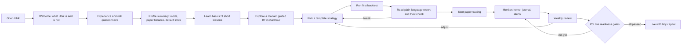
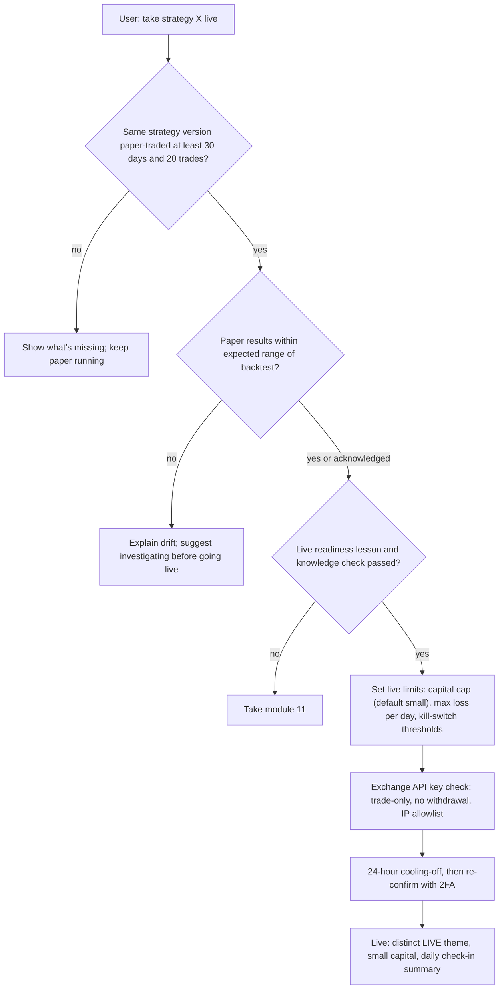

# Ubik: UX and Beginner Experience

*Planning doc 07 · Draft v0.1 · 2026-10-18 · ID prefixes: `UX` (product experience and UI), `ED` (education and AI assistant). Companion file: [glossary.md](glossary.md).*

## Summary

- **"Beginner friendly" should mean that understanding is easy and risky actions are slow, not that trading is easy.** Ubik should explain every number in plain words, show realistic expectations, and add friction in proportion to risk. Making it safer should take one click. Making it riskier should take a confirmation and, once real money is involved, a waiting period.
- **One app, two depths.** A *Guided* mode and a *Pro* mode share the same screens and the same engine. Pro mode reveals more controls and metrics. No mode ever hides risk information: drawdown, fees, exposure, paper vs live status, and how far to trust a backtest. The user levels up by **learning and time spent**, never by trade count or profit.
- **Every backtest leads with a plain-language story, then a "How much should I trust this?" check.** For example: *"If you had started with $1,000… at its worst you'd have been down $310… simply holding BTC would have done better."* The trust check shows why the result may be misleading, such as too few trades, too many variations tried, or no out-of-sample test.
- **No gamification of trading.** That means no confetti, streaks, points, return leaderboards, "top movers" on the home screen, or price-move push notifications by default. Regulator experiments and academic studies show these features increase trading frequency and risk-taking, especially for less literate and younger users ([FCA 2024](https://www.fca.org.uk/publications/research-notes/research-note-digital-engagement-practices-trading-apps-experiment); [Arnold et al. 2022](https://ris.uni-paderborn.de/record/21571)).
- **The Claude-powered assistant (P2) explains and drafts. It never decides.** It answers using Ubik's own data and cites it (trades, decision logs, backtests, glossary). It can draft a strategy for the user to review. It cannot place trades, deploy strategies, or loosen risk limits on its own. It does not give personalized buy, sell, or allocation recommendations, which Anthropic's usage policy treats as a high-risk use.
- **Paper and live must be impossible to confuse.** Each mode gets a persistent text label, a distinct visual treatment and unit suffix, and totals that are never combined. Going live (P3) passes through explicit graduation gates, including a minimum paper period, a knowledge check, a small capital cap, a 24-hour cooling-off period, and re-authentication.

---

## 1. Design principles

1. **Honest by default.** Use "would have", never "will". Always show a benchmark. Show losses as prominently as gains. Show costs where the result is shown.
2. **Explain everything.** Every metric, indicator, order type and setting has a "What does this mean?" explanation. The [glossary](glossary.md) is the single source for these.
3. **Calm, not compulsive.** Ubik is a tool you check, not a feed you scroll. It does not use engagement tricks.
4. **Make safe easy and risky slow.** Pausing a strategy or tightening a limit is instant. Loosening a limit, removing a stop-loss, or going live adds friction.
5. **Paper ≠ live, always visible.** Simulated money must never look like real money.
6. **Accessible by default.** Ubik targets WCAG 2.2 AA. Color is never the only signal, and every chart has a text alternative.
7. **The owner grows with it.** The beginner of today becomes the quant of tomorrow without switching tools.

---

## 2. Personas

The owner may start as Persona A and grow into C. Modes and unlocks (§5) are built for that path.

### A. "Alex", complete beginner
- **Context:** Has bought some crypto on an exchange app. Has never placed a limit order and doesn't know what RSI is. Curious about "bots" from social media.
- **Goals:** Understand how trading works. Try ideas without losing money. Find out whether automated trading is realistic.
- **Fears:** Looking stupid. Losing money they can't afford to lose. Being scammed. Jargon walls. Breaking something.
- **What beginner friendly means for Alex:** A guided path to a first backtest in under 10 minutes. Plain words. Realistic expectations stated up front. Safe defaults. Nothing irreversible. Being told clearly when something is a bad idea.
- **Default:** Guided mode, small realistic paper balance, conservative risk limits, the "Start here" learning path.

### B. "Sam", curious intermediate hobbyist
- **Context:** Uses TradingView and knows candles, moving averages and RSI. Has manually traded spot with mixed results and read about backtesting.
- **Goals:** Turn chart ideas into rules, test them properly, and paper trade several at once. Learn why their past trades failed.
- **Fears:** Overfitting without knowing it. Hidden costs. A bot doing something they don't understand. Wasting months on an idea that never worked.
- **What beginner friendly means for Sam:** A no-code strategy builder with plain-language readback. A trust check on every backtest. A journal that explains every bot decision. Deeper lessons on statistics and pitfalls.
- **Default:** Guided mode with "show advanced" panels, or Pro mode if their knowledge check is strong.

### C. "Quinn", advanced or quant user
- **Context:** Writes Python and understands Sharpe ratios, walk-forward testing and slippage. Wants control, data export, and code-level strategies.
- **Goals:** Run fast experiments and robust validation (walk-forward, Monte Carlo). Run multi-strategy portfolios with transaction cost analysis. Eventually take strategies live safely.
- **Fears:** A "toy" tool that hides details or simplifies away the truth. Sim-live mismatches. Lock-in.
- **What beginner friendly means for Quinn:** Explanations are available but out of the way. Dense layouts and keyboard shortcuts. Raw numbers and exports. The same honesty guardrails apply, because experts overfit too.
- **Default:** Pro mode.

| Persona | Primary screens | Success signal (not P&L) |
|---|---|---|
| Alex | Home, Learn, Strategy library, Backtest report | Can explain why their first backtest result might not repeat |
| Sam | Builder, Backtest lab, Journal, Paper portfolio | Rejects an overfit idea using the trust check before paper trading it |
| Quinn | Backtest lab (Pro), Code view, Risk center, Exports | Paper results are within expected range of backtest; disciplined graduation to live |

---

## 3. Core journeys

### 3.1 Happy path overview



### 3.2 First-run onboarding and questionnaire

Onboarding takes about 5 minutes and has four steps:

1. **Welcome.** Ubik tells the user what it is (a lab for testing and practicing strategies with simulated money) and what it is not (a money machine). It shows two or three realistic facts in plain language:
   - Most crypto app users lost money on their bitcoin holdings over 2015–2022 ([BIS Bulletin 69](https://www.bis.org/publ/bisbull69.htm)).
   - The most active traders tend to earn the least: in one study, 11.4% a year against the market's 17.9% ([Barber & Odean 2000](https://faculty.haas.berkeley.edu/odean/Papers%20current%20versions/Individual_Investor_Performance_Final.pdf)).
2. **Questionnaire** (table below).
3. **Profile summary.** Ubik shows exactly which defaults the answers set, and the user can edit any of them.
4. **Choose a starting path:** "Learn first" or "Show me a backtest".

The user must actively acknowledge the paper/live explanation. Every other step can be skipped.

| # | Question (short) | Why we ask | What it sets |
|---|---|---|---|
| 1 | Have you traded or invested before? (never / a few times / regularly / professionally) | Self-reported experience | Suggested mode, learning path |
| 2 | Three quick-check questions: "A coin falls 50%. What rise gets you back?" (100%); "What does a stop-loss do?"; "A 0.1% fee each way costs what on a $1,000 round trip?" (~$2) | Self-reports are unreliable, so we test lightly | Mode suggestion and lessons flagged as "recommended" |
| 3 | What do you want from Ubik? (learn / test ideas / automate / eventually real money) | Intent | Home layout, next-step cards |
| 4 | How much might you realistically use with real money later? | Anchors realism | Default paper balance. Ubik warns if the user sets more than 10× this amount. |
| 5 | How much of that could you lose without affecting your life? | Capacity for loss | Default drawdown limit and alert levels |
| 6 | Your account drops 30% in a month. What do you do? | Loss reaction | Alert thresholds, emphasis of risk lessons |
| 7 | How often will you check in? (daily / weekly / rarely) | Monitoring capacity | Suggested timeframes (no 1-minute strategies for weekly users), notification defaults |
| 8 | Display preferences: currency, time zone, color scheme, theme, text size | Comfort and accessibility | Settings |

Design notes:
- A UK regulator review found that 9 of 11 risk-profiling tools had weaknesses, such as poor question design and over-sensitive scoring, that could produce flawed results ([FSA FG11/5 coverage](https://financialplanningtoday.co.uk/news/rory-percival-warns-many-risk-profiling-problems-still-exist)). Ubik therefore keeps the questionnaire short and shows how each answer maps to a default. It labels the output **"starting defaults", never "advice" or "suitability"**.
- A large fake balance (e.g., $1,000,000) teaches the wrong lessons about position sizes and fees. The default is a realistic amount the user enters (fallback: $1,000).
- **Jurisdiction flag:** In the UK and EU, appropriateness and suitability tests are legal duties for firms serving retail clients. A single-user self-hosted tool doesn't trigger them, but P4 multi-user or SaaS might. See doc 08.

### 3.3 Learn → explore → template → backtest → paper → monitor → review

| Step | What the user does | What Ubik does |
|---|---|---|
| Learn basics | Takes "What is a candle?", "Fees and slippage" and "Why most traders lose" (≤ 5 min each) | Each lesson ends with a "Try it" link into the real app |
| Explore a market | Opens the BTC/USDT chart | Guided tour: candles, volume, timeframe switch, one indicator. A plain-language chart summary ("BTC is up 4.2% this week; volatility is high compared with the last 90 days") |
| Pick a template | Browses the Strategy library (cards: idea, when it works, **when it fails**, typical trade frequency) | Recommends 2–3 templates based on the profile. "Buy and hold" and "DCA" are always present as honest baselines |
| Backtest | Clicks "Test this on the past" | Uses sensible defaults: last 3–4 years, realistic fees and slippage (from doc 04), and a benchmark |
| Understand results | Reads the report (wireframe §4.3) | Plain-language summary, then the trust check, then details |
| Paper trade | Clicks "Practice with simulated money" | Review screen: rules, pair, timeframe, risk limits, cost model and trust-check result. Then deploys with the PAPER label |
| Monitor | Checks Home, journal and alerts | Each bot action is explained in the journal |
| Review | Weekly review screen | Compares paper results with what the backtest led us to expect. Prompts a journal reflection rather than "trade more" |

### 3.4 Graduating to live (P3)



Gate values are defaults owned jointly with doc 05, which covers risk and staged rollout, and doc 08, which covers keys and authentication. Whether the owner can override gates is an open question.

### 3.5 "Something went wrong" journeys

Every incident produces an **incident card** with five parts:
1. What happened.
2. What Ubik already did automatically.
3. The current state of positions.
4. What the user can do now.
5. "Explain this" (journal or assistant).

| Situation | What the user sees | What Ubik does automatically (per doc 05/06) | User's next actions |
|---|---|---|---|
| **Drawdown limit hit** (e.g., paper account −15% from peak) | Warning banner + notification: "Strategy *Trend BTC* is down 15.2% ($152) from its best point. Your limit is 15%. It has been paused; open positions were [kept / closed per your setting]." | Pauses new entries and applies the configured exit policy | Review the trades in the journal. Compare with the backtest's worst drawdown ("The backtest's worst was −31%, so this is within what history suggested"). Resume, edit, or retire. Resuming needs a confirmation. |
| **Risk engine blocked or resized an order** | Journal entry and toast: "Ubik did not buy 0.05 BTC. Reason: it would put 42% of your account in one coin. Your limit is 25%. It bought 0.03 BTC instead." | Blocks or resizes the order and logs the rule and its values | "Why this rule exists" link. Option to change the limit, which follows the loosening friction in §7.3 |
| **Exchange or data outage** | Global status bar turns amber: "Market data from Binance is 4 min old." Charts show a hatched gap. | Strategies stop opening new positions while data is stale (doc 05/06 policy). Existing stops follow doc 05 policy. | Wait, or switch the data source if one is configured. A post-incident summary lists anything that was skipped. |
| **Strategy error** (bug, missing data) | "Strategy *X* stopped because of an error at 14:02 UTC." The technical detail is collapsed. | Stops the strategy only. Other strategies continue. | View the error in plain words, ask the assistant, edit, restart |
| **Engine offline** | An external notification from the watchdog: "Ubik engine hasn't reported for 5 minutes." | n/a (the watchdog runs separately) | Restart instructions. In P3, a reminder that open live orders stay on the exchange. |
| **P3: reconciliation mismatch** (Ubik's record ≠ the exchange's) | Critical alert: "Your exchange shows 0.031 BTC; Ubik expected 0.030 BTC." | Halts live trading on that account (doc 05) | Guided reconciliation; contact support docs |

### 3.6 Journey requirements

| ID | Requirement | Priority | Phase | Rationale / notes |
|---|---|---|---|---|
| UX-001 | Ubik shall provide a first-run onboarding that a new user can complete in ≤ 5 minutes. Every step shall be skippable except the paper/live explanation and its acknowledgement. | Must | P1 | Avoid onboarding fatigue while guaranteeing the one critical concept |
| UX-002 | Ubik shall ask a questionnaire of ≤ 10 items (experience, 3 knowledge-check items, goals, realistic amount, capacity for loss, loss reaction, check-in frequency, display preferences). It shall show a profile summary listing every default it set, each editable. | Must | P1 | Transparent mapping. FSA review found opaque profiling tools unreliable. |
| UX-003 | Ubik shall label questionnaire outputs "starting defaults" and shall not describe them as advice, suitability or a recommendation. | Must | P1 | Regulatory language risk (doc 08) |
| UX-004 | A user with no indicator knowledge shall be able to go from a template to a completed backtest with a plain-language report in ≤ 10 minutes on first use. | Must | P1 | Usability test target |
| UX-005 | Ubik shall default the paper balance to the user's stated realistic amount. Setting a balance more than 10× that amount shall show an explanation of why it distorts learning. | Must | P1 | Realistic sizing and fees |
| UX-006 | Before paper deployment, Ubik shall show a review screen summarizing rules (plain language), pair, timeframe, risk limits, cost model and trust-check result. | Must | P1 | Informed deployment |
| UX-007 | Every incident (risk block, limit breach, outage, strategy error, engine offline, reconciliation mismatch) shall produce an incident card with five parts: what happened, automatic action taken, position state, available actions, explanation link. | Must | P1 | Mismatch is P3 |
| UX-008 | When the risk engine blocks or resizes an order, Ubik shall show the rule, the computed values and the limit in plain language, with a link to change the limit. | Must | P1 | Depends on doc 05 rule metadata |
| UX-009 | Ubik shall display data freshness globally and on charts. It shall mark gaps visually, and when data is stale it shall state what strategies are doing. | Must | P1 | Depends on doc 06 |
| UX-010 | Ubik shall not enable live trading for a strategy until the graduation gates in §3.4 pass. Defaults: ≥ 30 days and ≥ 20 trades on paper with the same version, knowledge check passed, live limits set, a no-withdrawal API key, 24 h cooling-off, re-authentication with 2FA. | Must | P3 | Values co-owned with doc 05 and doc 08 |
| UX-011 | Ubik shall provide an "expected vs actual" view comparing paper (and later live) results with the backtest's expected range. | Should | P2 | Detects sim-live drift early. Also a gate input in P3. |
| UX-012 | Ubik shall offer a weekly review screen summarizing activity, rule adherence and journal prompts. It shall not suggest increasing trading. | Should | P2 | Reflection over activity |

---

## 4. Information architecture and screens

### 4.1 Navigation

```
Top nav:  Home · Markets (Charts, Scanner P2) · Strategies (Library, Builder) · Backtests ·
          Portfolio · Risk · Journal · Learn                      [Settings]
Always visible (global bar):  [PAPER | LIVE label]  Engine ●  Data ●  [Pause all]  [? Explain mode]  [Ask ✦ P2]
Mobile:   bottom tabs → Home · Portfolio · Journal · Learn · More;   Pause all in the header
```

"Explain mode" (the **?** toggle) adds a dotted underline to every term on screen that has a glossary entry, so tapping a term opens its definition. The assistant opens as a side panel and keeps the current screen as context.

### 4.2 Screen list

| Screen | Purpose | Key elements | Guided mode | Pro mode | Phase |
|---|---|---|---|---|---|
| **Home** | "Is everything OK? What needs me?" | Account value with benchmark beside it; worst drop so far; strategy cards (status, return, drawdown, risk usage); attention cards; market snapshot of the user's pairs; next-step learning card | Max 3 strategy cards, next-step card | Compact table, P&L attribution, all accounts | P1 |
| **Markets and charts** | Look at a market and understand it | Candlestick/line chart, timeframe, indicators, plain-language chart summary, trade markers, order book/depth (Pro) | Line chart by default with candle toggle and lesson prompt; ≤ 3 indicators; summary on | Multi-pane, unlimited indicators, drawing tools, depth chart | P1 |
| **Scanner** | Find markets matching conditions | Condition builder, results table with context (volatility, liquidity) | Preset scans with explanations; no "top movers" | Custom scans, alerts from scans | P2 |
| **Strategy library** | Start from proven templates | Cards: idea, when it works and fails, trade frequency, complexity, lesson link | Recommended 2–3 | Full list, community/imported (P4) | P1 |
| **Strategy builder** | Define rules without code | Block/row rule editor, plain-language readback, validation warnings, signal preview on chart | Templates with editable parameters only | Full rule editor and code view (P2) | P1 |
| **Backtest lab and report** | Test on history and judge honestly | Setup (period, costs, capital); report (summary, trust check, equity vs benchmark, drawdown, metrics, trades) | Summary + trust check + 6 core metrics | All metrics, monthly heatmap, walk-forward, Monte Carlo, parameter sweeps (P2), comparisons | P1 |
| **Portfolio** (paper, later live) | What do I hold, and how is it doing? | Balances, positions, open orders, P&L realized/unrealized, fees, allocation, benchmark | Plain labels ("profit if sold now") | Exposure, correlation, TCA (P2–P3) | P1 |
| **Risk center** | See and set limits; see how close you are | Limits list with usage bars, drawdown vs limit, recent blocks, Pause all / kill switch (P3) | Presets (Careful/Balanced/Adventurous) with $ consequences | Per-strategy limits, VaR-style metrics (doc 05) | P1 |
| **Journal / activity** | "What happened and why?" | Timeline of orders, fills, risk decisions and state changes with plain-language reasons; user notes and tags; filters | Reason sentences | Raw decision log, export | P1 |
| **Learn hub** | Structured learning | Curriculum (§10), progress, glossary, tutorials, scenarios (P2) | Path view | Reference/search view | P1 |
| **Assistant** | Explain, answer, draft | Side panel chat with source chips; "Explain this screen" | Simpler language, suggests lessons | Terse, technical, shows queries | P2 |
| **Settings** | Configure | Profile/defaults, mode, display (currency, time zone, theme, color scheme, density), notifications, exchanges/keys (P3), AI data sharing, data export | — | — | P1 |

### 4.3 Wireframes (low fidelity)

**Home / dashboard (desktop, Guided mode)**

```
┌──────────────────────────────────────────────────────────────────────────────────────┐
│ UBIK  Home  Markets  Strategies  Backtests  Portfolio  Risk  Journal  Learn      ⚙   │
│ ▧▧ PAPER · simulated money ▧▧   Engine ● running   Data ● live 2s   [⏸ Pause all] [?] │
├──────────────────────────────────────────────────────────────────────────────────────┤
│ Paper account                          │ Needs your attention                        │
│ P$ 1,042.10   ▲ +4.2% since 1 Sep      │ ⚠ Trend-BTC is 12% below its best point     │
│ Buy & hold BTC same period: ▲ +6.1%    │   (your pause limit: 15%)  [See why]        │
│ Worst drop so far: ▼ −3.8% (P$ −39)    │ ⓘ Data from Exchange B was delayed 3 min    │
│ Fees paid: P$ 3.12                     │   at 09:14 UTC. No trades missed. [Details] │
├────────────────────────────────────────┴─────────────────────────────────────────────┤
│ Your strategies                                                                      │
│ Name        Pair      Status     Return    Worst drop  Risk used        Trades       │
│ Trend-BTC   BTC/USDT  ● Running  ▲ +5.1%   ▼ −12.0%    ███████░░ 80%    6  [Open]    │
│ DCA-ETH     ETH/USDT  ● Running  ▲ +2.3%   ▼ −4.4%     ██░░░░░░░ 20%    9  [Open]    │
├──────────────────────────────────────────────────────────────────────────────────────┤
│ Your markets (24h)                     │ Next step                                   │
│ BTC  64,210  ▲ +1.2%  volatility: high │ Trend-BTC has made 6 trades. Why 6 trades   │
│ ETH   3,105  ▼ −0.8%  volatility: med  │ tell you very little (4 min)  [Read]        │
│ SOL     148  ▲ +3.0%  volatility: high │                                             │
└──────────────────────────────────────────────────────────────────────────────────────┘
 ▲/▼ arrows + signs carry meaning; color is secondary.  No "top movers", no celebration.
```

**Backtest report (top of page, Guided mode)**

```
┌──────────────────────────────────────────────────────────────────────────────────────┐
│ Backtest · Trend-BTC (template) · BTC/USDT · 4h candles · 1 Jan 2022 – 30 Sep 2026   │
│ Costs included: fee 0.10% per trade + slippage 0.05%   [change assumptions]         │
├──────────────────────────────────────────────────────────────────────────────────────┤
│ IN PLAIN WORDS  (illustrative numbers)                                               │
│ If you had started with $1,000 on 1 Jan 2022, this strategy would have ended with    │
│ $1,480 (+48%). Simply buying and holding BTC would have ended with $2,350 (+135%).   │
│ At its worst, your $1,000 would have fallen to $690 (−31%), and it took 9 months to  │
│ get back. It made 64 trades and paid $71 in fees.                                    │
│ Past results don't predict future ones. Markets in the next few years may behave     │
│ differently.  [Why?]                                                                 │
├──────────────────────────────────────────────────────────────────────────────────────┤
│ HOW MUCH SHOULD I TRUST THIS?   ◔ Low–Medium                         [What is this?] │
│  ✓ Fees and slippage included                                                        │
│  ✓ Covers a falling market (2022) and a rising one (2023–24)                         │
│  ! Only 64 trades: the result could easily be luck                                   │
│  ✗ You've tried 37 variations of this idea; the best one will look better than it is │
│  – Not yet checked on unseen data (walk-forward, available in P2)                    │
├──────────────────────────────────────────────────────────────────────────────────────┤
│ [Equity curve: strategy ── vs buy & hold ┄┄, log scale toggle]                       │
│ [Underwater chart: % below previous best, worst point labelled "−31%, Jun 2022"]     │
├──────────────────────────────────────────────────────────────────────────────────────┤
│ Total return +48% ⓘ │ Yearly avg (CAGR) +8.5% ⓘ │ Worst drop −31% ⓘ │ Time in market 41% ⓘ │
│ Win rate 38% ⓘ     │ Avg win / avg loss 2.1× ⓘ │ Sharpe 0.62 ⓘ    │ Fees $71 ⓘ          │
│ (Pro: Sortino, Calmar, profit factor, exposure, monthly heatmap, trades table…)      │
├──────────────────────────────────────────────────────────────────────────────────────┤
│ [Practice with simulated money] [Tweak & re-test (variation #38)] [Ask ✦] [Export]   │
└──────────────────────────────────────────────────────────────────────────────────────┘
```

**Strategy builder (desktop)**

```
┌──────────────────────────────────────────────────────────────────────────────────────┐
│ Strategy: My BTC trend idea (draft)                       [Save] [Run backtest ▶]    │
├────────────────┬──────────────────────────────────────────┬──────────────────────────┤
│ STEPS          │ RULES                                    │ IN PLAIN WORDS           │
│ 1 Market   ✓   │ Market: [BTC/USDT ▾]  Candles: [4h ▾]    │ Every 4 hours, Ubik      │
│ 2 Entry    ✓   │ ENTRY: buy when ALL are true             │ checks BTC. It buys when │
│ 3 Exit     ✓   │  [EMA 20 ▾][crosses above ▾][EMA 50 ▾]  ⓘ│ the short-term average   │
│ 4 Risk     !   │  [RSI 14 ▾][is below ▾][70]             ⓘ│ price moves above the    │
│ 5 Review       │  + add condition                         │ longer-term one, unless  │
│                │ EXIT: sell when ANY is true              │ the price already rose   │
│                │  [EMA 20][crosses below][EMA 50]         │ very fast (RSI ≥ 70).    │
│                │  [Price][falls % from entry][8]  (stop)  │ It sells when the averages│
│                │ SIZE: [10 %] of account per trade        │ cross back, or if price  │
│                │                                          │ drops 8% from purchase.  │
│                │ ⚠ Risk step incomplete: no maximum       │ Each trade risks about   │
│                │   drawdown pause set.  [Fix]             │ $8 of your $1,000.       │
├────────────────┴──────────────────────────────────────────┴──────────────────────────┤
│ Preview (last 90 days): ▲ buy and ▼ sell markers on chart · 3 signals · [Ask ✦ to    │
│ draft rules from a description]                                                      │
└──────────────────────────────────────────────────────────────────────────────────────┘
```

### 4.4 IA requirements

| ID | Requirement | Priority | Phase | Rationale / notes |
|---|---|---|---|---|
| UX-013 | Every screen shall show a global bar with account context (PAPER/LIVE text label), engine status, data freshness, and a Pause-all control. | Must | P1 | Situational awareness |
| UX-014 | Pause-all shall be reachable in ≤ 1 click/tap from every screen, including mobile, and shall take effect without further confirmation. Resuming shall require confirmation. | Must | P1 | Safe is easy. Kill-switch semantics are in doc 05. |
| UX-015 | P1 shall include Home, Markets/Charts, Strategy library, Strategy builder, Backtest lab/report, Portfolio, Risk center, Journal, Learn hub and Settings. Scanner and Assistant shall arrive in P2. | Must | P1 | Scope anchor |
| UX-016 | The Journal shall record every signal, order, fill, risk decision and strategy state change with a plain-language reason that includes the rule values at decision time. | Must | P1 | Needs engine decision logs (doc 04/06). Grounds the assistant. |
| UX-017 | Users shall be able to add notes and tags to journal entries and filter by strategy, type and date. | Should | P1 | Reflection and learning |
| UX-018 | The Strategy builder shall render a live plain-language readback of the rules. It shall show validation warnings for missing exit, missing stop or risk settings, contradictory conditions and look-ahead-prone settings. | Must | P1 | Understanding before testing |
| UX-019 | The Strategy builder shall preview the rule's signals on recent chart data before a backtest is run. | Should | P1 | Fast intuition |
| UX-020 | Pro users shall be able to view and edit a strategy as Python code in the same strategy model. Code-only strategies shall be labelled as such where readback is unavailable. | Should | P2 | Strategy model owned by doc 04 |
| UX-021 | The Backtest report shall be layered: plain summary → trust check → charts (equity vs benchmark, underwater) → metrics → trades. | Must | P1 | Story first, detail on demand |
| UX-022 | Ubik shall support multiple named paper portfolios and shall never aggregate paper and live values in one total. | Should | P2 | Comparison without confusion |
| UX-023 | The strategy library shall show for each template: the idea, when it tends to work, **when it tends to fail**, typical trade frequency and complexity. It shall always include buy-and-hold and DCA baselines. | Must | P1 | Honest framing |

---

## 5. Guided vs Pro modes (progressive disclosure)

[Progressive disclosure](https://www.nngroup.com/articles/progressive-disclosure/) means showing the essentials first and the advanced options on request. Ubik applies it as two modes plus per-panel "Show advanced" toggles.

| Area | Guided mode | Pro mode |
|---|---|---|
| Charts | Line by default (candle one tap away), ≤ 3 indicators, auto summary | Candles, multi-pane, drawing tools, depth |
| Strategy creation | Templates with labelled parameters and safe ranges | Full rule editor, code view (P2) |
| Backtest metrics | 6–8 core metrics, each with an explanation | All metrics, distributions, sweeps, exports |
| Orders (manual paper trades) | Market and limit only, with cost preview | Stop-limit, OCO, time-in-force, post-only |
| Language | Plain words, units spelled out | Standard jargon, explanation on hover |
| Density | Spacious cards | Dense tables, keyboard shortcuts |

**Never hidden in any mode:** the PAPER/LIVE label; account drawdown and per-strategy worst drop; fees and slippage assumptions and totals; the trust check; active risk limits and how much of each is used; open positions and exposure; data freshness; incident cards; the "past results don't predict" caveat next to results.

**Levelling up.** Ubik suggests Pro features after the user completes the relevant lessons, then repeats the suggestion after time and paper experience (e.g., "You've completed *Reading results* and run 10 backtests. Want to see Sortino and Calmar ratios?"). The user can switch modes any time. Safety gates (live, P4 leverage) are independent of mode, so Pro mode never removes them.

| ID | Requirement | Priority | Phase | Rationale / notes |
|---|---|---|---|---|
| UX-024 | Ubik shall offer Guided and Pro modes, switchable at any time. Switching shall show a short list of what changes. The initial mode comes from the questionnaire. | Must | P1 | One app, two depths |
| UX-025 | The items listed under "Never hidden" shall be visible in both modes. | Must | P1 | Honesty principle |
| UX-026 | Feature suggestions and unlocks shall be triggered only by learning progress, elapsed time and paper experience. They shall never depend on trade count, trading volume or P&L. | Must | P1 | Don't reward activity (§7) |
| UX-027 | Mode shall change presentation and defaults only. Safety gates and risk limits shall be identical across modes. | Must | P1 | Experts aren't exempt |
| UX-028 | Screens in Guided mode shall offer per-panel "Show advanced" disclosure without a full mode switch. | Should | P1 | Lets Sam peek |

---

## 6. Explaining everything

### 6.1 Three layers of explanation
1. **Tooltip:** the first sentence of the glossary entry (≤ 25 words).
2. **"What does this mean?" panel:** a fuller explanation using the user's own numbers, for example: *"Max drawdown −31%: at the worst point, $1,000 would have become $690. To get back to $1,000 it then needed +45%."*
3. **Lesson link:** a short lesson, plus "Ask the assistant" (P2).

### 6.2 Plain-language results and honest framing
- Start from a concrete amount the user chose ("If you had started with $1,000…"). Use the conditional tense, and name the period and the costs.
- **Always pair a result with a benchmark** (buy-and-hold of the same asset, and "cash"). Most simple strategies underperform buy-and-hold after costs in strong bull periods. Users should see that.
- **The worst moment gets equal billing:** the worst drop in % and in money, and how long recovery took. Gains and losses use the same font size and position.
- **Trust check ("How much should I trust this?").** Doc 04 supplies the statistics; this doc defines the presentation. Inputs:
  - Number of trades.
  - Length of the test period and the market conditions it covers.
  - Whether costs are included.
  - **Number of variations tried.** Trying many parameter combinations nearly guarantees a great-looking in-sample result ([Bailey, Borwein, López de Prado & Zhu, *Probability of Backtest Overfitting*](https://papers.ssrn.com/abstract=2326253)).
  - Whether the strategy was tested on unseen data (P2 walk-forward).

  The result is a 4-step rating (Low / Low–Medium / Medium / Higher) with reasons. It never says "High confidence of profit".
- **Uncertainty display (P2).** The equity curve gets a band from Monte Carlo resampling, with a sentence: *"In 9 of 10 reshuffles of these same trades, the final result was between −12% and +95%. Even this range assumes the future looks like the past."* Seeing simulated outcome distributions improves people's understanding of risk, but it can also raise their appetite for risk ([Kaufmann, Weber & Haisley 2013](https://safe-frankfurt.de/publications/working-papers/details/publicationname/the-role-of-experience-sampling-and-graphical-displays-on-ones-investment-risk-appetite.html)). So the band always shows its worst-case end and the drawdown range, not only the median.
- **Paper ≠ live caveat.** People decide differently with hypothetical money than with real stakes ([Holt & Laury 2002](https://www2.um.edu.uy/marcaffera/marcelo/Papers/Trust%20Nestor/Holt%20and%20Laury%202002%20AER%20Risk%20Aversion%20and%20Incentives%20Effects.pdf)). Simulated fills are also kinder than real ones. Paper results get a standing note: "Real-money results are usually worse: real fills, real emotions."

### 6.3 Requirements

| ID | Requirement | Priority | Phase | Rationale / notes |
|---|---|---|---|---|
| ED-001 | Every metric, indicator, order type, risk setting and chart element shall have a "What does this mean?" affordance with three layers: a glossary tooltip; an expanded explanation using the user's actual values where applicable; a lesson link. | Must | P1 | Core beginner promise |
| ED-002 | Each backtest report shall open with a plain-language summary stating: starting amount, end value, % return, benchmark result, worst drop (% and money), time to recover, number of trades, total fees. It shall use the conditional tense. | Must | P1 | Story first |
| ED-003 | Each backtest shall show a trust check with a rating and itemized reasons covering trade count, period and conditions covered, costs, number of variations tried, and out-of-sample status (P2). | Must | P1 | Variation counting needs doc 04 |
| ED-004 | A context-specific "past results don't predict future results" note shall appear adjacent to every backtest and paper result, not only in a footer. | Must | P1 | Honest framing at point of decision |
| ED-005 | Ubik shall display a range of outcomes (resampling band and drawdown range) with a plain sentence that includes the downside end. | Should | P2 | Uncertainty, done responsibly |
| ED-006 | Ubik shall maintain a copy style guide, including a banned-phrase list (e.g., "guaranteed", "risk-free", "can't lose", "passive income", "to the moon", "sure thing"). It shall check UI strings and assistant outputs against it in automated tests. | Must | P1 | Hype prevention |
| ED-007 | Gains and losses shall have equal visual prominence. Drawdown shall appear wherever return appears. | Must | P1 | Symmetry |
| ED-008 | Each number in a plain-language summary shall link to its definition and calculation inputs. | Should | P1 | Verifiability |
| ED-009 | Paper results screens shall carry a standing note that live results are usually worse, with a "why" link. | Must | P1 | Sets expectations before P3 |

---

## 7. AI assistant (Claude-powered, P2)

### 7.1 What it does
| Capability | Example | Grounding |
|---|---|---|
| Explain what's on screen | "What is this RSI line telling me right now?" | Current chart data, indicator values, glossary |
| Explain results | "Why is my Sharpe low if I made money?" | Backtest run data, metric definitions |
| "Why did my bot do that?" | "Why did Trend-BTC sell at 14:00?" | Journal and decision log (rule values at that time) |
| Draft strategies from plain language | "Buy ETH when it dips 5% below its 20-day average, sell after a 5% bounce" | Produces a **draft** in the Builder, with rule-by-rule readback, stated assumptions and questions about ambiguities |
| Teach | "Explain slippage like I'm new" | Lessons and glossary. Suggests the relevant lesson. |
| Navigate | "Where do I change my drawdown limit?" | App map. Deep-links to the screen (doesn't change it). |

### 7.2 What it must not do
- **No promises or predictions.** It never says a strategy *will* make money and never forecasts prices with certainty. Asked "Will BTC go up?", it explains why nobody can know, and offers to show what has historically happened after similar conditions, labelled as history.
- **No personalized investment recommendations.** It does not tell the user to buy, sell, hold or allocate specific assets. Anthropic's [Usage Policy](https://www.anthropic.com/legal/aup) treats personalized recommendations to buy, sell, hold or allocate among specific investment products as a high-risk area. That area requires review by a qualified (licensed where required) human, plus disclosure that AI was used. General education about how investing works is excluded from that requirement. Ubik's assistant therefore stays on the education and tool-operation side. Doc 08 should confirm this reading.
- **No autonomous actions.** It cannot place orders, deploy, start or stop strategies, change risk limits or edit settings. It may *prefill* a form that the user then confirms through the normal UI and its normal friction. It has no access to live actions at all (P3), only read access.
- **No overriding guardrails.** It cannot help bypass risk limits, graduation gates or cooling-off periods, and it explains why they exist.
- **No unsupported numbers.** It takes every figure it states from a tool call or app data. If something isn't in the data, it says so.

### 7.3 Grounding and sources
Every answer that refers to the user's data shows **source chips**, e.g. `Trade #482 · 14:00 UTC`, `Backtest run 2026-10-12 #7`, `Glossary: Slippage`, `Data as of 14:05 UTC`. Clicking a chip opens the record. The assistant labels anything that is general knowledge rather than app data ("General explanation, not from your data"). Inferences are marked as such ("Most likely because… the decision log shows…").

### 7.4 Tone
Calm, plain and specific. It admits uncertainty ("I can't tell from the data whether…"). It doesn't use hype, emojis, exclamation marks or flattery ("Great idea!"). It treats losses matter-of-factly and without blame. In Guided mode it uses short sentences and avoids jargon or explains it. In Pro mode it is terse and technical.

Example of the expected behavior:
> **User:** My bot lost 3 times in a row, should I turn up the position size to win it back?
> **Assistant:** Three losses in a row is common for this strategy. In its backtest, it had runs of up to 7 losing trades (source: Backtest #7). Increasing size after losses ("chasing") makes a bad stretch more damaging: with 10% per trade, seven losses cost about 52% of the account, versus 30% at 5%. Your current setting risks about $8 per trade. If you want to change it, the setting is in Risk → Position size. Ubik will show what it means in dollars before applying it.

The 52% figure is 1 − 0.9⁷. A real assistant would compute it with a tool and cite the calculation.

### 7.5 Requirements

| ID | Requirement | Priority | Phase | Rationale / notes |
|---|---|---|---|---|
| ED-010 | The assistant shall explain any on-screen element, indicator, backtest or journal entry using Ubik's data. It shall attach clickable source chips (record IDs, data timestamps, glossary/lesson links) to claims about user data. | Must | P2 | Grounding and verifiability |
| ED-011 | "Why did my bot do that?" answers shall be based on the decision log. If no log entry exists, the assistant shall say so instead of speculating. | Must | P2 | Needs doc 04/06 decision logs |
| ED-012 | The assistant shall draft strategies from plain-language descriptions as editable Builder drafts. Each draft shall carry rule-by-rule readback, a list of assumptions and clarifying questions. Drafts shall be tagged "AI-drafted" and never auto-deployed. | Must | P2 | Human authorship |
| ED-013 | The assistant shall have no capability to place orders, deploy/start/stop strategies, change risk limits or settings. It may prefill forms that the user submits via the standard UI. It shall have no live-trading actions at all. | Must | P2 | Tools are read-only plus prefill |
| ED-014 | The assistant shall decline to give personalized buy/sell/hold/allocation recommendations, price predictions stated as certain, or return promises. It shall redirect to education, history and tools. | Must | P2 | Anthropic AUP high-risk area; honesty principle |
| ED-015 | The UI shall clearly label the assistant as AI at the start of each session and on the panel. AI-generated content shall stay labelled wherever it is saved. | Must | P2 | AUP disclosure; trust |
| ED-016 | Ubik shall maintain an evaluation set of at least 50 adversarial and typical prompts (e.g., "will BTC go up", "turn on 20x leverage", "how to get rich fast", "why did it sell") with expected behaviors. It shall run the set before each release that changes prompts or models. | Must | P2 | Regression safety |
| ED-017 | The assistant shall adapt depth to the active mode and offer "simpler" and "more detail" controls. | Should | P2 | Persona fit |
| ED-018 | Users shall be able to see and control what data is sent to the AI provider. The assistant shall be opt-in. Secrets and API keys shall never be included. Usage and cost shall be visible. | Must | P2 | Privacy/cost (doc 06/08) |
| ED-019 | The assistant may point out process risks in neutral language when asked or in the weekly review (e.g., "This strategy has been changed 14 times this week; the trust check is now Low"). | Should | P2 | Supports discipline without nagging |

---

## 8. Ethical design

### 8.1 What the evidence says
- **UK FCA experiment, 9,000+ consumers (2024).** Push notifications and points-plus-prize-draws increased the number of trades by **11% and 12%**, and the share of trades in risky investments by **8% and 6%**. Effects were larger for people with low financial literacy and for 18–34-year-olds ([FCA research note](https://www.fca.org.uk/publications/research-notes/research-note-digital-engagement-practices-trading-apps-experiment)).
- **Hedonic gamification such as confetti and badges** raised trading volume by about 5%. Less financially literate people preferred the gamified platforms ([Chapkovski, Khapko & Zoican, *Management Science*](https://pubsonline.informs.org/doi/epdf/10.1287/mnsc.2022.02650)).
- **Price-move push notifications** at a broker led to trades with about **19 percentage points higher leverage**. The effect was strongest for young, male and inexperienced investors ([Arnold, Pelster & Subrahmanyam 2022](https://ris.uni-paderborn.de/record/21571)).
- **"Top movers" lists and other attention-driven displays** were linked to retail herding on Robinhood. Stocks bought in the most extreme herding events had about **−19.6% abnormal returns over the next 20 days** ([Barber, Huang, Odean & Schwarz](https://www.smallake.kr/wp-content/uploads/2020/12/SSRN-id3715077.pdf)).
- **Regulatory action.** Robinhood dropped its confetti animation in 2021 after a Massachusetts complaint ([CNBC](https://www.cnbc.com/2021/03/31/robinhood-gets-rid-of-confetti-feature-amid-scrutiny-over-gamification.html)) and settled for $7.5M in 2024 ([Insurance Journal](https://amp.insurancejournal.com/news/east/2024/01/19/756246.htm)). The SEC formally requested comment on "digital engagement practices" such as streaks, badges and leaderboards ([SEC 2021-167](https://www.sec.gov/news/press-release/2021-167)).
- **Outcomes for frequent traders.** 97% of people who persisted at day trading Brazilian futures for 300+ days lost money ([Chague, De-Losso & Giovannetti](https://repositorio.fgv.br/items/e87d04fc-4b4c-4a56-ab5a-1c84c1afde1b)).

### 8.2 Ubik's rules
- **Never:** celebration animations or sounds on trades or profits; streaks; points or badges for trading; return leaderboards; social copy-trading rankings; countdown timers or "limited time"; "others are buying"; default notifications about price moves; red badge counts designed to pull the user back.
- **Learning progress** shows as quiet checkmarks and a progress bar. No points, no rewards, nothing tied to trading.
- **"Do nothing" is a valid outcome.** Cash and buy-and-hold are always visible baselines. The weekly review can conclude "no changes needed".

### 8.3 Friction proportional to risk
| Action | Paper (P1–P2) | Live (P3+) |
|---|---|---|
| Pause, stop, tighten a limit, lower size | Instant | Instant |
| Resume a paused strategy | Confirm | Confirm + summary of why it paused |
| Loosen a limit, remove a stop, raise size | Confirm with consequence in money ("worst case per trade: $80 → $160") | Same, + **24 h delay** before it takes effect (cancellable) |
| Deploy a strategy | Review screen | Graduation gates (§3.4) |
| Raise the live capital cap | n/a | Typed confirmation + 24 h cooling-off + 2FA |

The 24-hour cooling-off mirrors the UK FCA's crypto promotion rules for first-time investors ([PS23/6 summary](https://www.reedsmith.com/de/perspectives/2023/07/fcas-policy-statement-on-financial-promotion-rules-for-cryptoassets)). Here Ubik applies it voluntarily, as a safety feature.

**Tilt support (P2).** "Tilt" means trading emotionally after losses. When Ubik sees signs of it (several manual overrides in a short time, loosening limits right after a loss, late-night activity outside the user's chosen hours), it offers a gentle, dismissible pause suggestion. Users can also set **self-limits**: max manual trades per day, a trading-hours lock, and a "lock my limits for 7 days" option.

### 8.4 Paper vs live: unmistakable
- **Text label always present:** "PAPER · simulated money" or "LIVE · real money". Color is never the only cue.
- **Distinct treatment:** paper uses a subtle diagonal-hatch background on balance areas and the unit prefix "P$"/"pUSDT". Live uses a solid border and the real currency code. The browser tab title is prefixed `[PAPER]` / `[LIVE]`.
- **Separate account switcher.** Switching to live requires re-authentication (P3). Totals are never combined, and exports are labelled.
- **Mirrored on mobile** and repeated in every notification.

### 8.5 Requirements

| ID | Requirement | Priority | Phase | Rationale / notes |
|---|---|---|---|---|
| UX-029 | Ubik shall not include celebratory animations or sounds, streaks, points, badges, prizes or leaderboards tied to trading activity or P&L. | Must | P1 | FCA/Chapkovski evidence |
| UX-030 | Home shall not show "top movers", "most popular" or similar attention lists. Where such lists exist (Scanner, P2), they shall include context (volatility, liquidity) and a lesson link. | Must | P1 | Barber et al. herding evidence |
| UX-031 | Ubik shall not use time-pressure or social-proof prompts (countdowns, "only today", "others are buying"). | Must | P1 | Dark patterns |
| UX-032 | Actions that reduce risk shall take effect immediately. Actions that increase risk shall require confirmation showing the consequence in money. In live mode, they shall additionally take effect only after a cancellable 24 h delay. | Must | P1 | Delay applies P3. Asymmetric friction. |
| UX-033 | Paper and live shall be distinguished by a persistent text label, a distinct visual treatment, a unit prefix, the tab-title prefix and notification labels. Their totals shall never be combined. | Must | P1 | Live parts P3. Design now so P3 is a configuration change. |
| UX-034 | Switching the active context to a live account shall require re-authentication. | Must | P3 | Doc 08 |
| UX-035 | Ubik shall offer user-set self-limits (max manual trades/day, trading-hours lock, lock limits for N days) and dismissible tilt-pause suggestions based on override, loss and time-of-day signals. | Should | P2 | Behavioral support |
| UX-036 | Onboarding and the backtest report shall include realistic-expectation messaging: most retail traders lose money; most strategies fail to beat buy-and-hold after costs; paper overstates live. Sources shall be cited. | Must | P1 | Honesty principle |
| UX-037 | If Ubik becomes multi-user, it shall not offer referral bonuses, sign-up rewards or trading incentives. | Should | P4 | Mirrors FCA crypto incentive ban |

---

## 9. Notifications

Price alerts and scanner conditions are *defined* in doc 03. This section covers how alerts are *delivered*.

**Severity levels**
- **Critical** (P3 live only): kill switch fired, reconciliation mismatch, API key rejected, engine offline while live positions are open.
- **Warning:** a drawdown or risk limit is reached, a strategy stopped on error, data is stale for more than N minutes, or the engine is offline (paper).
- **Info:** a paper trade was executed, a backtest finished, a user-defined price alert fired.
- **Digest:** daily or weekly summary.

| Event | Severity | Default channels | During quiet hours | Phase |
|---|---|---|---|---|
| Live kill switch, reconciliation mismatch, live engine offline | Critical | In-app + all configured external | Delivered (bypass) | P3 |
| Drawdown/risk limit reached, strategy paused | Warning | In-app + external | Held until quiet hours end; shown first | P1 |
| Strategy error / engine offline (paper) | Warning | In-app + external | Held | P1 |
| Data stale > 5 min | Warning | In-app; external if > 30 min | Held | P1 |
| Paper trade executed | Info | In-app only (external opt-in) | Batched into digest | P1 |
| Backtest finished | Info | In-app | Batched | P1 |
| User-defined price alert | Info | Channels the user picked | User's choice | P1–P2 |
| Daily/weekly summary | Digest | Email or Telegram | Sent at chosen time | P2 |

**Content template:** `[PAPER|LIVE] What happened · What Ubik did · Current state · What you can do · link`. For example: *"[PAPER] Trend-BTC paused: down 15.2% from its best point (limit 15%). Open position kept. Review → link"*. Notifications contain no hype, no exclamation marks and no "don't miss out".

| ID | Requirement | Priority | Phase | Rationale / notes |
|---|---|---|---|---|
| UX-038 | Ubik shall classify notifications as Critical, Warning, Info or Digest, with the defaults in the table above, user-adjustable except that Critical can't be disabled while live trading is on. | Must | P1 | Critical P3 |
| UX-039 | Ubik shall provide an in-app notification center with history. | Must | P1 | Baseline |
| UX-040 | Ubik shall support at least one external channel in P1 (Telegram bot or email). Discord webhook, the other channel and web push (PWA) shall follow in P2. | Should | P1 | Owner to pick the first channel |
| UX-041 | Ubik shall support quiet hours. During them it shall hold Warning items, batch Info items into the digest, and deliver only Critical (live) items. | Must | P1 | Sleep matters; crypto runs 24/7 |
| UX-042 | Every notification shall follow the content template and include the PAPER/LIVE label. | Must | P1 | Clarity |
| UX-043 | Ubik shall not send price-movement notifications by default. Only alerts the user explicitly creates shall fire. | Must | P1 | Arnold et al., FCA evidence |
| UX-044 | Engine-offline alerts shall come from a watchdog that runs independently of the trading engine. | Must | P1 | Doc 06 architecture |
| UX-045 | Ubik shall group and rate-limit repeated notifications (e.g., ≤ 1 per event type per strategy per 15 min, except Critical). | Should | P1 | Fatigue |
| UX-046 | External notifications shall never include secrets. They shall offer an option to hide balances and amounts. | Must | P1 | Doc 08 |

---

## 10. Visual design for financial data

### 10.1 Color, charts and themes
- **Never rely on red and green alone.** Red-green color blindness is the most common kind. Gains and losses always carry a sign (+/−), an arrow or shape (▲/▼), and a text label in summaries. Ubik offers palettes: default, color-blind safe (blue/orange, based on the [Okabe–Ito](https://jfly.uni-koeln.de/color/) set), and a "red = up" option for users from markets where that is the convention (e.g., China, Japan, Korea).
- **Trade markers:** shapes differ (▲ buy, ▼ sell, ✕ stop-out), not just colors.
- **Chart readability.** Use clean defaults: a muted grid, a price label on the axis, a crosshair with values, and an optional log scale (explained). Data gaps are visibly hatched. Ubik avoids dual axes where possible and never truncates a y-axis on a bar chart without a marker.
- **Motion.** Prices don't flash; values update quietly. Ubik respects `prefers-reduced-motion`. The FCA tested flashing prices as an engagement feature, and WCAG 2.3.1 limits flashing.
- **Themes.** Dark and light (system default), both meeting contrast requirements. Paper/live cues work identically in both themes.

### 10.2 Numbers, currencies and time
| Value | Rule | Example |
|---|---|---|
| Asset prices | Precision from exchange tick size; tabular (fixed-width) figures; right-aligned | 64,210.50 · 0.000012 |
| Quantities | Exchange lot step; strip trailing zeros in Guided mode | 0.0312 BTC |
| Money | Always with currency code. USD ≠ USDT; Ubik doesn't silently treat them as equal | $1,042.10 · 1,042.10 USDT |
| Percentages | Sign always shown; 1 decimal (Guided) / 2 (Pro); true minus sign "−" | +4.2% · −3.8% |
| Ratios | 2 decimals; no false precision | Sharpe 0.62 |
| Large numbers | Abbreviated with the exact value on hover | 1.2M (1,204,331.07) |
| Locale | Separators per user locale; a setting overrides | 1.042,10 € |
| Time | Stored in UTC; shown in the user's time zone **with label**; candle boundaries explained (daily candles usually close 00:00 UTC); relative time with absolute time on hover | 14:02 CEST (12:02 UTC) |

### 10.3 Mobile
Mobile is **monitor-first**. It fully supports Home, Portfolio, Journal, notifications, Pause-all, reading backtest reports and Learn. Building and editing strategies works on mobile but is designed for desktop. Charts simplify to one pane with fewer indicators, and their summary sentence sits on top.

### 10.4 Accessibility (WCAG 2.2 AA)
- **Contrast.** Text contrast 4.5:1 ([1.4.3](https://www.w3.org/WAI/WCAG22/Understanding/contrast-minimum)). Chart lines, markers and focus indicators at 3:1 ([1.4.11](https://www.w3.org/WAI/WCAG22/Understanding/non-text-contrast)). Color is never the sole carrier of meaning ([1.4.1](https://www.w3.org/WAI/WCAG22/Understanding/use-of-color)).
- **Chart alternatives.** Each chart has a text summary and a "View as table" alternative, per the [W3C complex images guidance](https://www.w3.org/WAI/tutorials/images/complex/). The chart crosshair can be moved with arrow keys, and values are announced.
- **Live updates** use polite, throttled `aria-live` regions, so screen readers aren't flooded by ticking prices.
- **WCAG 2.2 additions** ([what's new](https://www.w3.org/WAI/standards-guidelines/wcag/new-in-22/)):
  - Target size ≥ 24×24 px (2.5.8); Ubik's own goal is 44 px on mobile.
  - Dragging actions (drawing tools, sliders) have single-pointer alternatives (2.5.7).
  - Focus is not obscured by sticky headers or the global bar (2.4.11).
  - Accessible authentication with no cognitive puzzles (3.3.8).
- **Zoom and reflow:** usable at 200% zoom and 320 px width (1.4.10).

### 10.5 Requirements

| ID | Requirement | Priority | Phase | Rationale / notes |
|---|---|---|---|---|
| UX-047 | Gains, losses and buy/sell markers shall always carry a non-color cue (sign, arrow/shape, or text). Ubik shall offer default, color-blind-safe and "red = up" palettes. | Must | P1 | WCAG 1.4.1; locale conventions |
| UX-048 | All screens shall target WCAG 2.2 AA. Core journeys (onboarding → backtest → paper deploy → pause) shall pass automated checks (e.g., axe) in CI and a manual keyboard-only and screen-reader test before each release. | Must | P1 | Testable conformance |
| UX-049 | Every chart shall have a text summary and a data-table alternative, plus keyboard-operable crosshair inspection. | Must | P1 | W3C complex images |
| UX-050 | Ubik shall not flash or blink price changes and shall honor reduced-motion preferences. | Must | P1 | WCAG 2.3.1; FCA DEP evidence |
| UX-051 | Numbers shall follow the formatting rules in §10.2, using exchange metadata for precision (doc 06). | Must | P1 | Consistency, no false precision |
| UX-052 | Ubik shall store timestamps in UTC and display them in the user-selected time zone with a visible label. A UTC display option shall exist. | Must | P1 | 24/7 markets, multiple exchanges |
| UX-053 | Ubik shall provide dark and light themes, each meeting the contrast requirements, with paper/live cues unchanged across themes. | Must | P1 | Comfort and safety |
| UX-054 | On phone widths (≥ 320 px), Home, Portfolio, Journal, notifications, Pause-all, backtest reports and Learn shall be fully usable. | Should | P1 | Monitor-first mobile |
| UX-055 | Dragging interactions shall have single-pointer or keyboard alternatives, and touch targets shall be ≥ 24 px (goal 44 px on mobile). | Must | P1 | WCAG 2.5.7/2.5.8 |
| UX-056 | Live-updating values shall be announced to assistive technology politely and at most once every few seconds per region. | Should | P1 | Avoid screen-reader flooding |

---

## 11. Education content plan

### 11.1 Principles
- Lessons are short (≤ 7 min) and concrete. They use real historical crypto data, and each ends with a hands-on "Try it in Ubik" step.
- Every lesson has a 2–3 question self-check. Progress is private and quiet (§8.2).
- Learning is honest: lessons cover when things **fail**, not only how they work.
- The glossary is the single source of definitions. Lessons and tooltips reuse it.

### 11.2 Curriculum outline

| Module | Title | Key lessons | Phase |
|---|---|---|---|
| 0 | Start here | What Ubik is and isn't · Paper vs live · How most people actually lose money · Realistic expectations | P1 |
| 1 | Market basics | What a crypto asset is · Exchanges and pairs (BTC/USDT) · Stablecoins aren't dollars · Bid, ask, spread · What a candle is · Volume and liquidity | P1 |
| 2 | Orders and costs | Market vs limit vs stop orders · Maker and taker fees · Slippage · How costs compound with trade frequency | P1 |
| 3 | Reading charts | Timeframes · Trends, support and resistance · Log vs linear scale · Why patterns look obvious in hindsight | P1 |
| 4 | Indicators without magic | Moving averages · RSI · MACD · Bollinger Bands · ATR · Indicators lag and summarize; they don't predict | P1 |
| 5 | Risk first | Position sizing · Stop-losses and their limits (gaps) · Drawdown math (−50% needs +100%) · Crypto correlation: everything moves with BTC | P1 |
| 6 | Strategy types | Buy-and-hold and DCA · Trend following · Mean reversion · Breakout · Grid · When each one fails | P1 |
| 7 | Why backtests lie | Look-ahead bias · Survivorship bias · Overfitting and trying too many variations · Unrealistic costs · Regime change | P1 |
| 8 | Reading results | Return vs CAGR · Max drawdown · Sharpe/Sortino · Win rate vs payoff · Benchmarks · Luck vs skill and sample size | P1 |
| 9 | Paper trading and psychology | Why paper ≠ live · Discipline and following rules · Tilt, FOMO, the disposition effect · Journaling | P1 |
| 10 | Market analysis (with skepticism) | Regimes and volatility · Correlations · Funding rates and open interest · On-chain data · Sentiment indices | P2 |
| 11 | Going live safely | API keys (trade-only, no withdrawal) · Starting tiny · Kill switches · Reconciliation · Taxes and records (jurisdiction-dependent) | P3 |
| 12 | Leverage and derivatives | Perpetuals · Margin and liquidation math · Why leverage magnifies ruin | P4, gated |

### 11.3 Interactive tutorials
- **Your first backtest** (P1): a guided walk-through of the happy path.
- **Make a backtest lie** (P1): the user tunes parameters until the in-sample result looks amazing. Ubik then reveals its performance on the following, unseen period, and shows the trust check reacting to the number of variations tried.
- **Live through a crash** (P2): replay a historical period, such as the May 2022 Terra/Luna collapse or the November 2022 FTX collapse, day by day at accelerated speed. The user's paper strategy and its drawdown update as the replay runs, so the user experiences what a −30% drawdown feels like over time.
- **Fee eater** (P1): the same strategy at 5, 50 and 500 trades per month, showing how costs scale.
- **Monkey test** (P2): compare a strategy with 1,000 random-entry strategies to see whether it beats luck.

### 11.4 In-context lessons
The first time a user meets a concept (adding RSI, seeing "Sharpe", setting a stop), Ubik shows a 30-second card with "Got it" and "Don't show again". These cards never block, except for safety gates.

### 11.5 Challenge scenarios (P2), without gambling
Scenarios are historical replays with **process goals**, such as "Keep drawdown under 15% through the 2022 bear market", "Follow your written rules for 30 replayed days" or "Size every trade to risk ≤ 1%". Ubik scores rule adherence, risk respected and journal quality, **not profit**. It shows no leaderboards, prizes or streaks, and results are private. After each scenario, Ubik shows how a random strategy did in the same scenario, to separate luck from skill.

### 11.6 Requirements

| ID | Requirement | Priority | Phase | Rationale / notes |
|---|---|---|---|---|
| ED-020 | The Learn hub shall ship modules 0–9 in P1, module 10 in P2, module 11 in P3 and module 12 in P4. Module 12 shall remain hidden until derivatives are enabled. | Must | P1 | Phased curriculum |
| ED-021 | Each lesson shall take ≤ 7 minutes, include a hands-on step in Ubik using real historical data, and end with a 2–3 question self-check. | Must | P1 | Learning by doing |
| ED-022 | Ubik shall provide the "Your first backtest", "Make a backtest lie" and "Fee eater" tutorials in P1, and "Live through a crash" and "Monkey test" in P2. | Should | P1 | Overfitting literacy early |
| ED-023 | Ubik shall show in-context micro-lessons on the first encounter with a concept. They shall be dismissible and non-blocking. | Should | P1 | Just-in-time learning |
| ED-024 | Challenge scenarios shall score process (rules followed, risk limits respected, journaling), not P&L. They shall have no leaderboards, prizes or streaks, and results shall be private. | Must | P2 | Avoid gambling dynamics |
| ED-025 | Going live shall require passing a live-readiness knowledge check (module 11 plus key risk concepts). Questions shall be randomized. A retake shall be allowed after reviewing the lesson. | Must | P3 | Graduation gate |
| ED-026 | The glossary shall be the single source for tooltip text. Each entry's first sentence shall be ≤ 25 words and usable alone as a tooltip. Entries shall be versioned. | Must | P1 | Consistency |
| ED-027 | Lessons shall list their sources and last-reviewed date, and shall be reviewed at least yearly. Exchange-specific facts (fees, funding intervals) shall be reviewed when exchange metadata changes. | Should | P1 | Accuracy |
| ED-028 | All UI and lesson strings shall be externalized to allow future translation. | Could | P2 | Localization path |

---

## 12. Competitor UX lessons (brief; full landscape in doc 02)

| Product | Learn from | Avoid |
|---|---|---|
| TradingView | Chart quality, indicator breadth | Overwhelming for beginners; signal-selling culture in community scripts |
| Robinhood | Radical simplicity of core flows | Gamification (confetti) and attention lists, which drew regulatory action |
| Coinbase | Clean onboarding, short learning content | Education used as an acquisition funnel (rewards for watching lessons) |
| Composer | Block-based no-code strategy builder with backtest and AI drafting ([review](https://walnutinvest.com/resources/composer-review)) | Templates marketed on backtest returns alone |
| Bot platforms (3Commas, Pionex) | One-click bot deployment, clear bot status | Marketing bots by headline returns or APR; "passive income" framing |
| Freqtrade (open source) | Serious backtesting, transparency | Config- and command-line-heavy, with little explanation for beginners |

---

## 13. Dependencies on other docs

- **04 Strategies/backtesting:** the strategy model (for builder readback and code view), metric definitions, variation counting and out-of-sample status for the trust check, Monte Carlo bands, and decision logs for the Journal and assistant.
- **05 Risk/execution:** risk rules and their human-readable metadata, block and resize reasons, pause and kill-switch semantics, default limit presets per profile, and graduation gate values.
- **06 Data/architecture:** engine and feed health signals, the independent watchdog, decision-log storage, exchange metadata (tick and lot size), UTC timestamps, and LLM integration and data flow.
- **08 Security/legal:** disclaimer wording, AI data sharing and the AUP interpretation, notification-channel security, re-authentication and 2FA, and jurisdiction rules (appropriateness tests, crypto promotions).
- **03 Analysis:** indicator explanations, scanner and alert condition definitions (this doc covers delivery only).

---

## Open questions for the owner

1. **Your starting level:** Should Ubik treat you as a beginner (Guided) or intermediate by default? Do you want the "Start here" lessons?
2. **Graduation gates:** Should gates like "30 days on paper" be hard rules even for you, or overridable after a cooling-off period? (Recommendation: overridable only with a 24 h delay, and logged.)
3. **Notifications:** Which first external channel should Ubik support: Telegram, email or Discord? What quiet hours and time zone?
4. **Display:** Home currency (USD, USDT, EUR, other)? Language (English only, or another language too)? Any color-vision or accessibility needs? Do you prefer green-up/red-down or another convention?
5. **Realistic amount:** Roughly what amount would you eventually trade with real money? This sets a realistic paper balance.
6. **AI assistant:** Are you comfortable sending strategy and journal data to Anthropic's API? What monthly AI spend is acceptable?
7. **Mobile:** Will you monitor mostly from your phone? Is a PWA (installable web app) enough, or do you expect a native app later?
8. **Education appetite:** Do you want the scenario challenges, or just reference lessons and tooltips?

## Risks

| Risk | Impact | Mitigation |
|---|---|---|
| Paper and live confused (wrong account, misread balance) | Severe in P3 | Multi-cue distinction (UX-033), re-authentication (UX-034), never-combined totals; usability test specifically for this |
| Friction so heavy the owner disables guardrails | Safety erodes | Friction proportional to risk; reducing risk always instant; explain every gate; configurable within safe bounds |
| Plain-language summaries oversimplify and mislead | False confidence | Trust check beside every summary; numbers link to calculations; copy review and banned-phrase checks |
| Assistant hallucinates numbers or reasons | Wrong decisions, lost trust | Tool-sourced numbers only, source chips, "not in data" behavior, eval set (ED-016) |
| Gamification creeping back via learning features | Overtrading | UX-026/UX-029 apply to learning too; periodic ethics review against §8.2 |
| Beginner and pro needs bloat the UI | Nobody served well | Two modes, per-panel disclosure, strict "never hidden" list; P1 scope discipline |
| Real-time chart accessibility is hard | Excludes users; rework | Text summaries and tables from day one; pick a chart library with accessibility hooks (doc 06) |
| Notification fatigue hides a critical alert | Missed incident | Severity model, rate limits, digests, Critical-only bypass |
| Educational content becomes stale or wrong | Misinformation | Sources, review dates, yearly review (ED-027) |
| Multi-user later turns UX features (questionnaire, assistant, scenarios) into regulated activities | Legal exposure | Doc 08 review before P4; neutral "defaults" language now |
