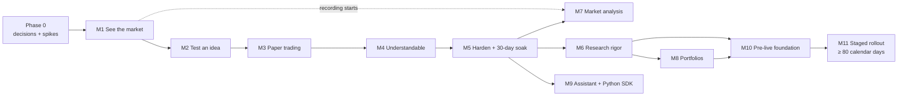

# Ubik — Roadmap

> Status: **Draft v0.1** (2026-10-18). This turns the phases in [00 Vision & Scope](00-vision-and-scope.md) into milestones with exit criteria. The domain docs (02–08) define *what* each requirement is; this doc defines *when* and *in what order*. Effort numbers are rough and low-confidence until Phase 0 is done.

## Summary

- **Phase 0 (about 2–3 weeks) decides and de-risks before any product code.** The owner answers the blocking questions (jurisdiction, exchanges, trading horizon, distribution intent), and five short spikes confirm the riskiest technical bets: the NautilusTrader trial run, exchange connectivity, the data pipeline, the incremental indicator engine and the deployment skeleton.
- **P1 "Paper Trader" ships as five vertical slices.** Each slice ends with something the owner can actually use: **see the market → test an idea → trade it on paper → understand it → harden and soak**. The core pipeline (strategy → sizing → risk → order management → simulated venue) is built properly in P1, because that is what makes going live a configuration step later.
- **Some gates are calendar time, not effort, and can't be compressed:** a 30-day unattended paper soak at the end of P1, and at least about 80 days from a strategy's first paper trade to scaled real money in P3 (paper ≥ 30 days → exchange demo ≥ 7 → shadow ≥ 14 → pilot ≥ 30). Data recording starts in P1 because free derivatives history is short.
- **P2 "Analyst" adds research rigor, market analysis, portfolios and the AI assistant. P3 "Live" adds the security and operations needed for real money and walks one strategy through the staged rollout.** P4 is a menu of options, not a commitment.
- **Biggest roadmap risk: scope.** P1 alone has about 280 "Must" requirements. The slice plan, the "first cut" list in §7 and strict phase discipline are the mitigations.

## 1. Planning assumptions

| Assumption | Effect if wrong |
|---|---|
| One developer (the owner) builds Ubik with an AI coding assistant. Effort is in **focused weeks**: one person working full time for a week | Part-time work stretches calendar time roughly in proportion. Two developers shorten P1 by maybe a third, not half, because the core is tightly coupled |
| Decisions in [10](10-decisions-and-open-questions.md) hold, especially "build a thin own core" (D-02) and "declarative strategies only in P1" (D-07) | Adopting NautilusTrader after the spike changes M2 and M3 substantially (likely shorter build, steeper learning) |
| The owner lives somewhere at least one recommended exchange is legally available | If not, Phase 0 must find a venue before M1 starts |
| Spot trading only, long/flat, liquid majors, 1h–1d strategy bars on a 1-minute data base | Faster strategies need better data and fill models (P2 or later) |

## 2. Phase 0 — Decide and de-risk (about 2–3 focused weeks)

| Workstream | What happens | Output |
|---|---|---|
| **Owner decisions** | Answer the "before Phase 0 ends" questions in [10 §2](10-decisions-and-open-questions.md#2-open-questions-for-the-owner): country/tax residence, exchanges, trading horizon, distribution intent, hosting, budgets | Decisions recorded in doc 10 |
| **Engine spike** (AR-028) | ≤ 2 weeks: try NautilusTrader v2 against the criteria in [06 §8.1](06-data-and-architecture.md). Can Ubik's strategy API, ledger and explanations sit cleanly on top? | Architecture decision record (ADR): own core vs Nautilus |
| **Connectivity spike** | ccxt against the chosen venues: public WebSockets, REST backfill, rate limits, geo-blocking behavior, instrument rules, fee schedules | Adapter contract draft; venue registry entries |
| **Data spike** | Download 5 years of 1-minute candles for 3 pairs (bulk files where available), write Parquet, query with DuckDB/polars, run quality checks | Measured storage and timings; data contract v1 |
| **Indicator-engine spike** | Incremental (streaming) indicators vs TA-Lib batch output for ~5 indicators; truncation test for look-ahead | Choice: own engine or talipp-based |
| **Skeleton and CI** | Repository layout, `uv` lockfiles, Docker Compose skeleton (Postgres+TimescaleDB, Valkey, engine/api/worker), CI with lint, type checks, tests, license check, secret scanning; ADR folder; `CLAUDE.md` for AI-assisted development | A green, empty pipeline |

**Exit criteria:** blocking owner questions answered or explicitly defaulted, ADRs for engine, venues and storage written, CI green on the skeleton.

## 3. P1 — "Paper Trader" (about 17–24 focused weeks + a 30-day soak)

Each slice is a vertical cut through data → engine → UI, so the owner can use Ubik early and feedback shapes the next slice. Requirement IDs are the main ones per slice, not exhaustive. Every P1 "Must" in docs 02–08 lands in exactly one slice by the end of M5.

### M1 — "See the market" (about 3–4 weeks)

| Area | Scope | Key requirements |
|---|---|---|
| Data | Live 1m candles and trades over WebSocket with REST fallback; ≥ 5 years of 1m backfill; daily instrument-rule snapshots; quality checks; explicit gap records; Parquet lake + Postgres | DA-001, DA-002, DA-004, DA-009–DA-015, DA-018, DA-020 |
| Recording | Start recording the data whose free history is short: funding, open interest, long/short ratios, dominance/breadth snapshots, top of book (analysis of it ships in P2) | MA-007, MA-011, PT-010 (see [03 §8](03-market-and-technical-analysis.md)) |
| Indicators | One closed-bar incremental indicator engine with the P1 catalog (~20 indicators), parity tests against TA-Lib, truncation (look-ahead) harness | TA-001–TA-010, TA-026, TA-028 |
| Chart | Candles/line, overlays, sub-panes, crosshair, data window, gap shading, timeframes 1m–1w | TA-013–TA-018 |
| Platform | Login with passkey or password + TOTP, private-by-default networking, global PAPER bar with data freshness, structured logs, health endpoints, backups, Docker Compose deploy | SEC-017–SEC-022, UX-013, AR-030–AR-032 |

**Exit:** the owner opens Ubik from a phone over a private tunnel and sees live BTC, ETH and SOL charts with indicators. 7 days of ingestion produce no unflagged gaps.

### M2 — "Test an idea" (about 4–6 weeks)

| Area | Scope | Key requirements |
|---|---|---|
| Strategy model | Strategy interface with injected clock, data feed and venue; intents only; typed parameters; immutable, hashed versions; deterministic state | ST-001–ST-010 |
| Simulated venue | One matching engine for backtest and paper; conservative fills; fees from effective-dated schedules; exchange order rules; latency; exact-decimal double-entry ledger | BT-001, BT-003–BT-016, EX-009–EX-012, AR-011, AR-012 |
| Order management and risk | Order state machine (event-sourced, persisted before "send"); risk engine with the Safe profile; position sizing; protective exits; sleeves | EX-001–EX-003, RK-001–RK-022, RK-035, PF-001, PF-002 |
| Backtester | Event-driven runs as worker jobs; reproducibility manifests; golden tests; trial ledger; out-of-sample vault; grid optimization ≤ 200 combinations | BT-016, BT-017, BT-021–BT-023, CAP-002, CAP-005, CAP-006, AR-014 |
| Templates | First 3 templates: DCA, MA crossover, Donchian breakout | ST-011 (partial) |
| Report v1 | Plain-language summary, trust check, benchmark (buy-and-hold BTC, traded asset, cash), core metrics, trades on chart, honesty warnings above the numbers | BT-030, BT-034–BT-036, ED-002–ED-004, CAP-008 |

**Exit:** golden tests reproduce known results exactly (G2). 1 year of 1m data backtests in ≤ 60 s on the reference machine (NFR-008). A newcomer can run a template backtest and read its report.

### M3 — "Trade it on paper" (about 4–5 weeks)

| Area | Scope | Key requirements |
|---|---|---|
| Paper venue | Same matching engine on live public data; no API keys; multiple paper accounts; reset/top-up | PT-001–PT-005, PT-013 |
| Resilience | Crash-safe, event-sourced state; restart recovery; reconciliation (paper); stale-data halts; reconnect and backfill; clock-drift checks | PT-007–PT-009, EX-004–EX-007, RK-026, RK-027, NFR-005, NFR-006 |
| Safety controls | Trading states (ACTIVE / REDUCE_ONLY / HALTED); kill switch L1–L3 from UI, CLI and API; one-tap Pause-all; loss limits and drawdown breakers live | RK-004, RK-019–RK-024, UX-014, SEC-005 |
| Visibility | Portfolio, Risk center and Journal screens; plain-language reasons for every block; notifications in-app plus one external channel; independent watchdog / dead-man's switch | UX-008, UX-015, UX-016, RK-038, AR-021, UX-036–UX-041 |

**Exit:** a 14-day unattended paper run with chaos tests (kill the engine mid-order, drop the WebSocket) shows zero duplicate and zero lost orders. Kill-switch tests pass.

### M4 — "Make it understandable" (about 4–6 weeks)

| Area | Scope | Key requirements |
|---|---|---|
| Strategies | Remaining templates (grid with safeguards, RSI and Bollinger mean reversion, rebalancing); no-code rule builder with plain-language readback and pre-run checks | ST-011, ST-014–ST-016, ST-018, UX-017, UX-022 |
| Onboarding and modes | First-run onboarding and questionnaire (≤ 5 min); Guided and Pro modes; "never hidden" risk items; disclaimers | UX-001–UX-006, UX-023–UX-026, CMP-017–CMP-020 |
| Explanations | "What does this mean?" on every metric, indicator and setting; glossary-driven tooltips; banned-phrase checks | ED-001, ED-006, ED-025, SIG-011 |
| Learning | Learn hub modules 0–9; tutorials "Your first backtest", "Make a backtest lie", "Fee eater" | ED-019–ED-021 |
| Analysis | Market Health Summary (descriptive only), trend/volatility labels, P1 alert types; evidence badges | MA-001, MA-003, SIG-001–SIG-015 |
| Home and accessibility | Home screen; color-blind-safe palettes; chart text summaries; number and time formatting | UX-027–UX-031, UX-044–UX-052 |

**Exit:** a usability session with a real beginner meets G1 (first backtest with a plain-language summary in ≤ 10 minutes) and G5 (everything shown is explained).

### M5 — "Harden and soak" (about 2–3 weeks of work, plus 30 calendar days)

- **30-day unattended paper soak** with at least 3 strategies (goal G3). Daily shadow backtests measure paper-vs-backtest divergence (PT-011).
- Restore drill from backup. Security checklist for every P1 "Must" in doc 08. License and dependency audit.
- Install and operations guide for self-hosting. Bug bash. Verify that every P1 "Must" is implemented and has a test.

**P1 exit (definition of done):** goals G1–G5 in [00 §4.1](00-vision-and-scope.md) are met, and every P1 "Must" is verified (see [01 §7](01-requirements-overview.md)).

## 4. P2 — "Analyst" (about 12–18 focused weeks)

| Milestone | Scope | Exit |
|---|---|---|
| **M6 Research rigor** | Walk-forward analysis; random and Bayesian optimization with trial budgets; Deflated Sharpe Ratio and Probability of Backtest Overfitting; Monte Carlo; stress-test library; vectorized screener; robustness heatmaps; expectation bands | The full "honest report card" appears on every optimized strategy |
| **M7 Market analysis** | Regimes, volatility suite, correlation and cointegration, dominance and breadth, derivatives analytics (from data recorded since M1), on-chain for BTC/ETH, sentiment and news digests, macro and event calendar; scanner; P2 alert types and channels | Each card shows source, freshness and evidence badge; every signal is backtestable without look-ahead |
| **M8 Portfolios** | Multi-strategy sleeves with allocation methods (equal weight, risk parity, volatility-scaled); correlation monitoring; portfolio VaR/Expected Shortfall; transaction-cost analysis (TCA) dashboards | Portfolio-level risk visible; allocation changes go through risk checks |
| **M9 Assistant and code** | Claude-powered assistant (read-only tools, cited sources, spend cap); Python strategy SDK in a sandbox; Learn module 10; "Live through a crash" and "Monkey test" tutorials; process-goal challenge scenarios | Assistant evaluation set passes (no invented numbers); sandbox escape tests pass |

## 5. P3 — "Live" (about 6–10 focused weeks + at least 80 calendar days of staged rollout)

| Milestone | Scope | Exit |
|---|---|---|
| **M10 Pre-live foundation** | Legal/tax consult if budgeted; execution **gateway** as the only holder of exchange keys; encrypted key storage; refuse keys that can withdraw; IP allow-list; dedicated sub-account; arming flow (re-authentication, knowledge check, 24 h first-time cooling-off); live reconciliation with the exchange; exchange-native dead-man's switch where available; incident runbooks; tax-grade exports | Security review of the gateway passes; pre-live checklist ([05 §9.1](05-risk-portfolio-execution.md)) can be completed |
| **M11 Staged rollout** | One strategy walks S1 Paper → S2 Exchange demo (≥ 7 days) → S3 Shadow (≥ 14 days) → S4 Pilot (≤ $500, ≥ 30 days) → S5 Scaled; graduation scorecard; automatic demotion; TCA calibrates backtest cost assumptions | One strategy finishes S4 with no severity-1 incidents (G6: no strategy code changed between paper and live) |

## 6. P4 — "Advanced" (options, not commitments)

Pick from these based on what P1–P3 teach:
- Derivatives and leverage behind extra guardrails, with Learn module 12.
- ML research workbench with strict overfitting controls.
- Multi-exchange execution and smart order routing.
- Market-making **simulation** (live market making at retail fee tiers is a non-goal).
- Multi-user hosting, but only after a legal review ([08 §8](08-security-legal-compliance.md)).

## 7. Keeping P1 shippable

**First cut list.** If P1 runs long, these move to P2 first, in this order. They're valuable, but neither safety, sim-live parity nor honesty depends on them:
1. Grid optimization (keep single runs and the trial ledger).
2. Templates beyond the first 5.
3. Email/Telegram alert delivery (keep in-app plus one channel for critical incidents).
4. Learn modules 6–9 and the tutorials (keep modules 0–5 and tooltips).
5. Multiple paper accounts (keep one).
6. Pro-mode extras: drawing tools, extra chart styles.

**Never cut from P1:** the risk engine and kill switch, persist-before-send order handling and crash recovery, exact-decimal ledger, shared matching engine, look-ahead protections, honesty warnings and benchmarks, paper/live labelling, login and private-by-default networking.

## 8. Critical path

- **M2 → M3 is the spine.** The matching engine, ledger, order management and risk engine built in M2 are reused unchanged by paper (M3) and live (P3).
- **M4 can partly overlap M3**: UI copy, the glossary and lessons don't depend on the paper venue.
- **P3 needs M6** (validated strategies) and **M8** (portfolio risk) before real money.

## 9. Indicative effort (low confidence)

| Phase | Focused weeks | Calendar gates |
|---|---|---|
| Phase 0 | 2–3 | — |
| P1 (M1–M5) | 17–24 | + 30-day soak |
| P2 (M6–M9) | 12–18 | — |
| P3 (M10–M11) | 6–10 | + ≥ 80 days staged rollout |

Treat these as ranges for planning conversations, not commitments. Re-estimate at the end of Phase 0 and after M2, when the core engine's real complexity is known.

## 10. Roadmap risks

| Risk | Mitigation |
|---|---|
| P1 scope (~280 Musts) causes the MVP to stall | Vertical slices with usable exits; first-cut list (§7); phase discipline |
| Engine spike chooses NautilusTrader, and its v2 is still unstable | Keep Ubik's strategy API as a thin layer over whichever engine wins; revisit at P4 |
| Jurisdiction rules out the preferred exchanges | Jurisdiction profiles and ≥ 2 venues from the start (AR-001) |
| A data source changes or disappears | Self-recording from M1; source adapters; graceful degradation |
| Paper results look better than live would | Conservative fills, shadow backtests, demo and shadow stages, tiny pilot |
| Solo-developer burnout or bus factor | Small slices, ADRs, tests as documentation, AI-assisted development with `CLAUDE.md` |
